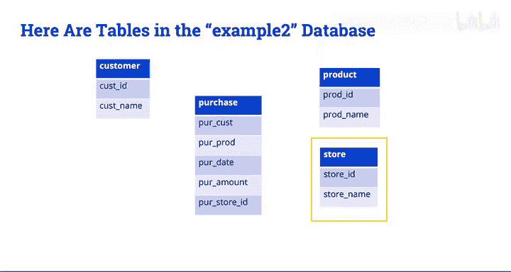

# 20：示例2数据库表结构详解 🗂️

在本节课中，我们将学习示例2数据库中的核心表结构。我们将逐一解析客户表、购买表、产品表和店铺表，理解它们各自存储的信息以及它们之间的关系。掌握这些表的结构是进行后续数据查询和分析的基础。

## 客户表 👤

上一节我们介绍了本课程的目标，本节中我们来看看数据库中的第一个核心表——客户表。

客户表用于存储个体客户的信息。该表记录了每位客户的基本数据，是关联客户购买行为的关键。

以下是客户表可能包含的主要字段：

*   `customer_id`：客户的唯一标识符。
*   `name`：客户的姓名。
*   `email`：客户的电子邮箱地址。
*   `signup_date`：客户的注册日期。

## 购买表 🛒

了解了客户信息如何存储后，我们接下来看看记录交易行为的购买表。

购买表用于存储客户完成的每一笔独立购买记录。它连接了客户、产品和店铺，是分析交易行为的核心表。

以下是购买表可能包含的主要字段：

*   `purchase_id`：每笔购买的唯一标识符。
*   `customer_id`：进行购买的客户ID，关联客户表。
*   `product_id`：被购买的产品ID，关联产品表。
*   `store_id`：购买发生的店铺ID，关联店铺表。
*   `purchase_date`：购买发生的日期和时间。
*   `quantity`：购买数量。
*   `total_amount`：该笔购买的总金额。

## 产品表 📦

现在，我们已经知道了交易是如何记录的，那么被交易的对象——产品，其信息又存放在哪里呢？这就是产品表的作用。

产品表用于存储可供购买的单个产品的详细信息。

以下是产品表可能包含的主要字段：

*   `product_id`：产品的唯一标识符。
*   `product_name`：产品的名称。
*   `category`：产品所属的类别。
*   `price`：产品的单价。其数据结构通常为浮点数，例如 `price = 19.99`。

## 店铺表 🏪

最后，我们来了解交易发生的地点——店铺。

店铺表用于存储购买行为发生的各个实体店铺的信息。

以下是店铺表可能包含的主要字段：

*   `store_id`：店铺的唯一标识符。
*   `store_name`：店铺的名称。
*   `location`：店铺的地理位置或地址。
*   `manager`：店铺的负责人。

---

---

本节课中我们一起学习了示例2数据库的完整表结构。我们详细介绍了客户表、购买表、产品表和店铺表，明确了每张表的用途及其核心字段。理解这些表及其之间的关系（通过`customer_id`， `product_id`， `store_id`等字段连接）是后续使用SQL进行数据查询、关联和分析的基石。