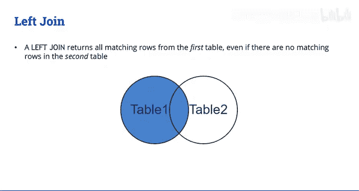

# 21：数据连接 🔗


在本节课中，我们将要学习数据连接（Join）的核心概念。数据连接是数据库操作中的一项关键技术，它允许我们从两个或多个表中收集信息，并将其呈现为一张单一的表。理解连接的工作原理对于进行有效的数据分析至关重要。

## 连接的基础与主键 🔑

上一节我们介绍了连接的基本定义，本节中我们来看看连接操作的基础：主键。

连接操作需要一种方式来唯一标识表中的每一行。

主键是一个列或一组列，其值能唯一标识表中的每一行。

以下是关于主键的两个关键点：
*   主键列的值在表中必须是唯一的。
*   主键用于在表之间建立关系。

## 连接类型概述 🔄

我们主要探讨三种基本的连接类型：内连接（Inner Join）、左连接（Left Join）和右连接（Right Join）。

## 内连接详解 🤝

内连接返回两个表中所有匹配的行。

其逻辑可以表示为以下伪代码：
```
FOR each row in TableA
    FIND a matching row in TableB (based on join condition)
    IF match FOUND
        COMBINE rows and OUTPUT
```

这意味着，只有当左表和右表中都存在满足连接条件的记录时，该记录才会出现在结果集中。

## 左连接与右连接详解 ↔️

上一节我们介绍了内连接，本节中我们来看看左连接和右连接，它们在某些场景下非常有用。

左连接返回左表中的所有行，以及右表中与之匹配的行。如果右表中没有匹配的行，则结果集中对应右表的列将显示为NULL值。

其逻辑可以表示为以下伪代码：
```
FOR each row in LeftTable
    FIND a matching row in RightTable (based on join condition)
    IF match FOUND
        COMBINE rows and OUTPUT
    ELSE
        OUTPUT LeftTable row with NULLs for RightTable columns
```

右连接的逻辑与左连接相反，它返回右表中的所有行，以及左表中与之匹配的行。如果左表中没有匹配的行，则结果集中对应左表的列将显示为NULL值。

## 外键：表关系的桥梁 🌉

连接操作通常依赖于外键来建立表与表之间的关系。



外键是一个表中的字段，它指向另一个表的主键。例如，在一个“预约”表中，可能会有`Doctor_ID`和`Patient_ID`字段，它们分别是“医生”表和“病人”表主键的外键。这些外键值指向其他表的主键值，从而将数据关联起来。

## 总结 📝


本节课中我们一起学习了数据连接的核心知识。我们首先了解了连接的作用和主键的概念，这是进行连接的基础。接着，我们详细探讨了三种主要的连接类型：内连接、左连接和右连接，并通过伪代码解释了它们的工作原理。最后，我们介绍了外键如何作为桥梁，将不同的数据表关联起来。掌握这些连接技术，是进行复杂数据查询和分析的关键一步。