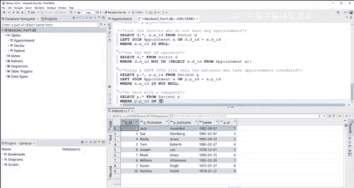

# 23：SQL连接操作详解 - 内连接与左连接 🗂️


在本节课中，我们将学习SQL中两种核心的连接操作：内连接（INNER JOIN）和左连接（LEFT JOIN）。我们将通过具体的查询示例，演示如何从多个关联表中组合数据，并理解这两种连接方式的区别与应用场景。

---

## 内连接（INNER JOIN）演示

内连接用于返回两个表中匹配条件的所有行。只有当连接条件在两边表中都找到匹配项时，行才会被包含在结果集中。

### 示例1：列出有预约的医生及其预约时间

首先，我们需要从`doctor`表和`appointment`表中选取信息。以下是实现此查询的步骤：

1.  从`doctor`表中选择所需列。
2.  使用`INNER JOIN`将`doctor`表与`appointment`表连接。
3.  指定连接条件为`doctor.DID = appointment.DID`。

由于这是内连接，结果将只显示有匹配预约记录的医生。

```sql
SELECT doctor.*, appointment.appointment_date, appointment.appointment_time
FROM doctor
INNER JOIN appointment ON doctor.DID = appointment.DID;
```

### 示例2：列出有预约的医生及其预约时间与患者姓名

上一节我们连接了医生和预约表，本节中我们进一步引入患者信息。以下是实现此查询的步骤：

1.  首先，如示例1所示连接`doctor`表和`appointment`表。
2.  再次使用`INNER JOIN`将上述结果与`patient`表连接。
3.  指定新的连接条件为`appointment.PID = patient.PID`。

此查询将只显示那些既有匹配预约，且预约又关联了匹配患者的医生记录。

```sql
SELECT doctor.*, appointment.appointment_date, appointment.appointment_time, patient.first_name, patient.last_name
FROM doctor
INNER JOIN appointment ON doctor.DID = appointment.DID
INNER JOIN patient ON appointment.PID = patient.PID;
```

### 示例3：查询Hopkins医生的所有预约详情

现在，我们学习如何在连接后对数据进行筛选。目标是找出Hopkins医生的所有预约及其患者信息。以下是实现此查询的步骤：

1.  使用`INNER JOIN`连接`doctor`、`appointment`和`patient`表。
2.  添加一个`WHERE`子句来过滤数据。
3.  在`WHERE`子句中设置条件：`doctor.last_name = 'Hopkins'`。

```sql
SELECT doctor.*, appointment.*, patient.*
FROM doctor
INNER JOIN appointment ON doctor.DID = appointment.DID
INNER JOIN patient ON appointment.PID = patient.PID
WHERE doctor.last_name = 'Hopkins';
```

### 示例4：查询特定时间且患者姓以S开头的预约

最后，我们来看一个包含多个过滤条件的复杂查询。目标是查找在`2016-02-15 12:00`且患者姓氏以‘S’开头的所有预约信息。以下是实现此查询的步骤：

1.  连接`doctor`、`appointment`和`patient`三个表。
2.  在`WHERE`子句中组合两个条件：
    *   `appointment.appointment_date = '2016-02-15 12:00:00'`
    *   `patient.last_name LIKE 'S%'` （`%`是通配符，表示匹配任意字符）

```sql
SELECT doctor.*, appointment.*, patient.*
FROM doctor
INNER JOIN appointment ON doctor.DID = appointment.DID
INNER JOIN patient ON appointment.PID = patient.PID
WHERE appointment.appointment_date = '2016-02-15 12:00:00'
AND patient.last_name LIKE 'S%';
```

---

## 左连接（LEFT JOIN）演示

左连接会返回左表（`FROM`后的表）的所有行，即使在右表中没有匹配的行。对于不匹配的情况，右表的列将显示为`NULL`。

### 示例5：列出所有医生及其预约（如有）

我们从左连接的基础用法开始。此查询将显示所有医生，无论他们是否有预约。以下是实现此查询的步骤：

1.  从`doctor`表中选择信息。
2.  使用`LEFT JOIN`将其与`appointment`表连接，条件仍是`DID`匹配。
3.  为了清晰，按医生姓氏排序。

对于没有预约的医生，其预约日期列将显示为`NULL`。

```sql
SELECT doctor.*, appointment.appointment_date
FROM doctor
LEFT JOIN appointment ON doctor.DID = appointment.DID
ORDER BY doctor.last_name;
```

### 示例6：列出所有患者及其预约（如有）

类似地，我们可以列出所有患者及其可能的预约。以下是实现此查询的步骤：

1.  从`patient`表中选择信息。
2.  使用`LEFT JOIN`将其与`appointment`表连接，条件是`PID`匹配。
3.  按患者姓氏排序。

对于没有预约的患者，预约日期列将显示为`NULL`。

```sql
SELECT patient.*, appointment.appointment_date
FROM patient
LEFT JOIN appointment ON patient.PID = appointment.PID
ORDER BY patient.last_name;
```

### 示例7：查找没有预约的医生

左连接的一个常见用途是查找在另一表中没有匹配项的行。以下是查找无预约医生的两种方法。

**方法一：使用`LEFT JOIN`和`WHERE`过滤**
此方法先进行左连接，然后筛选出右表（`appointment`）中匹配列为`NULL`的行。

```sql
SELECT doctor.*
FROM doctor
LEFT JOIN appointment ON doctor.DID = appointment.DID
WHERE appointment.DID IS NULL;
```

**方法二：使用`NOT IN`子查询**
此方法使用子查询先获取所有有预约的医生ID，然后主查询选择不在这个列表中的医生。

```sql
SELECT *
FROM doctor
WHERE DID NOT IN (SELECT DISTINCT DID FROM appointment);
```

### 示例8：查找有预约的患者

同样，我们也可以找出有预约的患者。以下是两种实现方法。

**方法一：使用`LEFT JOIN`和`WHERE`过滤**
此方法连接后，筛选掉预约ID为`NULL`的记录，只保留有匹配预约的患者。

```sql
SELECT patient.*
FROM patient
LEFT JOIN appointment ON patient.PID = appointment.PID
WHERE appointment.PID IS NOT NULL;
```

**方法二：使用`IN`子查询**
此方法使用子查询获取所有出现在预约表中的患者ID，然后主查询选择ID在这个列表中的患者。

```sql
SELECT *
FROM patient
WHERE PID IN (SELECT DISTINCT PID FROM appointment);
```

---

## 总结

本节课中我们一起学习了SQL中至关重要的两种表连接操作。



*   **内连接（INNER JOIN）**：仅返回两个表中匹配条件都存在的数据行，用于获取相关联的完整信息。
*   **左连接（LEFT JOIN）**：返回左表全部行，以及右表中匹配的行。右表无匹配时，相关列填充`NULL`。它常用于查找“有/无”关联关系的记录，例如“哪些医生没有预约”。

通过理解并灵活运用内连接和左连接，你可以有效地从多个数据库表中组合和筛选数据，这是进行复杂数据分析的基础。