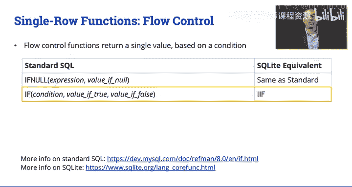
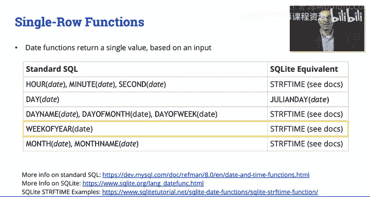
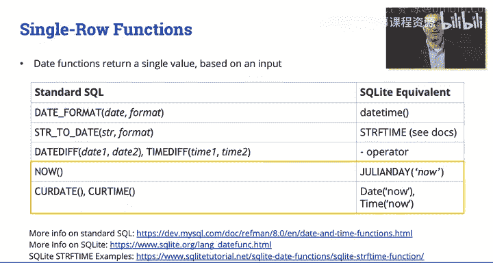

# 24：单行函数详解 🧮

在本节课中，我们将学习SQL中的单行函数。单行函数对查询结果中的每一行数据进行处理，并返回一个结果。它们广泛应用于字符串操作、流程控制和日期处理等场景。

---

## 字符串函数 📝

上一节我们介绍了单行函数的基本概念，本节中我们来看看常见的字符串函数。这些函数接收一个字符串输入，并返回一个处理后的字符串值。

以下是常见的字符串函数及其功能：

*   **CONCAT(字符串1, 字符串2, ...)**：将给定的多个字符串连接成一个字符串。
*   **UPPER(字符串)**：将字符串中的所有字符转换为大写。
*   **LOWER(字符串)**：将字符串中的所有字符转换为小写。
*   **LEFT(字符串, 长度)**：从字符串左侧开始返回指定长度的子串。
*   **RIGHT(字符串, 长度)**：从字符串右侧开始返回指定长度的子串。
*   **MID(字符串, 起始位置, 长度)**：从字符串的指定起始位置返回指定长度的子串。
*   **LTRIM(字符串)**：移除字符串左侧的所有空白字符。
*   **RTRIM(字符串)**：移除字符串右侧的所有空白字符。
*   **TRIM(字符串)**：移除字符串两侧的所有空白字符。
*   **REPLACE(字符串, 目标子串, 替换子串)**：将字符串中所有出现的指定目标子串替换为另一个子串。
*   **LENGTH(字符串)**：返回字符串的长度。
*   **LOCATE(子串, 字符串)**：返回指定子串在字符串中首次出现的索引位置。

---

## 流程控制函数 ⚙️

了解了字符串处理函数后，我们接下来学习流程控制函数。这类函数根据给定的条件返回不同的值。

以下是常见的流程控制函数：

*   **IFNULL(表达式, 替代值)**：如果给定的表达式结果为NULL，则返回指定的替代值；否则，返回表达式本身的结果。
*   **IF(条件, 值1, 值2)**：如果条件为真，则返回值1；如果条件为假，则返回值2。

---

## 日期函数 📅

最后，我们来探讨日期函数。日期函数用于处理日期和时间值，提取特定部分或进行格式转换。

以下是常见的日期函数：

*   **HOUR(日期)**：从给定日期时间中提取小时部分。
*   **MINUTE(日期)**：从给定日期时间中提取分钟部分。
*   **SECOND(日期)**：从给定日期时间中提取秒部分。
*   **DAY(日期)**：从给定日期中提取天数。
*   **DAYNAME(日期)**：返回给定日期对应的星期名称。
*   **DAYOFMONTH(日期)**：返回给定日期是该月中的第几天。
*   **DAYOFWEEK(日期)**：返回给定日期是该周中的第几天。
*   **WEEKOFYEAR(日期)**：返回给定日期是该年中的第几周。

以下是更多日期函数：

*   **MONTH(日期)**：从给定日期中提取月份。
*   **MONTHNAME(日期)**：返回给定日期对应的月份名称。
*   **DATE_FORMAT(日期, 格式)**：按照指定格式改变日期的显示形式。
*   **STR_TO_DATE(字符串, 格式)**：将特定格式的字符串转换为日期类型。
*   **DATEDIFF(日期1, 日期2)**：返回两个日期之间的天数差。
*   **TIMEDIFF(时间1, 时间2)**：返回两个时间之间的时间差。
*   **NOW()**：返回当前的日期和时间。
*   **CURDATE()**：返回当前的日期。
*   **CURTIME()**：返回当前的时间。

---

本节课中我们一起学习了SQL中的三类核心单行函数：**字符串函数**用于文本处理，**流程控制函数**用于条件判断，**日期函数**用于处理时间数据。熟练掌握这些函数能极大地提升数据查询和处理的灵活性与效率。