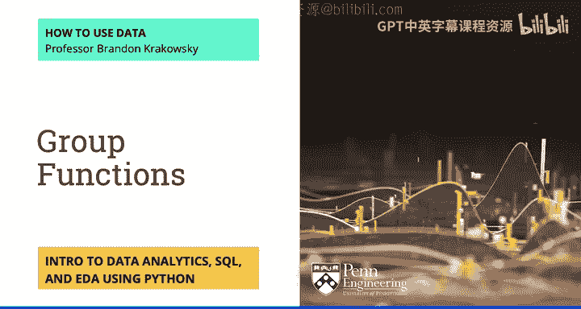
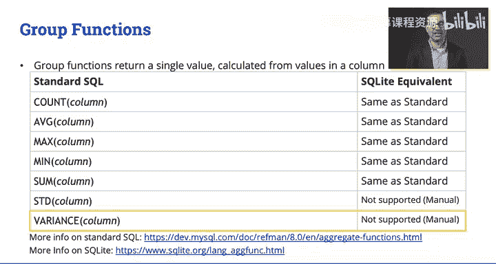

# 26：聚合函数 📊



在本节课中，我们将要学习SQL中的聚合函数。聚合函数能够对一列数据进行计算，并返回一个单一的值，这对于数据汇总和统计分析至关重要。

上一节我们介绍了SQL的基本查询操作，本节中我们来看看如何对数据进行聚合计算。

## 什么是聚合函数？ 🤔

聚合函数是SQL中用于对一组值执行计算并返回单个值的函数。它们通常与`SELECT`语句的`GROUP BY`子句结合使用，用于汇总数据。

以下是SQL中一些最常用的聚合函数及其功能描述：

*   **COUNT()**：统计指定列中非空值的数量。
    *   **公式/代码**：`SELECT COUNT(column_name) FROM table_name;`
*   **AVG()**：计算指定列中数值的平均值。
    *   **公式/代码**：`SELECT AVG(column_name) FROM table_name;`
*   **MAX()**：找出指定列中的最大值。
    *   **公式/代码**：`SELECT MAX(column_name) FROM table_name;`
*   **MIN()**：找出指定列中的最小值。
    *   **公式/代码**：`SELECT MIN(column_name) FROM table_name;`
*   **SUM()**：计算指定列中所有数值的总和。
    *   **公式/代码**：`SELECT SUM(column_name) FROM table_name;`
*   **STDDEV()**：计算指定列中数值的标准差，用于衡量数据的离散程度。
    *   **公式/代码**：`SELECT STDDEV(column_name) FROM table_name;`
*   **VAR()** 或 **VARIANCE()**：计算指定列中数值的方差，是标准差的平方。
    *   **公式/代码**：`SELECT VARIANCE(column_name) FROM table_name;`

了解了这些核心函数后，我们来看一个简单的应用示例。假设我们有一个`sales`表，其中包含`amount`（销售额）列。

```sql
-- 计算总交易次数、平均销售额、最高销售额和总销售额
SELECT
    COUNT(amount) AS transaction_count,
    AVG(amount) AS average_sale,
    MAX(amount) AS max_sale,
    SUM(amount) AS total_revenue
FROM sales;
```

这段查询会一次性返回四个聚合结果，让我们能够快速掌握销售数据的整体情况。

---



本节课中我们一起学习了SQL的聚合函数。我们了解了`COUNT`、`AVG`、`MAX`、`MIN`、`SUM`、`STDDEV`和`VARIANCE`这七个核心函数的作用，并看到了如何将它们组合在一个查询中，以便高效地对数据进行统计分析。掌握这些函数是进行数据汇总和探索性数据分析（EDA）的基础。