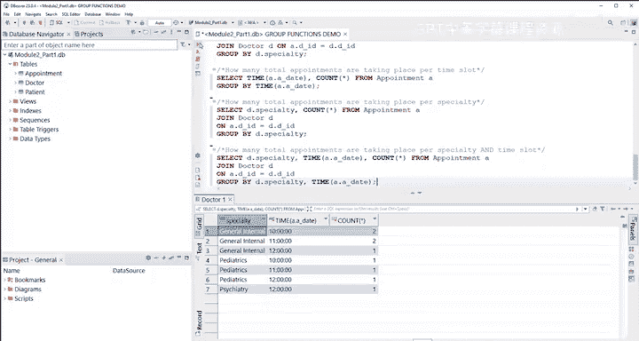

# 27：聚合函数应用编程演示 🧮


在本节课中，我们将学习如何使用 SQL 中的聚合函数对数据进行汇总计算。我们将通过一系列具体的查询示例，演示如何统计行数、计算最大值最小值，以及如何结合 `GROUP BY` 子句进行分组聚合。

---

## 概述

聚合函数是 SQL 中用于对一组值执行计算并返回单个值的函数。本节课将重点介绍 `COUNT`、`MAX`、`MIN` 等函数，并结合 `GROUP BY` 子句，展示如何从不同维度（如医生、科室、时间段）对医疗预约数据进行统计分析。

---

## 基础计数查询

首先，我们从最简单的计数查询开始，了解 `COUNT` 函数的基本用法。

以下是几个使用 `COUNT` 函数的基础示例：

1.  **统计医生总数**
    我们使用 `COUNT` 函数，并传入参数 `*`。这将计算 `doctor` 表中的所有行数。
    ```sql
    SELECT COUNT(*) FROM doctor;
    ```
    像 `COUNT` 这样的聚合函数会返回一个跨行计算的单一汇总值。

2.  **统计医生头衔数量**
    这里我们同样使用 `COUNT` 函数，但传入一个具体的列名 `D_title`。这将只计算该列中的值（非空值）数量。
    ```sql
    SELECT COUNT(D_title) FROM doctor;
    ```

3.  **统计不同科室的数量**
    这里我们使用 `COUNT` 函数，但结合 `DISTINCT` 关键字和列名。目的是计算 `specialty` 列中不同值的数量。
    ```sql
    SELECT COUNT(DISTINCT specialty) FROM doctor;
    ```

---

## 结合条件过滤的计数

上一节我们介绍了基础的计数，本节中我们来看看如何结合 `JOIN` 和 `WHERE` 子句进行条件计数。

以下是结合表连接和过滤条件的计数查询：

4.  **统计全科内科的预约数量**
    这里我将从 `appointment` 表中选择并计算所有行数。查询需要与 `doctor` 表连接，以获取医生科室信息。
    ```sql
    SELECT COUNT(*)
    FROM appointment a
    JOIN doctor d ON a.DID = d.DID
    WHERE d.specialty = 'general internal';
    ```
    这将统计科室为“全科内科”的医生的预约数量。

5.  **统计没有预约的病人数量**
    我们将从 `patient` 表计数病人 ID，然后与 `appointment` 表进行左连接。连接基于 `patient_id` 列。
    ```sql
    SELECT COUNT(p.patient_id)
    FROM patient p
    LEFT JOIN appointment a ON p.patient_id = a.patient_id
    WHERE a.patient_id IS NULL;
    ```
    接着，我们过滤查询以寻找 `patient_id` 为 `NULL` 的记录，这意味着左表（病人表）中的病人在右表（预约表）中没有匹配的预约。

---

## 使用 GROUP BY 进行分组聚合

掌握了单值聚合后，我们进入更强大的分组聚合。`GROUP BY` 子句允许我们将数据行分成组，然后对每个组应用聚合函数。

以下是使用 `GROUP BY` 的分组统计示例：

6.  **计算每位医生的预约总数**
    我们首先选择一个列进行分组或折叠（这里是 `Doctor_ID`），然后对另一组列应用聚合函数（这里是 `COUNT(*)`）。
    ```sql
    SELECT d.DID, COUNT(*) AS num_of_appointments
    FROM doctor d
    JOIN appointment a ON d.DID = a.DID
    GROUP BY d.DID;
    ```
    我们将聚合值命名为 `num_of_appointments`。查询会基于匹配的 `DID` 列连接 `appointment` 表，然后按照我们选择的第一个列（即 `Doctor_ID` 列）对连接后的行进行分组。这显示了每位医生或每个医生 ID 的总行数或预约数量。

7.  **查找每位医生的最后预约时间**
    这里我们再次首先选择要折叠或分组的列 `Doctor_ID (DID)`，然后应用 `MAX` 聚合函数来获取所有预约日期中的最晚时间。
    ```sql
    SELECT d.DID, MAX(a.appointment_date) AS last_appointment
    FROM doctor d
    JOIN appointment a ON d.DID = a.DID
    GROUP BY d.DID;
    ```
    我们将那个最晚时间命名为 `last_appointment`。查询基于匹配的 `DID` 列连接 `appointment` 表的信息，然后按照我们选择的第一个列 `Doctor_ID` 对连接的行进行分组。这显示了每个医生 ID 或医生的最晚时间或最后预约时间。

8.  **统计每个科室的医生数量**
    我们将选择 `specialty` 列进行分组，然后通过计数 `doctor` 表的行来进行聚合。
    ```sql
    SELECT specialty, COUNT(*) AS doctor_count
    FROM doctor
    GROUP BY specialty;
    ```
    然后按照我们选择的同一列（即 `specialty` 列）进行分组。这显示了每个科室的行数统计。

---

## 多维度分组与复杂聚合

在能够进行单列分组后，我们可以尝试更复杂的多维度分组，并同时应用多个聚合函数。

以下是涉及多表连接、多列分组或多个聚合函数的复杂查询：

9.  **查找每个科室的首个和最后预约时间**
    我们将选择 `specialty` 列进行分组或折叠。然后获取所有预约日期中的最早时间，我们称之为 `first_appointment`。同时获取所有预约日期中的最晚时间，称之为 `last_appointment`。
    ```sql
    SELECT d.specialty,
           MIN(a.appointment_date) AS first_appointment,
           MAX(a.appointment_date) AS last_appointment
    FROM appointment a
    JOIN doctor d ON a.DID = d.DID
    GROUP BY d.specialty;
    ```
    查询从 `appointment` 表选择，并与 `doctor` 表连接（我们需要两个表的信息），基于匹配的 `DID` 列进行连接。然后按照我们选择的第一个列（即要折叠的 `specialty` 列）进行分组。这显示了每个科室的首个和最后预约时间。

10. **统计每个时间段的预约总数**
    我们将选择要分组或折叠的列。这将是从 `appointment_date` 中提取的时间值，然后通过计数每个组的行数来进行聚合。
    ```sql
    SELECT TIME(a.appointment_date) AS time_slot, COUNT(*) AS appointment_count
    FROM appointment a
    GROUP BY TIME(a.appointment_date);
    ```
    然后按照我们选择的同一项（即从 `appointment_date` 中提取的时间值）进行分组。这显示了每个唯一时间段的行政或预约数量。

11. **统计每个科室的预约总数**
    我们将选择 `specialty`，并计数行数。查询从 `appointment` 表出发，连接 `doctor` 表的信息。
    ```sql
    SELECT d.specialty, COUNT(*) AS appointment_count
    FROM appointment a
    JOIN doctor d ON a.DID = d.DID
    GROUP BY d.specialty;
    ```
    基于两个表中匹配的 `DID` 列值进行连接，然后按照 `specialty` 分组。这显示了每个唯一科室的预约数量。

12. **统计每个科室和每个时间段的预约总数**
    这里我们将选择两列进行分组或折叠：`specialty` 和 `appointment` 的 `time`，然后计数每个科室和时间段组合的行数。
    ```sql
    SELECT d.specialty,
           TIME(a.appointment_date) AS time_slot,
           COUNT(*) AS appointment_count
    FROM appointment a
    JOIN doctor d ON a.DID = d.DID
    GROUP BY d.specialty, TIME(a.appointment_date);
    ```
    基于两个表中匹配的 `DID` 列值连接 `appointment` 表和 `doctor` 表的信息，然后按照我们选择的那些相同列（即 `specialty` 和 `appointment` 的 `time`）进行分组。这显示了每个唯一的科室与时间段组合的行数或预约数量。

---

## 总结



本节课中我们一起学习了 SQL 聚合函数的强大功能。我们从简单的 `COUNT(*)` 开始，逐步深入到结合 `WHERE` 过滤、使用 `GROUP BY` 进行单列及多列分组，并应用了 `MAX`、`MIN` 等聚合函数。通过这些示例，你应能掌握如何对数据进行不同维度的汇总分析，这是进行数据探索和生成报告的关键技能。