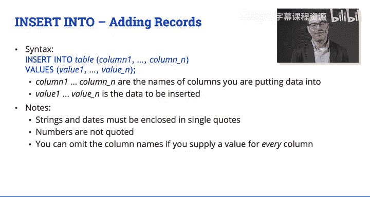

# 28：数据创建 🗃️


在本节课中，我们将学习如何在数据库中创建新的数据表，以及如何向表中插入数据。我们将涵盖创建表的基本语法、常见的数据类型，以及两种插入数据的方法。

## 创建新表

要创建一个新表，需要使用 `CREATE TABLE` 语句。

该语句需要为新表指定一个名称，并在括号内提供一个以逗号分隔的列名及其对应数据类型的列表。

以下是创建表的基本语法结构：
```sql
CREATE TABLE table_name (
    column1 datatype constraint,
    column2 datatype constraint,
    ...
    table_constraint
);
```
其中，每一列的数据类型定义了该列将要存储的数据种类。

你可以为每一列指定一个可选的列约束，这是一条用于允许或限制该列值的规则。

你也可以指定一个可选的表约束，这是一条用于允许或限制表中整行数据的规则。

## 常见数据类型

在定义新表的列时，了解可用的数据类型至关重要。以下是几种常见的数据类型分类。

### 字符串数据类型

以下是定义新表列时一些常见的字符串数据类型：

*   **CHAR(n)**：这是一个固定长度的字符串，`n` 代表给定的最大字符数。
*   **VARCHAR(n)**：这是一个可变长度的字符串，`n` 代表给定的最大字符数。
*   **TEXT**：这是一个大型字符串，具有给定的最大字符数限制。

### 数值数据类型

以下是一些常见的数值数据类型：

*   **BIT**：一个非常小的整数值。
*   **INT**：标准整数值。
*   **BIGINT**：大整数值。
*   **DECIMAL(p, s)**：一个十进制数值，`p` 代表总的最大位数（精度），`s` 代表小数点右侧的位数（标度）。

### 日期时间数据类型

以下是一些常见的日期时间数据类型：

*   **DATE**：日期，显示格式通常为 `YYYY-MM-DD`。
*   **DATETIME**：日期与时间的组合，显示格式通常为 `YYYY-MM-DD HH:MM:SS`。
*   **TIMESTAMP**：另一种日期与时间的组合，显示格式通常为 `YYYY-MM-DD HH:MM:SS`。

### 大型对象数据类型

以下是一个常见的大型对象数据类型：

*   **BLOB**：二进制大型对象，具有给定的以字节为单位的最大大小。

## 从现有表复制数据

上一节我们介绍了如何创建一个空表，本节中我们来看看如何用现有数据填充它。一种方法是从另一个表复制记录。

要将记录从现有表复制到新表，首先使用 `INSERT INTO` 语句。

指定你要插入记录的新表，以及你要放入数据的新表列名的逗号分隔列表。

然后，使用 `SELECT` 语句从现有表中选择要插入到新表中的记录。

以下是该操作的语法示例：
```sql
INSERT INTO new_table (column1, column2, ...)
SELECT column1, column2, ...
FROM existing_table;
```
请注意，如果你为每一列都提供了值，并且顺序与表定义一致，那么可以省略新表列名的逗号分隔列表。并非所有字段都是必需的。

## 插入新记录

除了从其他表复制，我们也可以直接插入全新的数据行。

要向新表中插入记录，首先使用 `INSERT INTO` 语句。

指定你要插入记录的表，以及你要放入数据的表列名的逗号分隔列表。

然后，使用 `VALUES` 命令，后跟要插入的值的逗号分隔列表。

以下是该操作的语法示例：
```sql
INSERT INTO table_name (column1, column2, ...)
VALUES (value1, value2, ...);
```
再次注意，如果你为每一列都提供了值，并且顺序与表定义一致，那么可以省略表列名的逗号分隔列表。

---



本节课中我们一起学习了在SQL中创建数据的核心操作。我们掌握了使用 `CREATE TABLE` 语句定义新表结构的方法，了解了常见的字符串、数值、日期等数据类型。接着，我们探讨了两种填充数据的方式：使用 `INSERT INTO ... SELECT ...` 从现有表复制数据，以及使用 `INSERT INTO ... VALUES ...` 直接插入新记录。理解这些基础语句是进行有效数据管理和分析的第一步。