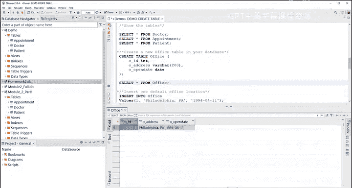

# 29：CREATE TABLE与INSERT INTO 🗂️

在本节课中，我们将学习如何使用SQL语句创建新表（CREATE TABLE）以及如何向表中插入数据（INSERT INTO）。这是构建和管理数据库的基础。

## 概述

我们将通过一个模拟的医疗数据库示例，演示如何创建`doctor`、`patient`、`appointment`和`office`表，并向这些表中插入数据。你将学会创建表结构、从其他数据库复制数据以及手动插入新记录。

---

## 创建新表

首先，我们将在演示数据库中创建一个新的`doctor`表。

```sql
CREATE TABLE doctor (
    D_ID INT DEFAULT 0,
    first_name VARCHAR DEFAULT NULL,
    last_name VARCHAR DEFAULT NULL,
    D_title VARCHAR(10) DEFAULT NULL,
    specialty VARCHAR(50) DEFAULT ‘no’
);
```

以上语句创建了一个名为`doctor`的表，包含医生ID、名、姓、职称和专业等列。

接下来，我们创建一个`patient`表。

```sql
CREATE TABLE patient (
    PID INT DEFAULT 0,
    P_first_name VARCHAR(75) DEFAULT NULL,
    P_last_name VARCHAR(75) DEFAULT NULL,
    B_date VARCHAR(20) DEFAULT NULL
);
```

这将在数据库中创建`patient`表，包含患者ID、名、姓和出生日期等列。

---

## 从其他数据库复制数据

为了从SQLite的另一个数据库复制记录，我们需要先附加该数据库。然后，我们可以将数据复制到新创建的表中。

以下是复制`doctor`表记录的示例：

```sql
INSERT INTO doctor (D_ID, first_name, last_name, D_title, specialty)
SELECT D_ID, first_name, last_name, D_title, specialty
FROM other_example_db.doctor;
```

这条语句将另一个示例数据库中`doctor`表的所有记录复制到当前数据库的`doctor`表中。

查看新`doctor`表的信息，可以看到它包含了所有相同的记录。

同样地，我们复制`patient`表的所有记录：

```sql
INSERT INTO patient (PID, P_first_name, P_last_name, B_date)
SELECT PID, P_first_name, P_last_name, B_date
FROM other_example_db.patient;
```

查看`patient`表，确认它包含了所有相同的记录。

---

## 通过查询创建并填充新表

我们还可以在一个查询中创建新表并直接填充数据。例如，创建一个`appointment`表：

```sql
CREATE TABLE appointment AS
SELECT *
FROM other_example_db.appointment;
```

这会创建一个与源表结构完全相同的`appointment`表，并复制所有数据。

查看新`appointment`表的信息，确认它包含了所有相同的记录。

---

## 手动插入新数据

现在，我们手动向表中插入新的记录。

首先，向`doctor`表插入一条新记录：

```sql
INSERT INTO doctor (D_ID, first_name, last_name, D_title, specialty)
VALUES (9, ‘Brandon’, ‘Kraowski’, ‘M’, ‘Dermatology’);
```

这将在`doctor`表中插入一条ID为9、名为Brandon Kraowski的皮肤科医生记录。

接下来，为这位新医生在2026年2月16日上午10点和11点安排两个预约：

```sql
INSERT INTO appointment (appointment_ID, date, D_ID)
VALUES
    (10, ‘2026-02-16 10:00’, 9),
    (11, ‘2026-02-16 11:00’, 9);
```

这将在`appointment`表中插入两条新记录。

然后，添加一名新患者Elliot Graham，注意其出生日期未知：

```sql
INSERT INTO patient (PID, P_first_name, P_last_name)
VALUES (12, ‘Elliot’, ‘Graham’);
```

由于未指定`B_date`列，该字段将为NULL。

---

## 创建并填充`office`表

最后，我们创建一个新的`office`表：

```sql
CREATE TABLE office (
    office_ID INT,
    office_address VARCHAR(200),
    office_open_date DATE
);
```

这将创建一个包含办公室ID、地址和开业日期的`office`表。

初始时，该表为空。我们插入一条默认的办公室记录：

```sql
INSERT INTO office
VALUES (1, ‘Philadelphia’, ‘1994-04-11’);
```

注意，这里没有指定列名，SQL会默认使用所有列并按顺序插入值。

---

## 查看结果

现在，让我们查看所有表格的新信息：

*   查询`doctor`表，可以看到底部新增了Brandon Kraowski的记录。
*   查询`appointment`表，可以看到底部新增了两条记录。注意，由于未指定患者ID（PID），该字段为空。
*   查询`patient`表，可以看到底部新增了Elliot Graham的记录，且出生日期字段为空。
*   查询`office`表，可以看到插入了一条记录。

---



## 总结


在本节课中，我们一起学习了SQL的两个核心操作：`CREATE TABLE`和`INSERT INTO`。我们掌握了如何创建具有特定列和数据类型的新表，如何从其他表或数据库复制数据，以及如何手动向表中插入单条或多条记录。这些是进行数据存储和管理的基础技能。