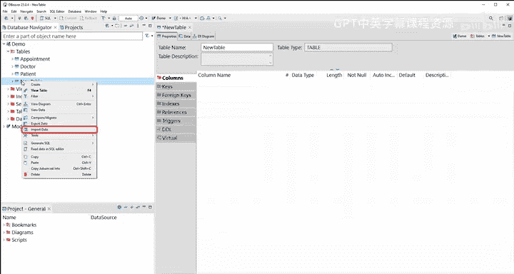
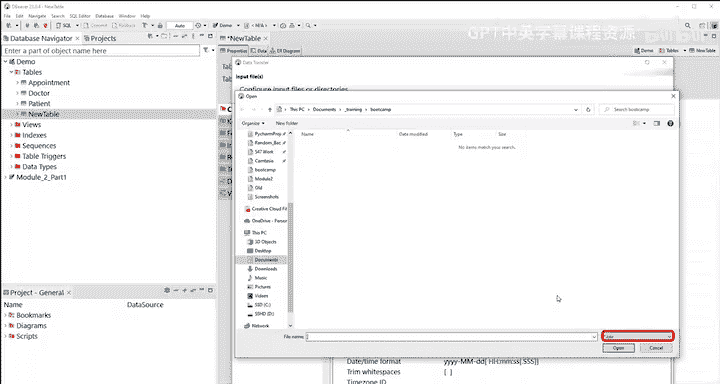
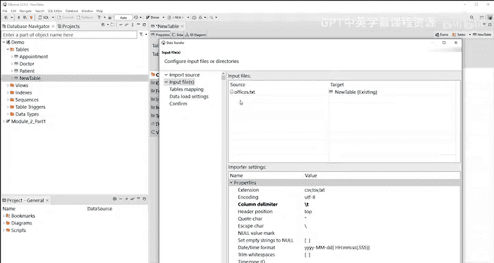
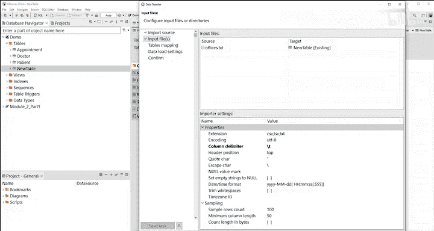
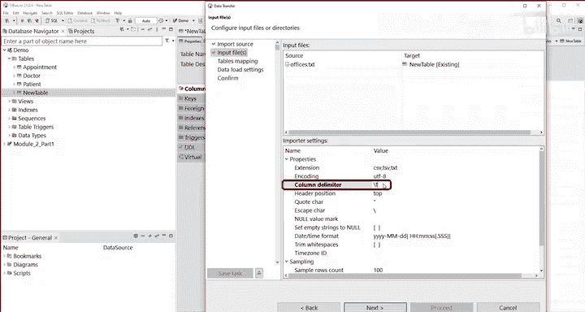
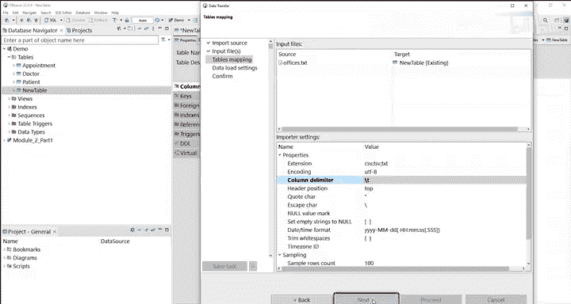
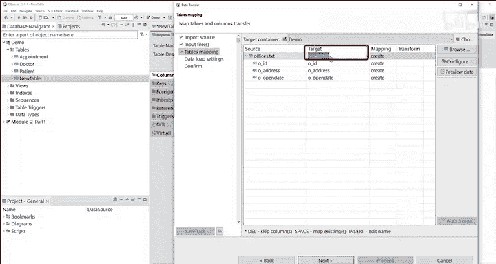
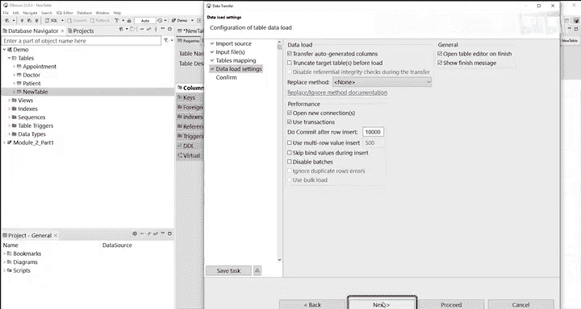
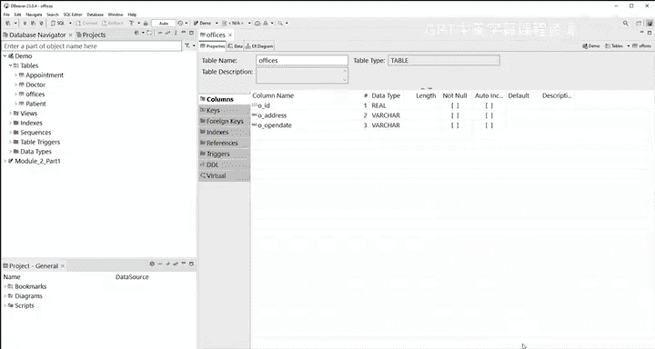
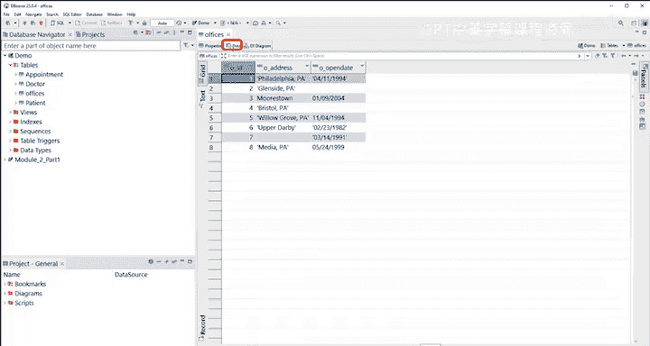

# 31：SQLite数据加载演示  📊

在本节课中，我们将学习如何将外部数据文件导入到SQLite数据库中一个已存在的表中。我们将通过一个具体的操作演示，展示从选择文件、配置导入设置到最终完成数据加载的完整流程。

---

上一节我们介绍了SQLite数据库的基本概念，本节中我们来看看如何将外部数据文件导入到已创建的表中。

首先，我们需要启动数据导入功能。在SQLite数据库管理工具中，找到并点击“导入数据”选项。

接下来，系统会提示我们选择一个要导入的文件。

我们需要在文件资源管理器中定位到目标数据文件。

在选择文件后，我们需要查看并配置导入设置。以下是关键的配置步骤：

在“属性”设置中，我们需要特别注意“列分隔符”这一项。它通常以粗体显示，用于指定数据文件中分隔各列数据的字符。在本例中，它被设置为 `\t`，这代表一个制表符（Tab字符）。

配置完分隔符后，我们需要进入“表映射”设置。这一步的目的是确保源文件中的数据列能正确映射到目标数据库表的对应列。

我们将目标表名设置为 `offices`。

如果继续执行，我们可以预览到所有即将被创建或填充的数据列。

最后，执行导入操作。操作成功后，我们可以在数据库中看到数据已经成功导入到 `offices` 表中。

---

本节课中我们一起学习了将外部数据文件导入SQLite数据库的完整过程。关键步骤包括：启动导入功能、选择数据文件、配置列分隔符（如 `\t`）、进行表映射以匹配目标表结构，以及最终执行并验证导入结果。掌握这个流程是进行数据管理和分析的基础。