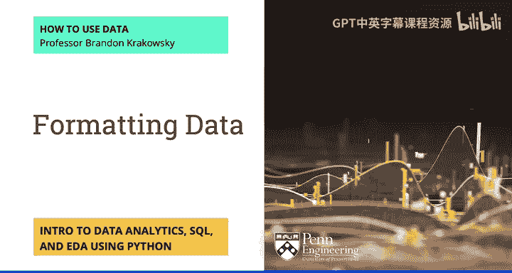
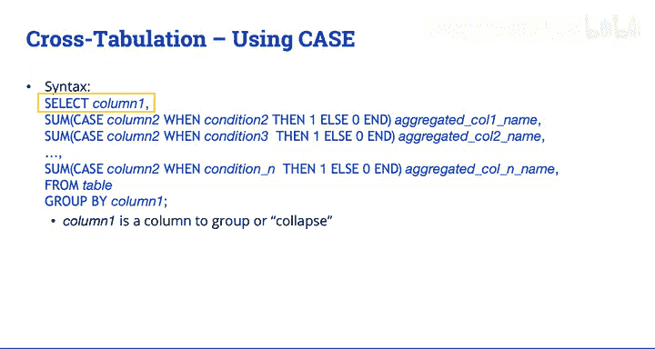
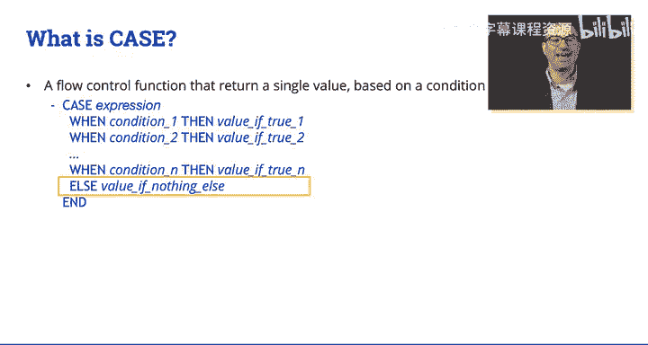

# 32：SQL 数据交叉表与条件聚合 📊



在本节课中，我们将学习如何在 SQL 中创建交叉表。交叉表是一种将聚合函数应用于多个列，并以表格形式呈现结果的数据汇总方法。我们将重点介绍使用 `IF` 和 `CASE` 这两种流程控制函数来实现条件聚合。

---

## 使用 IF 函数创建交叉表

上一节我们介绍了交叉表的基本概念，本节中我们来看看如何使用 `IF` 函数来构建它。

`IF` 函数是一个流程控制函数，它根据给定条件的真假返回不同的值。其基本语法如下：

```sql
IF(condition, value_if_true, value_if_false)
```

以下是使用 `IF` 函数创建交叉表的步骤：

1.  **选择分组列**：首先，使用 `SELECT` 语句指定需要进行分组或合并的列。
2.  **创建条件聚合列**：然后，使用 `IF` 函数创建新的列。这些列的值是基于特定条件对原始列应用聚合函数（如 `SUM`, `COUNT`, `AVG` 等）计算得出的。
3.  **指定数据源与分组**：最后，使用 `FROM` 子句指定数据来源的表，并使用 `GROUP BY` 子句按适当的列进行分组。

一个简单的示例如下：
```sql
SELECT
    department,
    SUM(IF(gender = 'M', salary, 0)) AS male_salary_total,
    SUM(IF(gender = 'F', salary, 0)) AS female_salary_total
FROM employees
GROUP BY department;
```

---

## 使用 CASE 函数创建交叉表



除了 `IF` 函数，`CASE` 表达式是另一种实现条件聚合的强大工具。它提供了处理多个条件的更清晰结构。

`CASE` 表达式会依次评估给定的条件，并返回第一个满足条件所对应的值。其基本语法结构如下：

```sql
CASE
    WHEN condition1 THEN result1
    WHEN condition2 THEN result2
    ...
    ELSE default_result
END
```

以下是使用 `CASE` 表达式创建交叉表的步骤：

1.  **选择分组列**：首先，在 `SELECT` 语句中确定用于分组的列。
2.  **创建条件聚合列**：接着，使用 `CASE` 表达式在 `SELECT` 列表中创建新列。在这些列内部，根据不同的条件对目标列应用聚合函数。
3.  **指定数据源与分组**：使用 `FROM` 子句指明查询的表，并通过 `GROUP BY` 子句完成最终的分组操作。

一个简单的示例如下：
```sql
SELECT
    product_category,
    COUNT(CASE WHEN region = 'North' THEN order_id END) AS north_orders,
    COUNT(CASE WHEN region = 'South' THEN order_id END) AS south_orders,
    COUNT(CASE WHEN region = 'East' THEN order_id END) AS east_orders,
    COUNT(CASE WHEN region = 'West' THEN order_id END) AS west_orders
FROM sales
GROUP BY product_category;
```

---

## 总结 📝

本节课中我们一起学习了 SQL 中创建交叉表的两种核心方法。

*   我们首先了解了交叉表是一种对多列进行条件聚合并以表格形式展示的数据汇总方式。
*   然后，我们深入探讨了如何使用 **`IF(condition, true_value, false_value)`** 函数来实现简单的二元条件判断和聚合。
*   最后，我们学习了功能更强大的 **`CASE...WHEN...THEN...ELSE...END`** 表达式，它能够清晰、灵活地处理多个复杂条件，是构建交叉表的常用选择。



掌握这两种技术，你将能够有效地对数据进行多维度的分析和汇总。