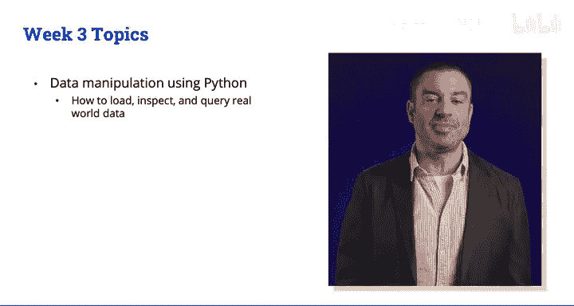
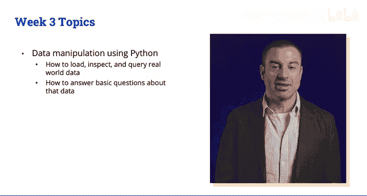
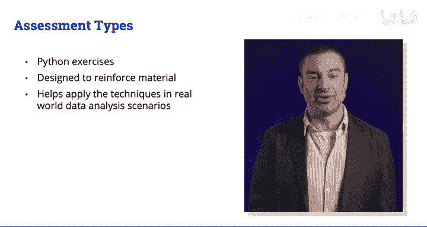

# 33：探索性数据分析(EDA)概述 📊

在本节课中，我们将学习探索性数据分析（EDA）的核心概念。EDA是一种分析数据以总结其主要特征并提取基本洞察的方法。我们将了解如何通过Python进行数据操作，并掌握数据聚合、汇总及可视化的关键技能。

---

探索性数据分析是数据分析流程中至关重要的第一步。它旨在通过可视化和统计方法理解数据集的结构、识别模式、发现异常并检验假设。

上一节我们介绍了数据分析的整体框架，本节中我们来看看探索性数据分析的具体内涵。

## 什么是探索性数据分析(EDA)？

探索性数据分析是一种分析数据的方法，其核心是**总结数据的主要特征**并**提取基本洞察**。它不依赖于严格的建模假设，而是通过直观的探索来理解数据。

## 本模块的学习目标 🎯

本模块将深入探讨使用Python进行数据操作的实践方面。

以下是本模块涵盖的核心内容：

*   **数据加载、检查与查询**：学习如何处理真实世界的数据。
*   **回答基本数据问题**：掌握从数据中获取答案的技巧。
*   **数据聚合与汇总**：学习如何对数据进行分组和统计。
*   **数据可视化**：这是任何数据分析的关键部分，我们将学习如何用图形展示数据。

## 将使用的工具与库 🛠️

为了达成上述目标，我们将使用Python中强大的数据分析生态系统。

以下是本模块将重点使用的库：

*   **数据分析库**：`pandas` 和 `NumPy`。
    *   `pandas` 用于数据操作和分析。
    *   `NumPy` 提供高效的数值计算支持。
*   **数据可视化库**：`Matplotlib` 和 `seaborn`。
    *   `Matplotlib` 是基础绘图库。
    *   `seaborn` 基于Matplotlib，提供更美观的统计图形。

## 实践练习 💻

为了确保全面理解所学概念并获得实践经验，本模块包含一系列简短的Python练习。

这些练习旨在巩固所学材料，并帮助你在真实的数据分析场景中应用相关技术，从而有效提升你进行探索性数据分析的能力。

---

本节课中，我们一起学习了探索性数据分析（EDA）的定义及其在数据分析流程中的重要性。我们明确了本模块的学习目标，包括数据操作、汇总和可视化，并介绍了实现这些目标所需的Python核心库（`pandas`, `NumPy`, `Matplotlib`, `seaborn`）。最后，我们了解到通过配套的实践练习，可以将理论知识转化为实际技能。