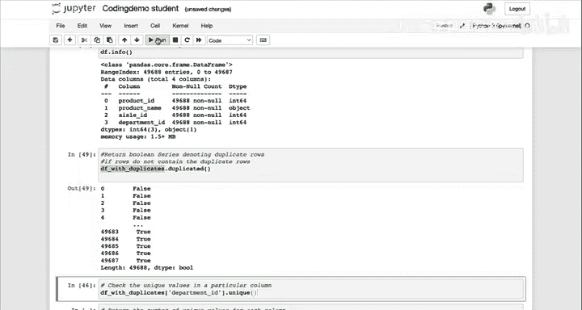
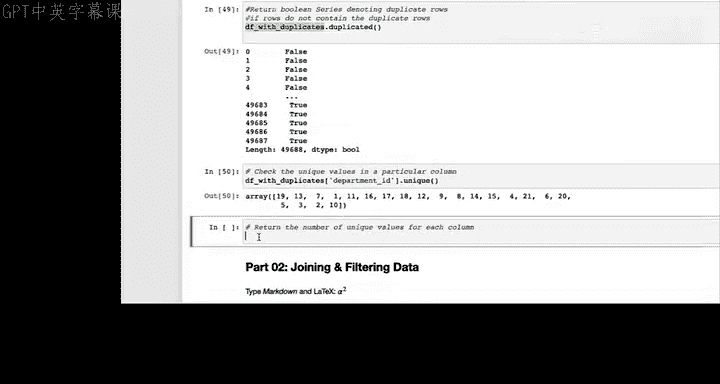
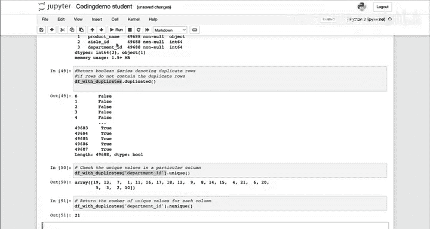
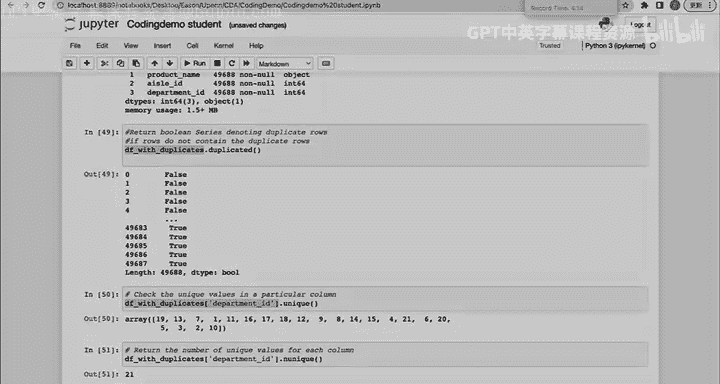

# 36：数据加载与审查 📊

在本节课中，我们将学习如何使用Python的Pandas库加载数据，并掌握审查数据框（DataFrame）基本信息的基本方法。我们将从导入库开始，逐步学习如何查看数据的结构、统计信息以及处理重复项。

---

## 导入库与加载数据

首先，我们需要导入数据分析的核心库——Pandas。我们通常为其设置一个简短的别名，以便后续调用。

```python
import pandas as pd
```

我们将使用Instacart数据集进行演示。第一步是加载产品数据文件。

```python
df = pd.read_csv('products.csv')
```

运行上述代码后，我们便创建了一个名为 `df` 的数据框。

---

## 检查数据框基本信息

上一节我们成功加载了数据，本节中我们来看看如何检查数据框的基本属性。

我们可以使用 `type()` 函数来确认 `df` 的类型。

```python
type(df)
```
**输出**：`pandas.core.frame.DataFrame`

要查看数据框的行数，可以使用 `len()` 函数。

```python
len(df)
```
**输出**：`49688`

如果想同时获取行数和列数，可以使用数据框的 `.shape` 属性。

```python
df.shape
```
**输出**：`(49688, 4)`。这表示数据框有49，688行和4列数据。

---

## 查看数据摘要统计

在了解了数据的基本规模后，我们来看看数据的数值特征。

使用数据框的 `.describe()` 方法，可以快速获取数值列的关键统计信息，包括计数、均值、标准差、最小值和最大值。

```python
df.describe()
```

---

## 查看数据行

接下来，我们学习如何查看数据的具体内容。

使用 `.head()` 方法可以查看数据框的前几行。默认显示前5行。

```python
df.head()
```

如果想查看指定数量的行，可以向 `.head()` 方法传入一个数字参数。

```python
df.head(10)
```

有时，数据中可能存在重复行。在大多数情况下，我们需要移除这些重复项。假设我们有一个包含重复行的新数据框 `df_with_duplicates`。

```python
df_no_duplicates = df_with_duplicates.drop_duplicates()
```
默认情况下，`.drop_duplicates()` 会基于所有列删除完全重复的行。执行后，将返回一个移除了重复行的新数据框。

要查看数据框末尾的数据，可以使用 `.tail()` 方法。默认显示最后5行。

```python
df.tail()
```

同样，可以指定查看的行数。

```python
df.tail(50)
```

---

## 获取数据框详细信息

另一个有用的方法是 `.info()`，它可以提供数据框的简明摘要。

```python
df.info()
```
对于数据框中的每一列，它会显示列名、非空值的数量以及该列的数据类型。

---

## 识别与处理重复值

假设我们的数据框存在重复行，并且希望在删除前先检查哪些行是重复的。

`.duplicated()` 方法会返回一个布尔序列，标记出重复的行。

```python
duplicate_series = df_with_duplicates.duplicated()
```
返回的序列中，`False` 表示该行不重复，`True` 表示该行在数据框中的其他地方存在重复。

---

## 检查列的唯一值

我们还可以检查某一列中有哪些不同的值。

以下代码返回 `department_id` 列中的所有唯一值。



```python
df_with_duplicates['department_id'].unique()
```

如果我们只想知道某一列有多少个唯一值，可以使用 `.nunique()` 方法。



```python
df_with_duplicates['department_id'].nunique()
```
**输出**：`21`。这表示 `department_id` 列中有21个不同的部门ID。

---



## 总结



本节课中，我们一起学习了Python数据分析的第一步：**数据加载与审查**。我们掌握了如何使用Pandas加载CSV文件，并运用了多种方法来探索数据框，包括检查其维度、查看摘要统计、浏览数据行、识别重复项以及分析列的唯一值。这些是进行任何数据分析前必不可少的基础操作。