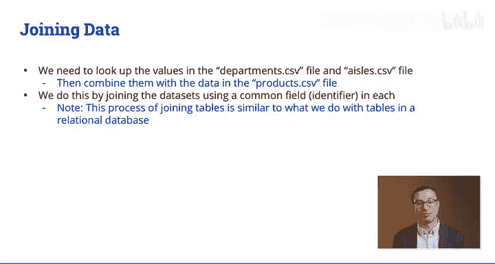
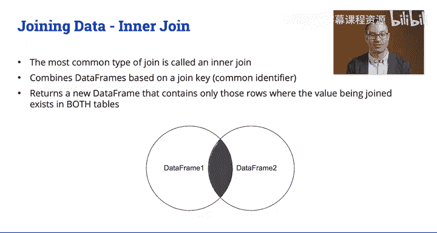

# 41：数据连接与筛选 🧩

在本节课中，我们将学习如何通过连接（Join）操作，将不同数据表中的信息合并起来，并在此基础上进行数据筛选。这是数据分析中整合多源数据的关键步骤。

---

上一节我们介绍了数据连接的基本概念，本节中我们来看看具体的连接操作是如何进行的。

我们需要在部门数据和ILs数据中查找值，并将它们与产品数据框中的数据合并。这将为我们提供每个产品的市场部门和IL信息。

我们通过在每个表中使用公共字段或标识符来连接数据集实现这一目标。这种连接表的过程类似于我们在关系型数据库中对表进行的操作。




产品数据中的部门ID将与部门数据中的部门ID连接，产品数据中的IL ID将与ILS数据中的ILI连接。

最常见的连接类型称为内连接（Inner Join）。它基于一个连接键或公共标识符组合数据框，并返回一个新的数据框，该数据框仅包含连接值在两个表中都存在的那些行。



以下是执行连接操作的核心步骤：

*   用于执行连接的pandas函数是 `merge`。
*   在 `left` 和 `right` 参数中指定要连接的数据框。
*   为 `how` 参数指定 `inner`（这是默认选项）。
*   在 `left_on` 和 `right_on` 参数中指定连接键。


其基本代码公式如下：

```python
merged_df = pd.merge(left=left_dataframe,
                     right=right_dataframe,
                     how='inner',
                     left_on='left_key_column',
                     right_on='right_key_column')
```

---


本节课中我们一起学习了数据连接的核心概念与操作方法。我们了解到，通过内连接可以基于公共字段整合来自不同数据表的信息，从而获得更完整的数据视图，这是进行深入数据分析的基础。