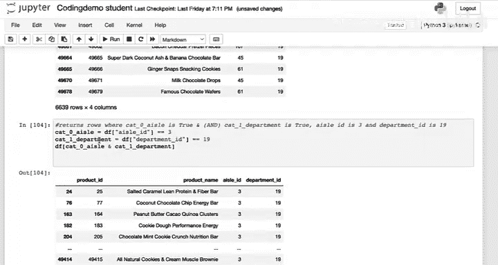

# 43：数据筛选 🎯


在本节课中，我们将学习如何使用布尔索引（Boolean Indexing）来筛选数据。这是一种在数据框（DataFrame）中查找特定行的强大方法，通过创建条件或条件组合来实现。

## 布尔索引简介 🔍

上一节我们介绍了数据框的基本结构，本节中我们来看看如何从数据框中提取我们感兴趣的数据行。核心方法是创建一个布尔序列（True/False值序列），其中每个值对应数据框中的一行，表示该行是否满足我们设定的条件。

## 创建单个条件进行筛选

首先，我们学习如何创建一个条件来筛选数据。例如，我们想在一个名为 `df` 的数据框中，找到“产品名称”列等于“巧克力夹心饼干”的所有行。

以下是创建和应用的步骤：

1.  **创建条件**：我们生成一个布尔序列，存储在变量 `cookies` 中。
    ```python
    cookies = df['product_name'] == 'Chocolate Sandwich Cookies'
    ```
    执行这行代码后，`cookies` 变量将包含一个与 `df` 行数相同的序列，其中满足条件的行对应 `True`，否则为 `False`。

2.  **应用条件筛选**：我们将这个布尔序列放入数据框的方括号内，即可得到筛选后的结果。
    ```python
    filtered_df = df[cookies]
    ```
    这将返回一个新的数据框 `filtered_df`，其中只包含“产品名称”为“巧克力夹心饼干”的行。

## 组合多个条件进行筛选

我们经常需要根据多个条件来筛选数据。Python使用逻辑运算符来组合条件。

以下是组合条件的方法：

*   **“或”条件（OR）**：使用竖线符号 `|`。满足**任意一个**条件的行为 `True`。
    ```python
    # 创建两个条件
    condition1 = df['aisle_id'] == 19
    condition2 = df['department_id'] == 19

    # 使用“或”运算符合并条件
    combined_condition = condition1 | condition2

    # 应用组合条件进行筛选
    result_df = df[combined_condition]
    ```
    这段代码将筛选出 `aisle_id` 为19 **或** `department_id` 为19的所有行。

*   **“与”条件（AND）**：使用单个“与”符号 `&`。必须**同时满足所有**条件的行为 `True`。
    ```python
    # 创建两个条件
    condition1 = df['aisle_id'] == 3
    condition2 = df['department_id'] == 19

    # 使用“与”运算符合并条件
    combined_condition = condition1 & condition2

    # 应用组合条件进行筛选
    result_df = df[combined_condition]
    ```
    这段代码将筛选出 `aisle_id` 为3 **并且** `department_id` 为19的所有行。

## 总结 📝



本节课中我们一起学习了数据筛选的核心技术——布尔索引。我们掌握了如何创建单个条件来定位特定数据行，以及如何使用逻辑运算符 `|`（或）和 `&`（与）来组合多个条件，实现更复杂、更精确的数据查询。这是进行数据探索和分析的基础技能。