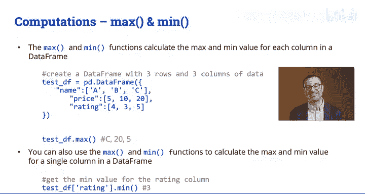

# 44：计算基础 📊


在本节课中，我们将学习如何使用Python中的Pandas库对数据框（DataFrame）进行基本的数值计算。我们将重点介绍求和、求平均值、求最大值和最小值等核心函数。

---

## 使用`sum`函数计算总和

上一节我们介绍了数据框的基本结构，本节中我们来看看如何计算数据中数值的总和。`sum`函数可以用于计算数据框各列或指定列中所有值的总和。

以下是使用`sum`函数的两种主要方式：

*   **计算每列的总和**：对整个数据框应用`sum()`函数，会返回一个序列（Series），其中包含每一列数值的总和。
    ```python
    df.sum()
    ```
*   **计算指定列的总和**：通过列名选择特定的列，然后对其应用`sum()`函数。
    ```python
    df['price'].sum()
    ```
    这段代码专门计算`price`列的总和。

---

## 使用`mean`函数计算平均值

了解了如何求和之后，我们自然想知道数据的平均水平。`mean`函数用于计算数据框指定列中所有值的平均值（均值）。

其用法与`sum`函数类似，通常用于单列计算。
```python
df['price'].mean()
```
这段代码首先创建一个包含三行三列数据的数据框，然后计算`price`列和`rating`列的平均值。

---

## 使用`max`和`min`函数计算极值

除了集中趋势，数据的范围也很重要。`max`和`min`函数分别用于找出数据中的最大值和最小值。

与前面的函数一样，它们可以应用于整个数据框或单个列。

以下是具体应用：

*   **计算每列的极值**：对整个数据框应用`max()`或`min()`函数，会返回每列的最大值或最小值。
    ```python
    df.max()  # 计算每列的最大值
    df.min()  # 计算每列的最小值
    ```
*   **计算指定列的极值**：通过列名选择列，然后计算其极值。
    ```python
    df['rating'].min()
    ```
    这段代码计算`rating`列的最小值。

---



本节课中我们一起学习了Pandas中四个基础的数值计算函数：`sum`（求和）、`mean`（求平均）、`max`（求最大值）和`min`（求最小值）。掌握这些函数是进行数据描述性统计分析的第一步，它们能帮助我们快速了解数据的总体情况。