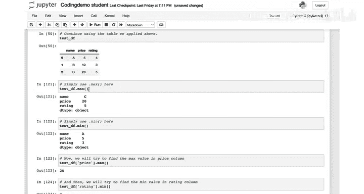

#  45：数据计算编程演示 📊

在本节课中，我们将学习如何对数据进行聚合计算，包括求和、求平均值以及寻找最大值和最小值。这些操作是数据分析的基础，能帮助我们快速理解数据的整体特征。


---

## 跨多行数据聚合

上一节我们介绍了数据的基本结构，本节中我们来看看如何对数据框中的多行数据进行聚合计算。我们将使用一个包含每笔订单所购商品信息的数据框。

我们将从订单数据框中计算重新订购的总次数。

以下是具体步骤：

1.  查看“reordered”列中的所有值。
2.  使用 `sum` 函数计算总和。

```python
reorder_numb = orders['reordered'].sum()
```

然后，我们将显示 `reorder_numb` 的结果。这给出了超过1900万次重新订购的总数。

---

## 计算平均值

为了演示 `mean` 函数，我们使用一个包含产品名称、价格和评级的测试数据框。

我们将计算所有产品的平均价格。

以下是具体步骤：

1.  从测试数据框 `test_df` 中，查看“price”列的所有值。
2.  使用 `mean` 函数计算平均值。

```python
avg_price = test_df['price'].mean()
```

然后，我们显示 `avg_price`。平均价格约为11.667。

现在，让我们获取平均评级。

以下是具体步骤：

1.  从测试数据框 `test_df` 中，查看“rating”列的所有值。
2.  使用 `mean` 函数计算平均值。

```python
average_rate = test_df['rating'].mean()
```

我们显示 `average_rate`，结果是4.0。

---

## 寻找最大值与最小值

我们将再次使用测试数据框 `test_df` 来演示最大值和最小值的查找。

首先，让我们使用 `max` 函数。

```python
df_max = test_df.max()
```

由于我们在数据框本身上调用 `max`，它会给出每一列的最大值。这只对“price”和“rating”列有意义。

接着，让我们为数据框调用 `min` 函数。

```python
df_min = test_df.min()
```

这给出了每一列的最小值。同样，这只对“price”和“rating”列有意义。

现在，让我们获取特定列的最大值和最小值。

以下是获取最高价格的步骤：

1.  查看“price”列中的所有值。
2.  使用 `max` 函数获取最大值。

```python
max_price = test_df['price'].max()
```

结果是20。

以下是获取最低评级的步骤：

1.  从测试数据框中，查看“rating”列的所有值。
2.  使用 `min` 函数获取最小值。

```python
min_rating = test_df['rating'].min()
```

结果是3。



---

本节课中我们一起学习了数据的基本聚合操作：使用 `sum` 进行求和，使用 `mean` 计算平均值，以及使用 `max` 和 `min` 寻找极值。掌握这些函数是进行更复杂数据分析的第一步。