# 51：直方图可视化 📊

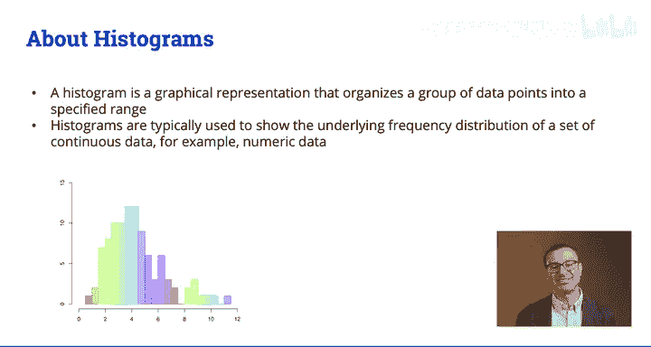

在本节课中，我们将学习如何使用Python的Matplotlib库创建直方图，以可视化数据集中产品的复购次数分布。直方图是一种强大的工具，用于展示连续数据的频率分布。


## 什么是直方图？

直方图是一种图形表示方法，它将一组数据点组织到指定的数值范围内。

直方图通常用于展示一组连续数据（例如数值数据）的潜在频率分布。

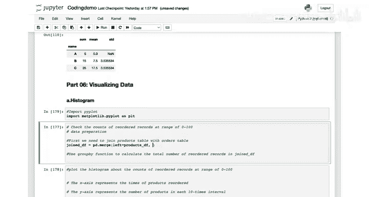

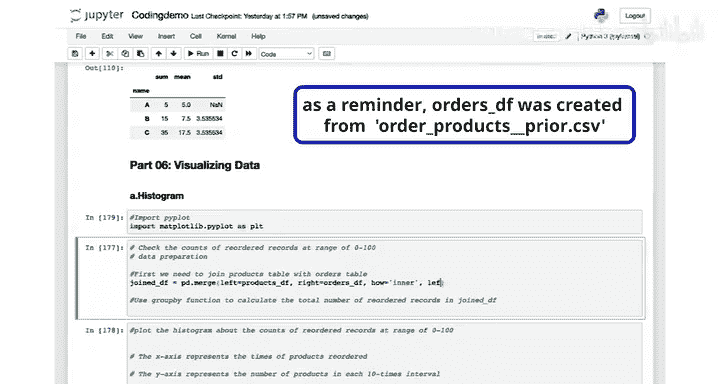

## 数据准备

在开始绘制图表之前，我们需要准备好用于可视化的数据。我们将通过合并产品表和订单表来获取产品的复购信息。

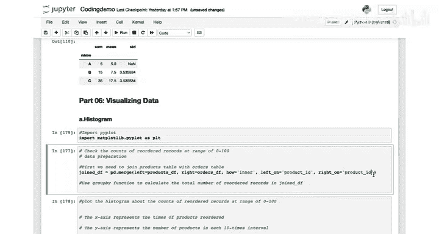

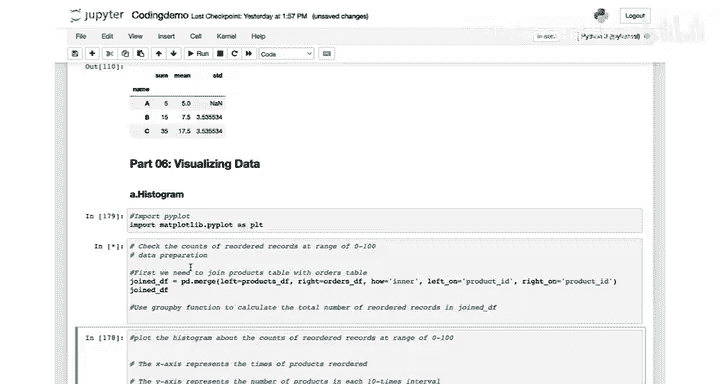

以下是数据准备步骤：

1.  **导入库**：首先，我们需要导入必要的库。我们将使用Matplotlib进行绘图，并使用Pandas进行数据处理。
    ```python
    import matplotlib.pyplot as plt
    import pandas as pd
    ```

2.  **合并数据**：我们将产品数据框（`products_df`）与订单数据框（`orders_df`）进行合并，以关联产品信息和其复购记录。这里使用内连接（inner join），连接键是双方共有的`product_id`列。
    ```python
    joined_df = pd.merge(products_df, orders_df, on='product_id', how='inner')
    ```

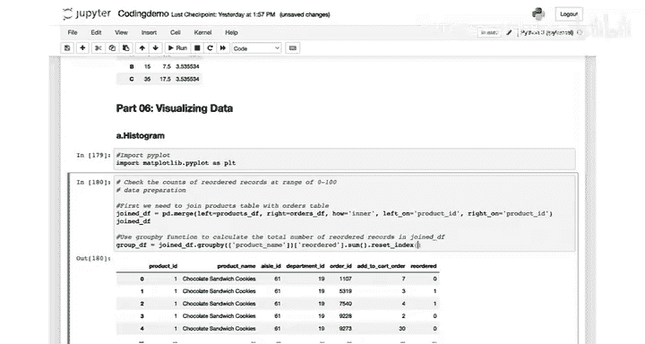

3.  **数据聚合**：接下来，我们使用`groupby`函数按产品名称分组，并计算每个产品的总复购次数（即对`reordered`列求和）。`reset_index()`方法用于将分组后的索引重置为默认的整数索引。
    ```python
    grouped_df = joined_df.groupby('product_name')['reordered'].sum().reset_index()
    ```
    执行后，我们将得到一个包含两列的数据框：`product_name`（产品名称）和`reordered`（该产品的复购总次数）。

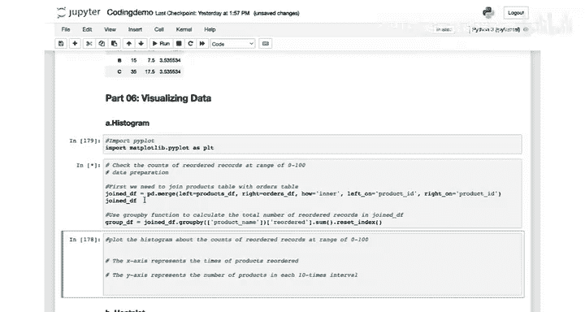

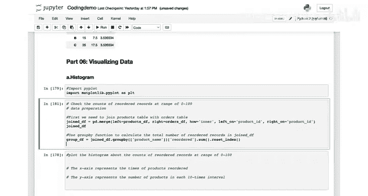

## 绘制直方图

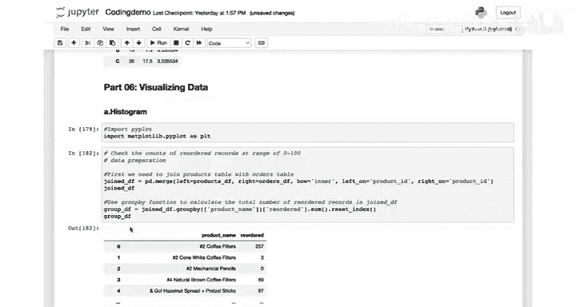

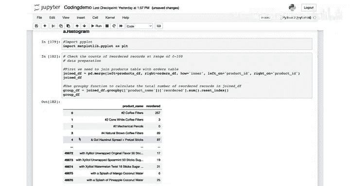

数据准备就绪后，现在我们可以开始绘制直方图了。我们将使用Matplotlib的`hist`函数。

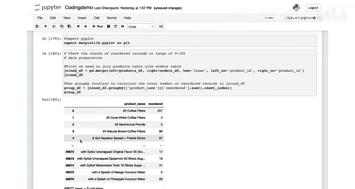

以下是绘制直方图的关键参数设置：

*   **数据**：我们传入`grouped_df[‘reordered’]`，即每个产品的复购次数列表。
*   **分箱**：通过`bins`参数设置直方图的柱子数量，这里设为10。
*   **范围**：通过`range`参数设置X轴（复购次数）的显示范围，这里设为`[0, 100]`。
*   **样式**：我们可以设置透明度（`alpha`）、柱子的填充颜色（`color`）和边框颜色（`edgecolor`）来美化图表。
*   **标签与标题**：为图表添加X轴标签、Y轴标签和标题，使其含义清晰。

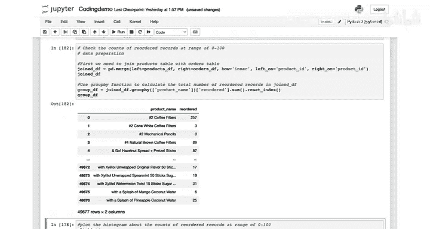

完整的绘图代码如下：
```python
plt.hist(grouped_df['reordered'], bins=10, range=[0, 100], alpha=0.3, color='blue', edgecolor='black')
plt.xlabel('Times Products Reordered')
plt.ylabel('Number of Products')
plt.title('Distribution of Products Reordered')
plt.show()
```

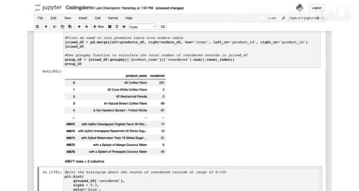

## 解读直方图

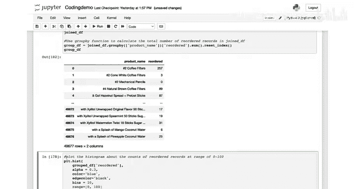

运行上述代码后，我们将看到生成的直方图。

这张直方图展示了产品复购次数的分布情况。Y轴代表不同产品的数量，X轴代表产品被复购的次数。

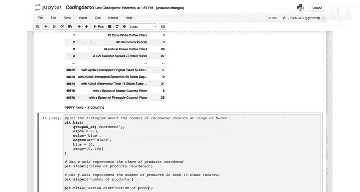

例如，从图中我们可以解读出：有略多于5000种不同的产品被复购了10到20次。通过观察柱子的高度，我们可以快速了解复购次数集中在哪个区间，以及分布的形态。

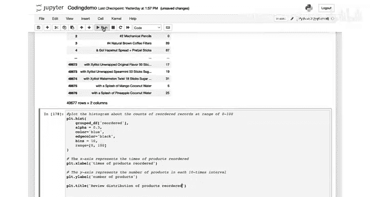

## 总结

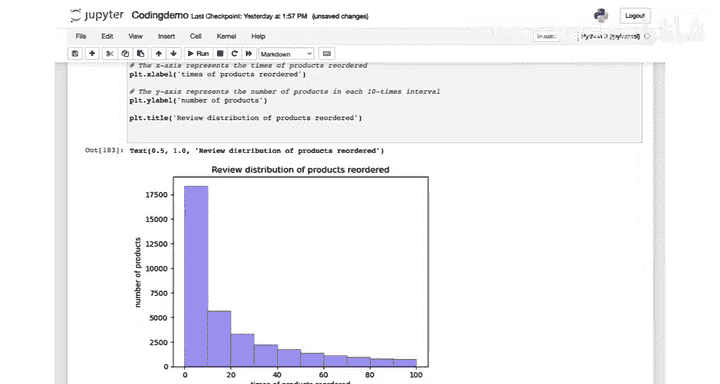

本节课中，我们一起学习了直方图的定义与用途，并完成了从数据准备到图形绘制的完整流程。我们使用Pandas合并与聚合数据，然后利用Matplotlib的`hist`函数创建了一个展示产品复购分布的直方图。通过调整参数，我们可以控制图表的分箱、范围和外观，从而更有效地传达数据背后的信息。