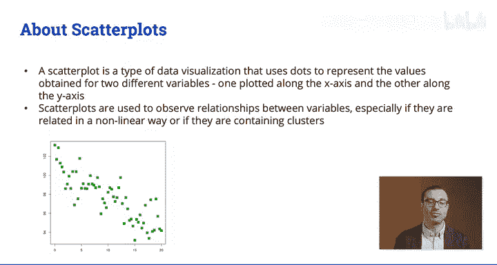
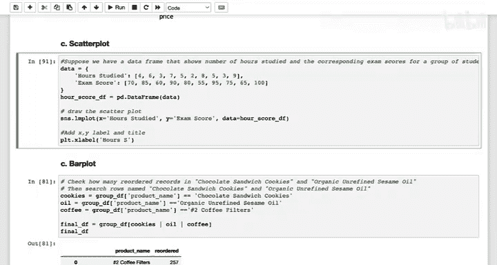
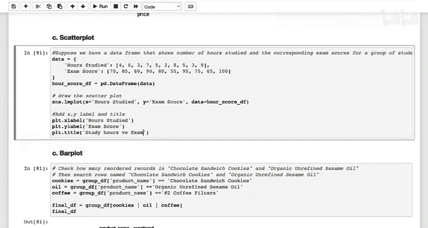
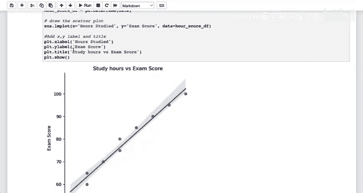

# 52：散点图可视化 📊

在本节课中，我们将学习如何使用散点图进行数据可视化。散点图是一种通过点来表示两个变量之间关系的图表，特别适用于观察非线性关系或数据中的聚类现象。

## 什么是散点图？ 🤔

散点图是一种数据可视化方法，它使用点来表示两个不同变量的取值。其中一个变量沿 X 轴绘制，另一个变量沿 Y 轴绘制。

散点图主要用于观察变量之间的关系，尤其是当它们呈非线性关系或数据中存在聚类时。



## 创建示例数据 📝

假设我们有一个数据框，它展示了一组学生的学习小时数与对应的考试成绩。

以下是创建该数据框的代码，我们将其命名为 `hour_score_df`：

```python
import pandas as pd

# 示例数据
data = {
    'hours_studied': [1, 2, 3, 4, 5, 6, 7, 8, 9, 10],
    'exam_score': [50, 55, 60, 65, 70, 75, 80, 85, 90, 95]
}

hour_score_df = pd.DataFrame(data)
```

## 绘制散点图 🎨

为了了解这两组数值之间的关系，我们将创建一个散点图。我们将使用 Seaborn 库的 `lmplot` 函数来完成这个任务。



以下是绘制散点图的完整代码：


```python
import seaborn as sns
import matplotlib.pyplot as plt



# 使用 lmplot 绘制散点图
sns.lmplot(x='hours_studied', y='exam_score', data=hour_score_df)


# 设置坐标轴标签和标题
plt.xlabel('Hours Studied')
plt.ylabel('Exam Score')
plt.title('Study Hours vs. Exam Score')

# 显示图表
plt.show()
```

## 解读散点图 🔍

生成的散点图中，每个点代表一名学生，包含了其学习小时数和考试成绩。

例如，对于一名学生，当他学习了 5 小时，他获得了 80 分；对于另一名学生，当他学习了 5 小时，他获得了 75 分。

此外，请注意 `lmplot` 在散点图中放置的回归线。这条线描绘了散点图中两个变量之间的关系。在本例中，它展示了学习小时数与考试成绩之间的关系。


## 总结 📚



本节课我们一起学习了散点图的创建与解读。我们了解到散点图是探索两个数值变量之间关系的强大工具，能够直观地展示数据点分布、趋势以及可能存在的聚类。通过 Python 的 Seaborn 和 Matplotlib 库，我们可以轻松地创建并自定义散点图，从而为数据分析和探索性数据分析提供有力的视觉支持。