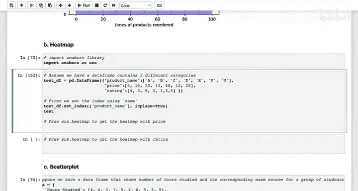
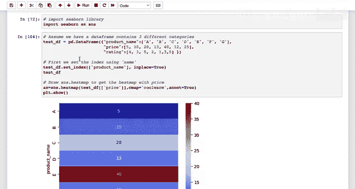
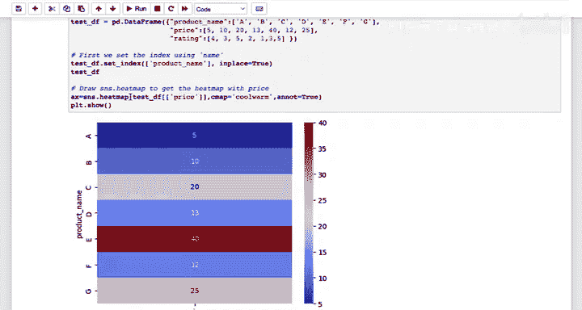
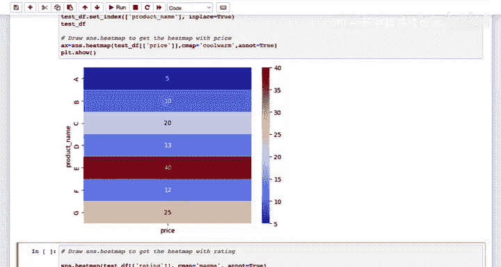
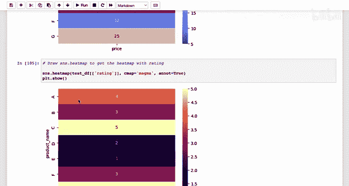

# 53：热力图可视化 📊

在本节课中，我们将要学习什么是热力图，以及如何使用Python的Seaborn库来创建和自定义热力图，以直观地展示数据集中数值的分布和关系。

## 概述


热力图是一种二维图形化数据表示方法，其中每个单独的数值都用颜色来表示。在数据分析中，热力图常用于可视化复杂的数据集，并展示变量之间的相关性或关系。


## 数据准备

上一节我们介绍了热力图的基本概念，本节中我们来看看如何为创建热力图准备数据。我们将使用一个包含产品名称、价格和评分的示例数据框。

首先，我们需要导入必要的库并创建示例数据。

```python
import seaborn as sns
import matplotlib.pyplot as plt
import pandas as pd

# 假设我们有一个数据框
data = {
    'product_name': ['A', 'B', 'C', 'D'],
    'price': [15, 10, 20, 25],
    'rating': [4, 3, 5, 2]
}
test_df = pd.DataFrame(data)
```

为了便于将产品名称作为热力图的轴标签，一个简单的方法是将数据框的索引设置为“product_name”列。

```python
test_df.set_index('product_name', inplace=True)
print(test_df)
```

`set_index`函数将数据框的索引设置为一个已存在的列，而不是默认的数字索引。`inplace=True`参数表示直接在原数据框上进行修改。



## 创建基础热力图

数据准备就绪后，现在我们可以开始绘制热力图了。我们将使用Seaborn库的`heatmap`函数。

以下是绘制价格相对于产品名称的热力图的步骤：

```python
sns.heatmap(test_df[['price']], cmap='coolwarm', annot=True)
plt.show()
```


在这段代码中：
*   `test_df[['price']]` 是我们想要可视化的数据。
*   `cmap='coolwarm'` 参数指定了使用的颜色映射。
*   `annot=True` 参数确保在每个色块上显示具体的数值。

执行上述代码后，我们将得到一个热力图，它清晰地展示了每个产品名称对应的价格。例如，产品C的价格是20，产品B的价格是10。



## 自定义热力图外观



我们已经学会了创建基础热力图，接下来看看如何通过更改颜色映射来定制热力图的外观，以适应不同的数据或展示需求。

以下是使用不同颜色映射绘制评分热力图的代码：

```python
sns.heatmap(test_df[['rating']], cmap='magma', annot=True)
plt.show()
```

这次，我们将`cmap`参数设置为`'magma'`，这会生成一个具有不同颜色风格的热力图。这个热力图展示了每个产品名称对应的评分。例如，产品C的评分是5，产品B的评分是3。



通过改变`cmap`参数，你可以使用Seaborn和Matplotlib支持的任何颜色映射，如`'viridis'`、`'plasma'`、`'summer'`等，来强调数据的不同特征。

## 总结



本节课中我们一起学习了热力图可视化的核心技能。我们首先了解了热力图是一种用颜色表示数值的二维数据可视化工具。然后，我们逐步实践了如何使用Pandas准备数据，特别是通过`set_index`方法设置索引。最后，我们重点掌握了使用Seaborn库的`sns.heatmap()`函数创建热力图，并通过`cmap`和`annot`等参数来自定义其颜色和注释，从而有效地将数据模式直观地呈现出来。