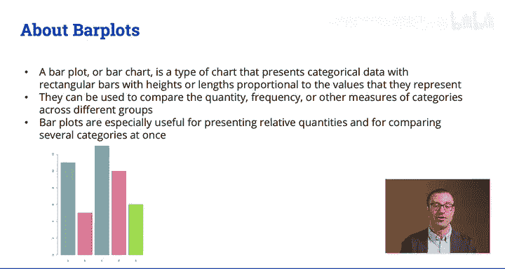
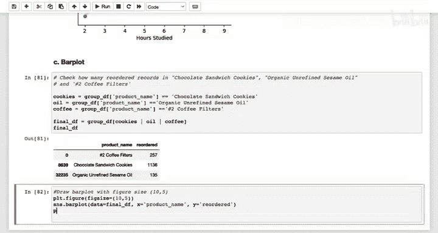
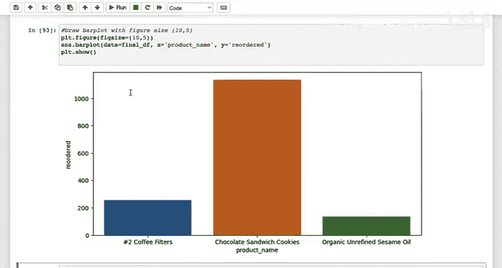
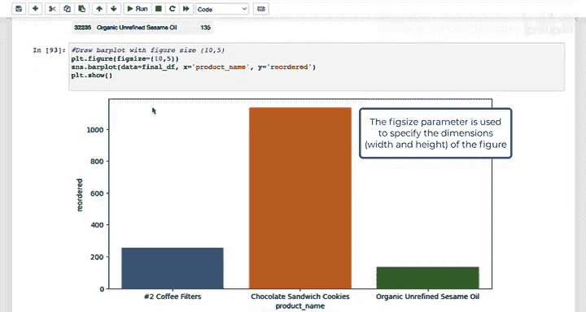

# 54：条形图可视化 📊

在本节课中，我们将学习条形图（Bar Plot）的基本概念，并使用 Python 的 Seaborn 库来创建条形图，以可视化不同产品的复购次数数据。

条形图是一种用矩形条表示分类数据的图表，矩形条的高度或长度与其所代表的数值成比例。条形图常用于比较不同组别之间类别的数量、频率或其他度量值。它特别适用于一次性展示多个类别的相对数量，便于直观比较。

---

上一节我们介绍了条形图的基本概念，本节中我们来看看如何准备数据并创建条形图。

首先，我们需要准备数据。假设我们已经有一个名为 `group_df` 的数据框，其中存储了每个产品名称对应的复购次数记录。我们的目标是筛选出三种特定产品的数据：巧克力夹心饼干、有机未精炼芝麻油和二号咖啡滤纸。

以下是数据准备的步骤：

1.  为每种产品创建一个筛选条件。
2.  使用这些条件从 `group_df` 中过滤出对应的行。
3.  将过滤后的结果存储在一个新的数据框（例如 `final_df`）中。

完成上述步骤后，`final_df` 将只包含这三种产品及其对应的复购次数。

---

数据准备完成后，现在我们可以开始绘制条形图。我们将使用 Seaborn 库中的 `barplot` 函数。

在绘图之前，通常需要设置图表的大小以获得更好的显示效果。我们可以使用 Matplotlib 的 `figure` 函数来设置图形尺寸。

以下是创建条形图的具体步骤：

1.  设置图形尺寸为 10（宽）x 5（高）。
2.  调用 `sns.barplot()` 函数。
3.  指定数据源为 `final_df`。
4.  将 `product_name` 设置为 X 轴。
5.  将复购次数的 `counts` 设置为 Y 轴。
6.  最后，调用 `plt.show()` 来显示图表。

运行代码后，我们将看到一个条形图。图中每个条形代表一个特定产品，条形的高度直观地显示了该产品的复购次数。例如，从图中可以清晰地看出，巧克力夹心饼干的复购次数超过了一千次。

---

本节课中我们一起学习了条形图的作用以及如何使用 Seaborn 库创建条形图。我们首先准备了需要可视化的特定产品数据，然后通过设置图形参数和调用绘图函数，生成了一个清晰展示产品复购次数对比的条形图。条形图是数据探索和结果展示中非常有效的工具。