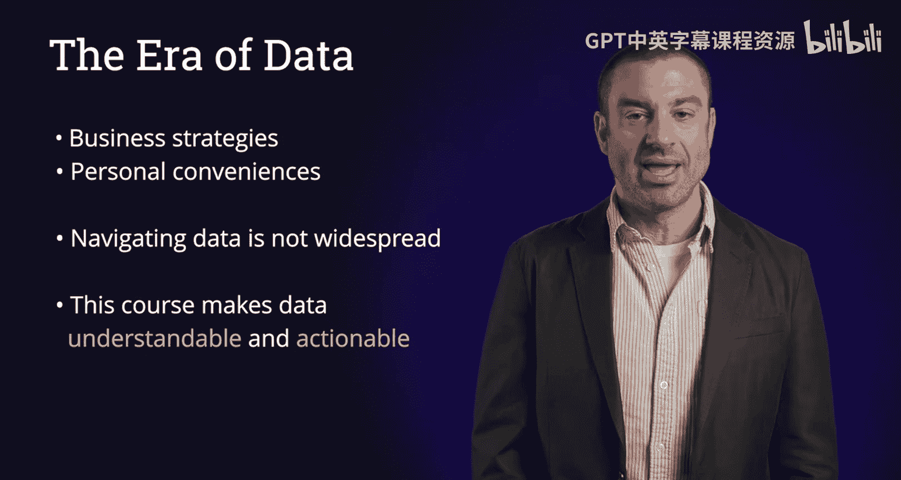
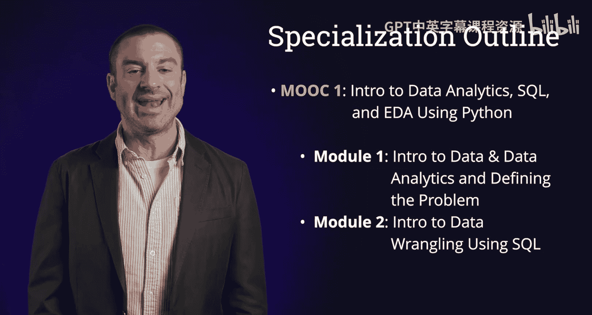
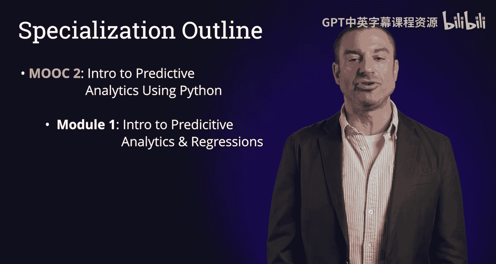
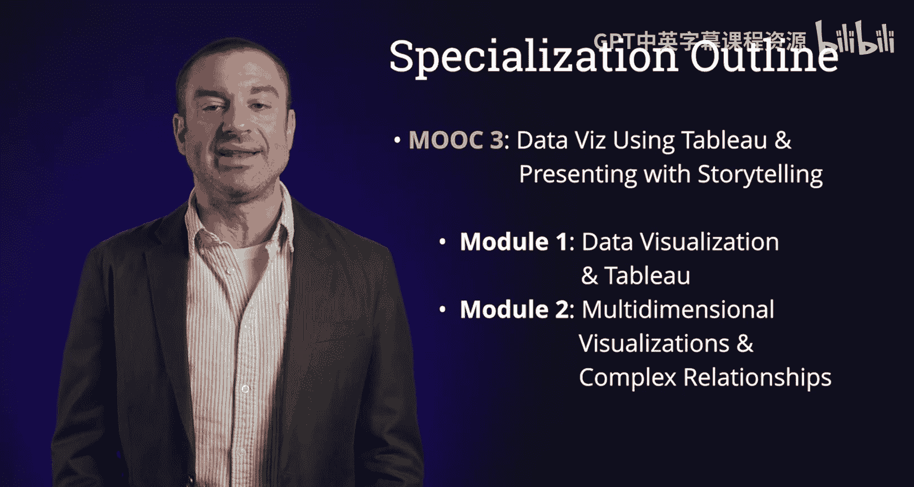

# 如何运用数据：专项课程简介

## 概述
在本节课中，我们将要学习宾夕法尼亚大学提供的《如何运用数据》专项课程的整体结构与核心内容。该课程旨在帮助初学者掌握数据分析、预测分析和数据可视化的基本技能，为进入数据领域打下坚实基础。

在数字时代，数据无处不在，塑造着我们日常的决策。它正在变革行业、驱动创新并创造新的机遇。欢迎来到我们的Coursera专项课程《如何运用数据》。这是一个关键的门户，专为任何渴望挖掘数据潜力的人设计，无论其先前经验如何。探索数据的旅程从这里开始，你将在此解锁数据分析、数据科学和数据工程的基础知识。本专项课程是你穿越不断演变的数据领域的综合指南，提供实用的技能和见解，这些技能和见解将随着技术进步而保持其相关性。

我们生活在一个数据触及我们存在各个角落的时代，从企业的战略制定到微小的个人便利，数据是塑造我们世界的一股无形力量。然而，尽管数据无处不在，驾驭这片广阔信息海洋的能力仍未普及。本专项课程旨在弥合这一差距，为你提供工具，使数据不仅可理解，而且可操作。其核心是将信息转化为洞察，再将洞察转化为影响力。

数据分析、预测分析和数据可视化不仅仅是当代的流行语，更是现代技能组合的支柱，这些技能在未来技术演进过程中将长期保持其价值。随着技术的发展，我们与数据交互的方式也会变化。然而，你在此学到的核心原则是永恒不变的，为你提供坚实的基础，无论数字环境如何变化。

## 课程结构
本专项课程精心构建为三个循序渐进的课程，每一门都建立在前一门的基础上，确保全面且连贯的学习体验。

### 第一门课程：数据分析基础
第一门课程为你数据分析之旅奠定基石，其结构包含三个关键模块。

上一节我们介绍了课程的整体框架，本节中我们来看看第一门课程的具体内容。

**模块一：数据世界入门**
此模块为你打开数据世界的大门，提供对数据分析、数据科学和数据工程的见解。它涵盖了整个数据分析流程，介绍了本课程至关重要的编程语言和工具，并通过案例研究让你将理论概念带入真实世界的情境中。

**模块二：数据整理与SQL**
此模块深入探讨数据整理，重点在于SQL。你将探索数据存储和访问方式，通过关系型数据库的视角学习SQL基础，并掌握数据操作技术。对于希望理解SQL以及如何为分析准备数据的人来说，此模块至关重要。

**模块三：使用Python进行探索性数据分析**
此模块将重点转向使用Python进行探索性数据分析，你将学习如何检查、查询和汇总数据，并通过可视化信息来挖掘洞察。此模块旨在为你提供实践技能，包括使用如`pandas`这样的数据分析库，以及如`Matplotlib`和`Seaborn`这样的可视化工具。

### 第二门课程：预测分析
第二门课程将你的技能进一步带入预测领域，分为三个内容丰富的模块。

在掌握了数据分析基础后，本节中我们来看看如何利用数据进行预测。

**模块一：预测分析入门**
此模块向你介绍预测分析，涵盖线性回归和逻辑回归等基本模型。这是你开始学习如何从历史数据中预测未来趋势的地方。

**模块二：决策树与随机森林**
此模块将你的知识扩展到决策树和随机森林，更深入地探讨更复杂的监督学习模型，以增强你的预测分析能力。

**模块三：无监督学习与聚类**
此模块探索无监督学习和聚类，引导你了解模型比较的细微差别，以及在没有预定义标签的情况下识别模式的艺术。

### 第三门课程：数据可视化与叙事
第三门课程是你的数据旅程的顶点，通过三个重点模块将分析转化为行动。

在学习了如何分析和预测数据之后，本节中我们来看看如何有效地呈现和传达你的发现。

**模块一：使用Tableau进行数据可视化**
此模块让你沉浸在使用Tableau进行数据可视化的学习中，你将掌握创建有影响力的可视化数据故事背后的概念和原则，重点是一维和时间序列可视化。

**模块二：多维可视化与复杂关系**
此模块介绍多维可视化和复杂关系，扩展你分析和可视化多表数据的能力，从而增强你数据解读的深度和清晰度。

**模块三：洞察呈现与数据叙事**
此模块专注于洞察呈现和数据叙事，在这里你将学习如何将你的分析综合成连贯且有说服力的叙述。这是向利益相关者有效传达数据洞察的关键技能。

每一门课程都相互关联，建立在上一门的基础上，以形成对数据分析的全面理解。

## 课程要求与证书
按顺序完成所有三门课程对于获得专项课程证书至关重要，该证书向潜在雇主证明了你的投入和专业知识。本专项课程需要投入，包含评分作业、定期测验和沿途的实践练习，让你能够批判性和创造性地将所学应用于真实场景。

这不仅仅是一个专项课程，更是对你未来的投资，为你配备了随着技术进步而保持其价值的常青技能。

## 总结
本节课中我们一起学习了《如何运用数据》专项课程的概览。总而言之，《如何运用数据》是成为下一代数据专业人士的门户。通过理解数据分析，你不仅是在跟上数字时代的步伐，更是在帮助塑造它。

加入我们这个激动人心的旅程，解锁数据的全部潜力，并转变你的职业生涯。欢迎来到数据分析的世界，让我们一起开始这段变革之旅。