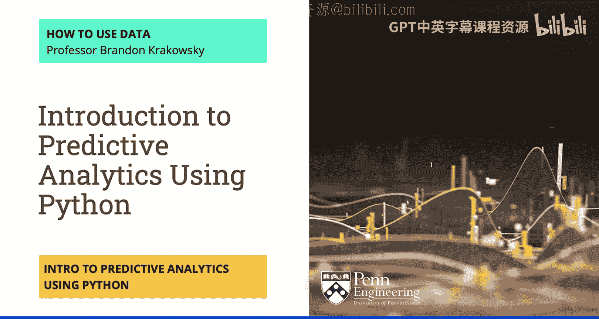
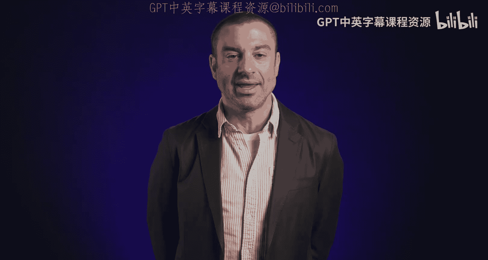
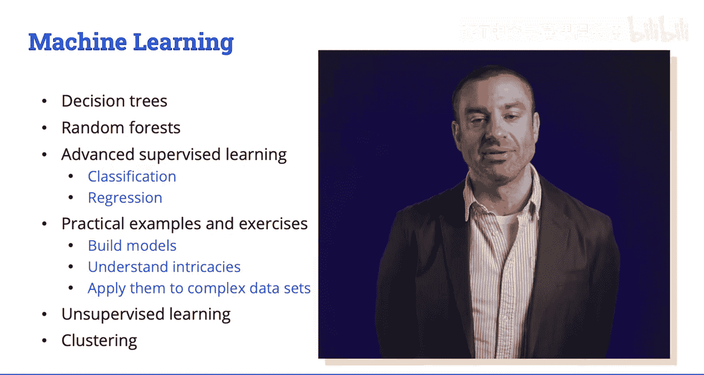
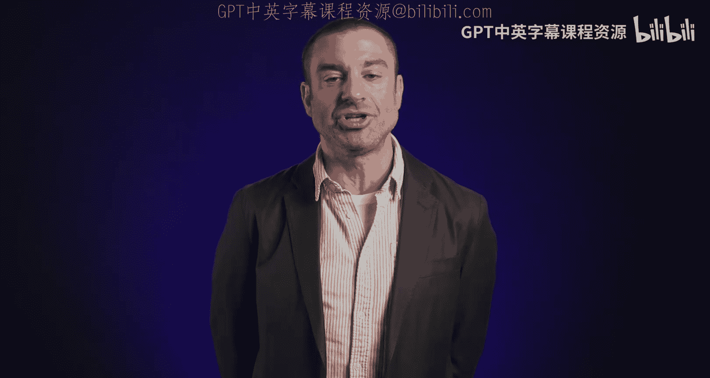

# uPenn《如何运用数据2、3（Python预测分析、数据可视化和叙事）｜How to Use Data》中英字幕 p02 1_Python预测分析课程导论.zh_en [BV1LqxEzcEBy_p2]

Welcome to our course on predictive analytics， specially designed to enhance your skills in building。

 refining and implementing predictive models using Python。

 This course serves as a comprehensive introduction to predictive analytics。

 beginning with the fundamentals of linear and logistic regression。😊。

These models are the cornerstone of predictive analytics。

 enabling you to forecast future events by learning from historical data。

 We cover a bit of the theory behind these models， But in particular。

 their application in real world scenarios and the process of evaluating their performance to ensure accuracy and reliability。

😊，As the course progresses， we delve deeper into the realm of machine learning with a focus on decision trees and random forests。

These techniques represent a more advanced aspect of supervised learning。

 offering powerful tools for both classification and regression tasks。

Through practical examples and hands on exercises， you'll learn how to build these models。

 understand their intricacies， and apply them to complex data sets to identify patterns and make predictions。

Additionally， we introduce the concepts of unsupervised learning and clustering。

 broadening your analytics toolkit， and providing you with the skills to tackle data without predefined labels or categories。

 By the end of this course， you'll not only have a thorough understanding of various predictive analytics techniques。

 but also be capable of applying these techniques to solve real world problems。

 setting the stage for continued growth and exploration in the field of data analytics。

