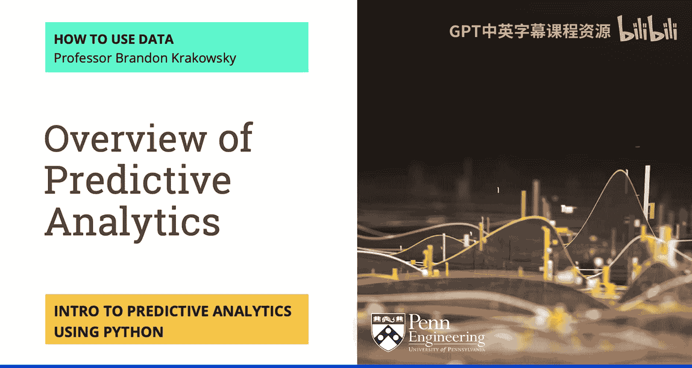
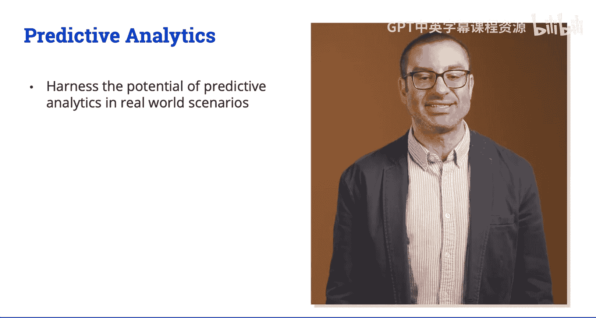
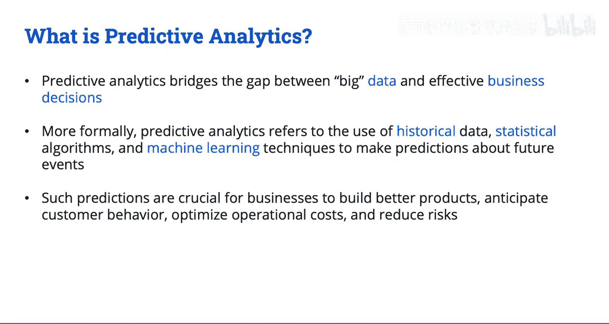
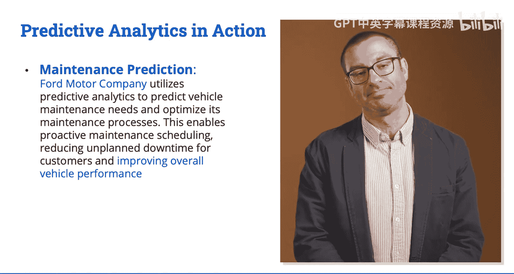

# uPenn《如何运用数据2、3（Python预测分析、数据可视化和叙事）｜How to Use Data》中英字幕 p04 3_第一周导论：预测分析概述.zh_en [BV1LqxEzcEBy_p4]

Welcome to the first predictive analytics module of this course。

 This module is designed as an introduction to predictive analytics。

 a tool that uses historical data， statistical algorithms and machine learning techniques to predict future outcomes。

😊，In this module， we'll learn about supervised learning and focus on three of the most common supervised learning models。

 linear regression， logistic regression and decision trees。😡。

Each of these models will be explored in detail using Python。

 providing you with the knowledge and skills to build and interpret them effectively。😡。

With this knowledge， you'll be able to begin to harness the potential of predictive analytics in real world scenarios。

 enablingling data informed decision making。 What is predictive analytics。

 Pretive analytics bridges the gap between big data and effective business decisions。 More formally。

 predictivetive analytics refers to the use of historical data。

 Staistic algorithms and machine learning techniques to make predictions about future events。

Such predictions are crucial for businesses to build better products， anticipate customer behavior。

 optimize operational costs and reduce risks。😡。

Predictive analytics can be used to make predictions and solve business problems。

 Here are some interesting use cases。 Product recommendations。

 By analyzing customer browsing and purchase history。

 Amazon's predictive analytics models generate personalized recommendations for each user。

 I customer engagement and increasing sales。Surge pricing and supply allocation by analyzing historical rider demand。

 traffic patterns and driver availability。 Uber's algorithms predict high demand periods and locations。

 allowing them to adjust prices accordingly， balancing supply and demand to maximize revenue during peak times。

Maintenance prediction Ford Motor Company utilizes predictive analytics to predict vehicle maintenance needs and optimize its maintenance processes。

This enables proactive maintenance scheduling， reducing unplanned downtime for customers and improving overall vehicle performance。

 and， of course， there are many other use cases。

