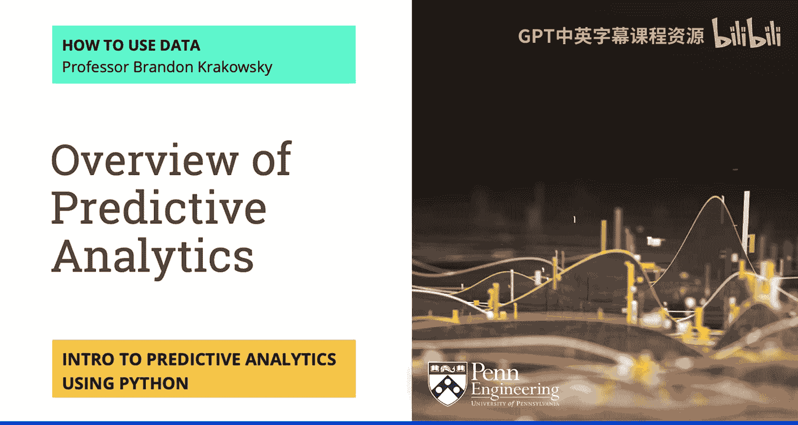
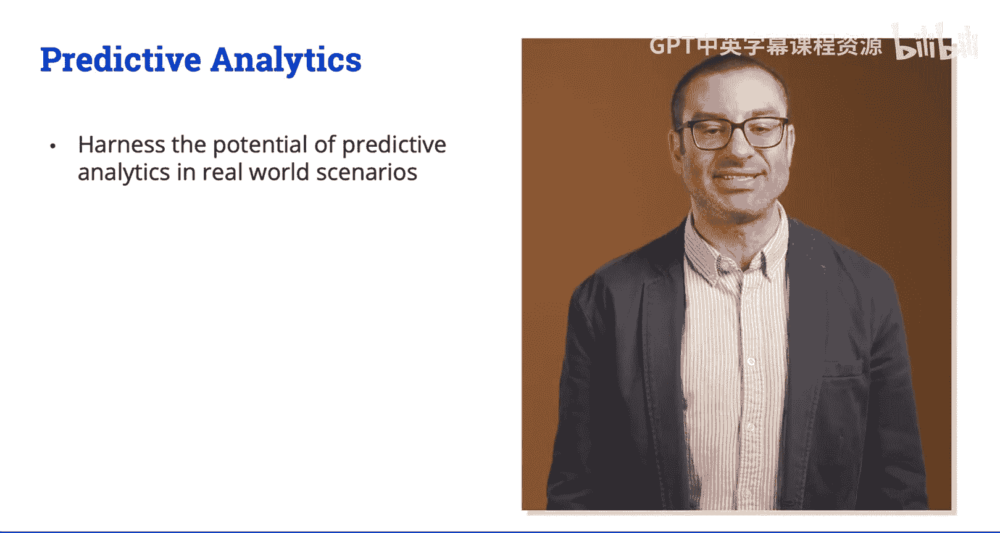
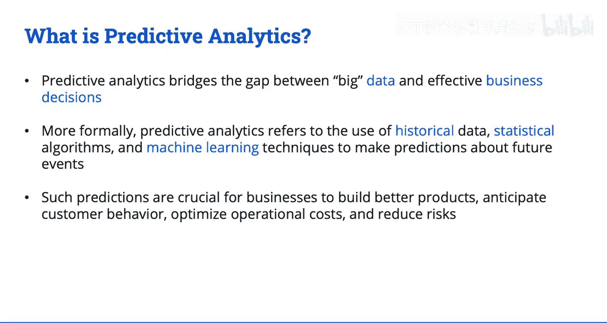
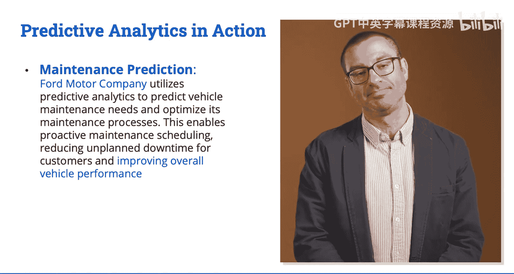

# 预测分析：1.1：预测分析概述

在本节课程中，我们将学习预测分析的基本概念、核心价值以及它在现实世界中的典型应用案例。

## 什么是预测分析？

预测分析是连接大数据与有效商业决策的桥梁。更正式地说，预测分析指的是利用历史数据、统计算法和机器学习技术来预测未来事件。

此类预测对于企业至关重要，可用于构建更好的产品、预测客户行为、优化运营成本以及降低风险。

## 预测分析的应用案例

预测分析可用于进行预测并解决商业问题。以下是一些有趣的应用案例。

*   **产品推荐**：通过分析客户的浏览和购买历史，亚马逊的预测分析模型为每位用户生成个性化推荐，从而提高客户参与度并增加销售额。
*   **动态定价与资源调配**：通过分析历史乘客需求、交通模式和司机可用性，优步的算法预测高需求时段和地点，从而相应调整价格，在高峰时段平衡供需以最大化收入。
*   **维护预测**：福特汽车公司利用预测分析来预测车辆维护需求并优化其维护流程。这使得能够主动安排维护计划，减少客户的意外停机时间，并提高车辆的整体性能。

当然，除此之外还有许多其他应用案例。

## 本模块学习内容

上一节我们了解了预测分析的定义和价值，本节中我们来看看本课程模块的具体学习目标。

欢迎来到本课程的第一个预测分析模块。本模块旨在介绍预测分析。预测分析是一种利用历史数据、统计算法和机器学习技术来预测未来结果的工具。

在本模块中，我们将学习监督学习，并重点介绍三种最常见的监督学习模型：**线性回归**、**逻辑回归**和**决策树**。

我们将使用Python详细探讨每一种模型，为您提供有效构建和解释这些模型所需的知识与技能。

掌握了这些知识，您将能够在现实场景中开始利用预测分析的潜力，从而实现数据驱动的决策。

## 总结

本节课中我们一起学习了预测分析的核心定义，它利用**历史数据**和**算法**来预测未来。我们还探讨了它在电商推荐、共享出行定价和工业维护等领域的实际应用。最后，我们明确了本模块将重点学习三种监督学习模型：线性回归、逻辑回归和决策树，并使用Python进行实践。