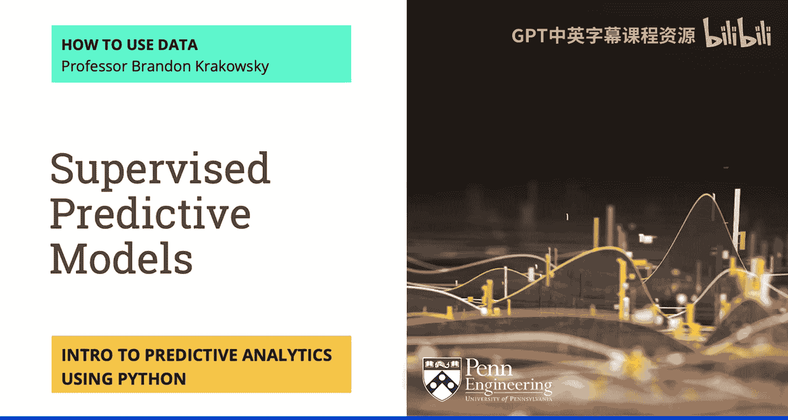
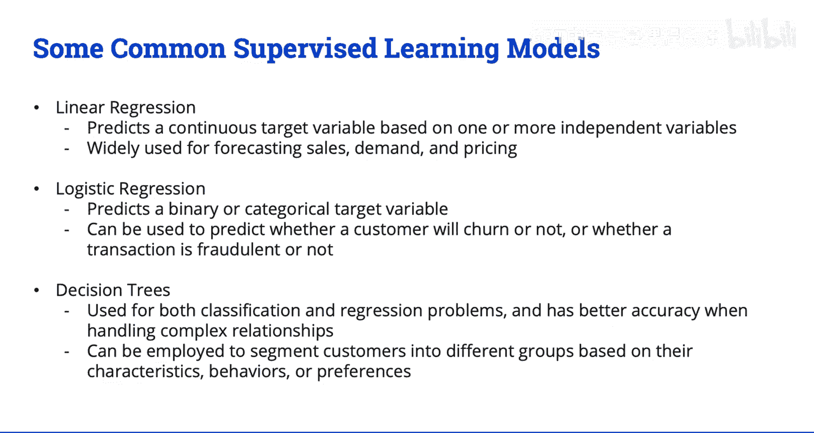

# uPenn《如何运用数据2、3（Python预测分析、数据可视化和叙事）｜How to Use Data》中英字幕 p05 4_监督式预测模型.zh_en [BV1LqxEzcEBy_p5]

In a typical machine learning pipeline， a data set Z is fed through a machine learning algorithm to obtain a model F。

 The Model F represents a relation between some input features such as historical prices and a target output。

 such as future product sales。And given a new input。

 the Model F can produce a corresponding prediction using learned insights from data set Z。

 Let's look at the major differences between supervised and unsupervised learning。

For supervised learning， the input consists of labeled data。

 and the output comes from a model that predicts the label for a new given input。 for example。

 learning to classify spam emails from a data set of emails labeled as either spam or not spam。😡。

For unsupervised learning， the input consists of unlabeled data。

 and the output comes from a model that predicts a representation of structure in the data。

 For example， grouping large collections of images with similar characteristics without the need from manually labeling the image contents。

Intuitively， a supervised learning model tries to make predictions that imitate a set of known labeled examples。

Both supervised and unsupervised learning techniques have valuable applications in predictive analytics。

Here are some very common supervised learning models， linear regression。

 which predicts a continuous target variable based on one or more independent variables。😡。

Linear regression is widely used for forecasting sales， demand， and pricing。Logistic regression。

 which predicts a binary or categorical target variable。

 Logistic regression can be used to predict whether a customer will churn or not or whether a transaction is fraudulent or not and decision trees。

 which are used for both classification and regression problems and has better accuracy when handling complex relationships。

Decision trees can be employed to segment customers into different groups based on their characteristics。

 behaviors or preferences。

