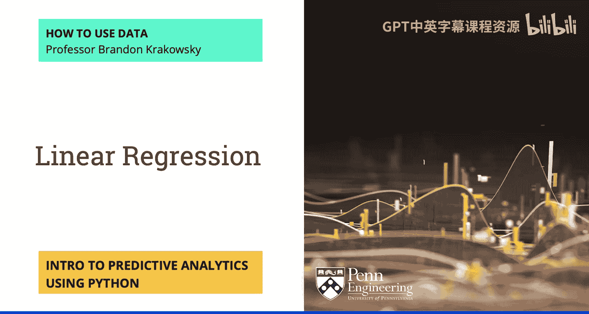
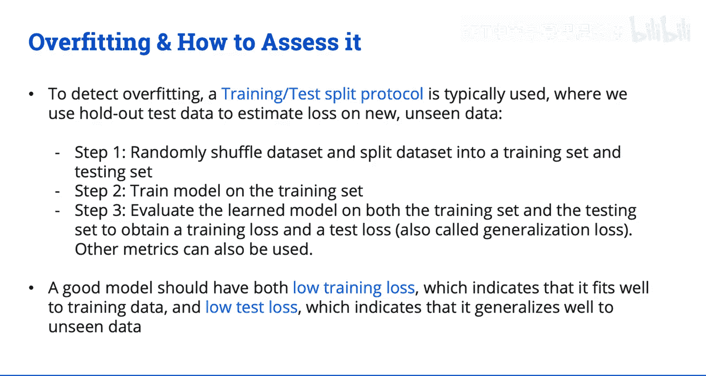

# uPenn《如何运用数据2、3（Python预测分析、数据可视化和叙事）｜How to Use Data》中英字幕 p06 5_线性回归.zh_en [BV1LqxEzcEBy_p6]

Recall the M L pipeline that ultimately produces a model F in linear regression。

 We make an assumption that the model is a linear model。 In other words。

 linear regression assumes a linear relation between some given inputs and the target output。

 For example， imagine we want to predict the age of a customer based on the number of orders they've made for a certain product。

 In this case， the number of orders they've made is the input variable and the age of the customer is the output variable。

To perform linear regression， we gather data on various customers， including their orders and ages。

We plot this data on a graph with the X axis representing the number of orders and the y axis representing the age。

 Each data point is represented by a blue circle on the graph。

The goal of linear regression is to find a line that best fits the data points。

 This line is represented by a red line on the graph。

The position and slope of this line are determined through a mathematical process that minimizes the distance between the line and the data points。

Once we have this line， we can use it to make predictions。 For example。

 if we have the number of orders for a new customer， we can use the line to estimate their age。

The line represents the learn model that allows us to predict the output variable age based on the input variable number of orders。

😡，In linear regression， the model parameters refer to the values that determine the specific characteristics of the linear model。

 These parameters define the slope and intercept of the line that represents the relationship between the input variable and the output variable。

Let's go back to the example of predicting customer ages based on their number of orders。

 In this case， the parameters of the linear regression model are as follows。

 The slope represents the change in the output variable。

 age for a unit change in the input variable number of orders。

 and the intercept is the point where the line intersects the y axis。😡。

How do we find the most optimal model parameters？If the training data set has a significant trend。

 we can easily draw out a line that looks optimal rather quickly。 But for noisy real life data sets。

 finding the most optimal model is not as straightforward。

 During the training process of linear regression， the algorithm learns the optimal values for these parameters By minimizing the difference between the predicted values of the model and the actual values from the training data。

😡，We need a metric that measures how well the model performs from machine learning problems。

 a loss function is usually defined to evaluate the model。 Intuitively。

 the loss function would have small values if the predicted output is close to the desired output and large values otherwise。

😡，A commonly used loss function is the mean squared error or MSE loss function。

 This loss represents the average squared difference between the predicted output and the desired output across all samples in the training dataset set。

The optimal linear regression model minimizes the MSC loss。In practice。

 we can use the mean squared error function in the SKt Learn Maine Learning Library to calculate the MSE。

😡，A simple linear regression involves one independent variable and one dependent variable。

 and a multivariate linear regression extends to include multiple independent variables。

Overfitting occurs when the learn model fits the training dataset set very well。

 but fails to generalize to new examples。The model on the right has no loss on the training data。

 but does not actually capture the patterns of the data。

Overfitting is a common issue that can occur when using complex models。

When a model becomes too complex， it may start to capture noise or random fluctuations in the training data。

 leading to poor generalization to new unseen data。To detect overfitting。

 a training test split protocol is typically used， where we use holdout test data to estimate loss on new unseen data。

Here's what the process looks like， step one， randomly shuffle the data set and split the data set into a training set and testing set。

😡，Step two， train the model on the training set。Step 3。

 evaluate the learn model on both the training set and the testing set to obtain a training loss and a test loss。

 also called generalization loss。Other metrics can also be used。

 A good model should have both low training loss， which indicates that it fits well to training data and low test loss。

 which indicates that it generalizes well to unseen data。😡。

