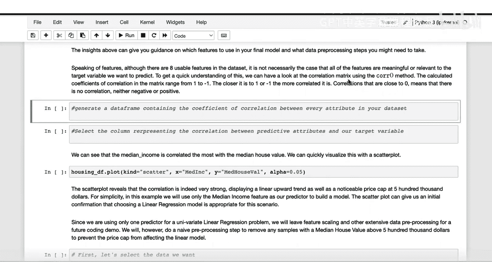

# uPenn《如何运用数据2、3（Python预测分析、数据可视化和叙事）｜How to Use Data》中英字幕 p07 6_编程演示：数据加载与探索.zh_en [BV1LqxEzcEBy_p7]

In this coding example， we'll walk through applying and analyzing a linear regression model on the California Housing dataset set using the P S Ki Learn Library。

 Ps Kit Learnn， also known as S K Learnn， is a popular open source machine learning library and Python that provides a wide range of tools and algorithms for various machine learning tasks。

 Before we start， let's first load up our data。Instead of using an external source。

 we'll directly fetch the data set from S K learn using the method。 Fe California housing。

 When we execute this method， we'll give a parameter as frame and we'll set this to true to indicate that we're loading the data set into the format of a panda's data frame。

 We'll fetch that data set， and then we'll store it in our variable called California housing。

So once the data set is loaded， we'll first take a look at the available description of the dataset to do that。

 we can access the D ESC attribute。 So the dataset set contains aggregated data about housing values in each district in California。

 There are a total of over 20000 samples where each sample has 8 numeric attributes that can be used as predictors and one target。

 which is also numeric。 that represents the median house value of a particular district in California。

Let's have a closer look at the data frame to understand what the detailed values of each of these attributes look like。

 as well as what the target will be。So we'll load our data frame from the data set that we fetched。

 We can do that by accessing Californiahousing do frame。

And we'll look at the first five rows in our data frame。Take the data frame， housing Df dot head。

And then we'll see the first five rows。So here we can see our eight attributes。

We also have our target that we want to predict called median house value and all the attributes of numeric values。

 as shown in the Padas data frame。Now that we've had an initial look at the data。

 let's formulate the business problem we'd like to solve using the data。 Given the outlined features。

 we would like to build a supervised machine learning model that predicts the median house value for a given block group using regression。

As you recall， a linear regression is a supervised machine learning model。

 and we're using a supervised model because we have labeled data。

 So we know what the median house value is for each sample to train the model and we're using a regression。

 because we have numeric， continuous values as our target， rather than categorical values。

 prior to training the model， it always helps to explore the data a bit more to deal with any unwanted values and verify that applying a linear regression model is indeed reasonable for this scenario。

Let's first have a look at the data using the info method。 We'll apply that to the H DF data frame。

This shows us what the data types are for each of the attributes and the data。

 as well as a count of the non null values for each of the attributes。

 null values correspond with potential missing values in the dataset set。 So upon observation。

 we'll notice that we're really lucky。 This data set only contains numerical features。

 So they're all encoded as floats， and there are no missing or null values in the dataset。

Let's have a look at the statistics for the numeric features of the data set。

 We could do this by applying the described method to the data frame。We'll take the data frame。

 we'll callDe。This will show a number of statistics for each of the attributes in the dataset。

 We have the count， mean， standard deviation， min， Max and various quantiles。

 using these statistics we can easily get an understanding of what the distributions for each feature look like and how the different distributions relate to each other in terms of scale。

 Another good way to explore this is to plot a histogram for each of the numeric features to compare the distributions between each feature。

 A histogram shows you the number of instances which is represented by the vertical axis。

 across a given value range， which is represented by the horizontal axis。

 A data frame actually has its own built in histogram method。We'll take the data frame。

 we'll call hist， we'll give a bins value of 50。And we'll give it the figure a size of 12 by 8 so we could see everything clearly。

So here we have our histograms。 We'll zoom out a little bit so we can see everything in place。

Let's adjust this。So we have histograms for each of the features。

 as well as our target variable here。From these plots。

 we'll notice that the features have varying scales。

 meaning that some features have very large ranges from 0 to 15000。

Others might have ranges with smaller values， from 0 to 3000。

This could cause the learned model to be biased towards a certain feature over others To prevent this。

 feature scaling is a very helpful pre processing method that could be applied。

Another observation is some of the features are tail heavy。

 indicating that there are values that extend to the right of the median more than to the left。

 This could make it harder for the model to detect patterns in the data。Finally。

 from median house value and housing median age， you can notice that the values are being capped。

 meaning that once they exceed a certain value。 So here it would be 5， the values are capped at 5。

 depending on the problem that you're working with。

 you might or might not want to see your model learn this capping behavior。So let's zoom back in。

 The insights above can give you some guidance on what features you want to use in your final model and what data processing methods you might need to use。

