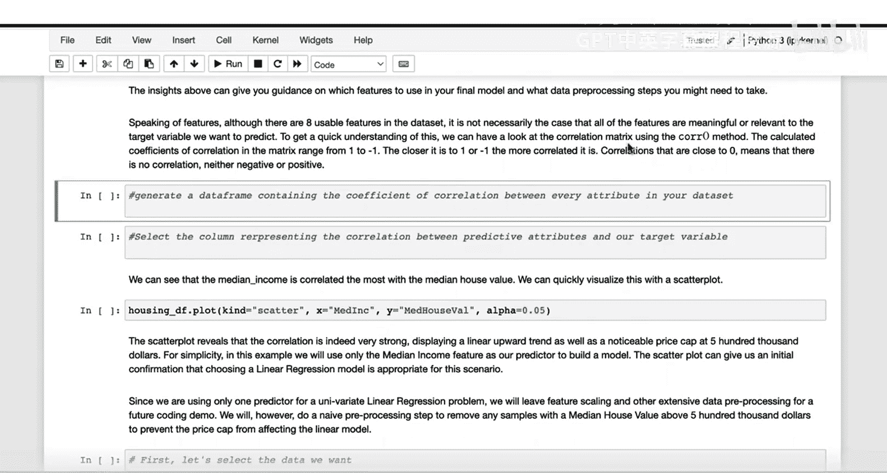

# 机器学习实战：1：数据加载与探索


在本节课中，我们将学习如何使用Python的Scikit-learn库加载加州房价数据集，并进行初步的数据探索，为后续构建线性回归模型做好准备。

## 数据加载

首先，我们需要加载数据。我们将直接从Scikit-learn库中获取加州房价数据集，而不是使用外部数据源。使用 `fetch_california_housing` 方法，并设置参数 `as_frame=True`，将数据加载为Pandas DataFrame格式。

```python
from sklearn.datasets import fetch_california_housing

california_housing = fetch_california_housing(as_frame=True)
```

数据加载完成后，我们将其存储在变量 `california_housing` 中。

## 数据集概览

接下来，我们查看数据集的描述信息，以了解其背景和结构。通过访问数据集的 `DESCR` 属性可以获取这些信息。

该数据集包含了加州各街区的房价汇总数据。总共有超过20000个样本，每个样本有8个数值型特征（作为预测变量）和1个数值型目标变量。目标变量代表了加州特定街区的房价中位数。

为了更具体地了解每个特征和目标变量的取值，我们查看DataFrame的前几行数据。我们从已获取的数据集中加载DataFrame。

```python
housing_df = california_housing.frame
print(housing_df.head())
```

输出将显示DataFrame的前五行。我们可以看到八个特征列，以及我们想要预测的目标列 `MedHouseVal`。所有属性都是数值型的。

## 问题定义

在初步查看数据后，我们来定义要解决的业务问题。基于给定的特征，我们希望构建一个**监督式机器学习模型**，使用**回归**方法来预测给定街区的房价中位数。

我们选择线性回归模型，原因如下：
*   **监督式模型**：因为我们拥有带标签的数据，即我们知道每个样本对应的房价中位数，可用于训练模型。
*   **回归任务**：因为我们的目标变量是连续数值，而非分类值。

## 深入数据探索

在训练模型之前，进一步探索数据总是有益的。这有助于处理异常值，并验证应用线性回归模型对此场景是否合理。

首先，我们使用 `info` 方法查看数据的基本信息。

```python
print(housing_df.info())
```

此方法显示每个特征的数据类型，以及每个特征中非空值的数量。空值对应数据集中的潜在缺失值。观察发现，这个数据集很“干净”：所有特征都是数值型（编码为浮点数），且没有缺失值。

接着，我们查看数据集中数值特征的统计摘要。这可以通过对DataFrame应用 `describe` 方法来实现。

```python
print(housing_df.describe())
```

这将显示每个特征的多个统计量，包括数量、均值、标准差、最小值、最大值和各分位数。通过这些统计量，我们可以轻松了解每个特征的分布情况，以及不同特征在尺度上的关系。

另一种有效的探索方式是绘制每个数值特征的直方图，以比较特征间的分布。直方图的纵轴代表实例数量，横轴代表数值范围。DataFrame有内置的直方图绘制方法。

```python
housing_df.hist(bins=50, figsize=(12, 8))
```

以下是绘制出的直方图。我们为每个特征以及目标变量都生成了直方图。

从这些图中，我们可以观察到几点：
1.  **特征尺度不一**：有些特征的值范围很大（例如0到15000），而有些特征的值范围较小（例如0到3000）。这可能导致模型在学习过程中过度偏重某些特征。为了防止这种情况，**特征缩放**是一种非常有用的预处理方法。
2.  **部分特征呈重尾分布**：这意味着数值在均值右侧的延伸比左侧更多。这可能使模型更难检测数据中的模式。
3.  **数值截断**：在“房价中位数”和“房龄中位数”中，可以注意到数值存在上限（例如，超过5的值都被记录为5）。根据你处理的具体问题，你可能希望或不希望模型学习到这种截断行为。

## 总结




本节课中，我们一起学习了如何加载加州房价数据集，并对其进行了初步探索。我们查看了数据的基本信息、统计摘要和分布直方图。这些探索为我们提供了重要洞察，例如特征尺度差异和分布形态，这将指导我们在后续步骤中决定使用哪些特征以及需要应用哪些数据预处理方法（如特征缩放），为成功构建线性回归模型奠定基础。