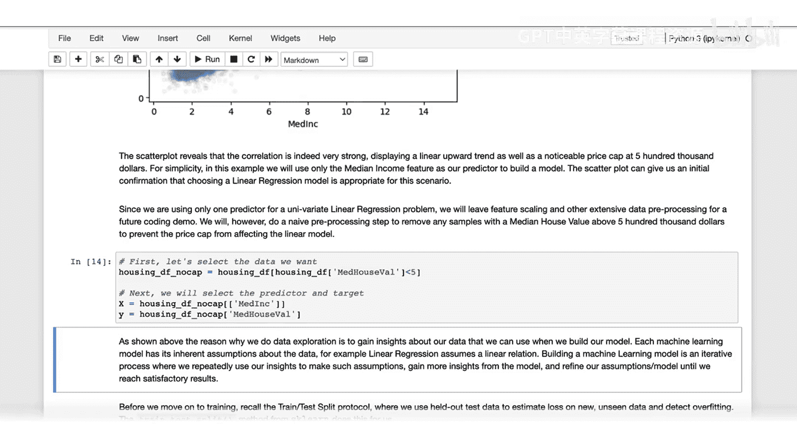

# uPenn《如何运用数据2、3（Python预测分析、数据可视化和叙事）｜How to Use Data》中英字幕 p08 7_编程演示：创建相关性矩阵.zh_en [BV1LqxEzcEBy_p8]

Speaking of features， although there are  eight useful features in the data set。

 it's not necessarily the case that all of the features are meaningful or relevant to the target value that we want to predict。

To get a quick understanding of this， let's take a look at the correlation matrix for the data frame。

The calculated correlation values of the matrix range from 1 to negative 1。

The closer it is to one or negative one， the more correlated it this correlations that are close to 0 mean that there is no correlation。

 Neither negative or positive。 So I'm going to create the correlation matrix using the data frames correlation method。

 take the data frame， apply the correlation method。So this gives us a new data frame。

 which represents the correlation matrix between every attribute。This is a lot of information。

So to drill down and get what we need， we can select the column representing the correlation between the predictive attributes and our target variable。

 median house value。So we'll do this by first selecting from the data frame from the correlation matrix。

 the column corresponding to median house value from the correlation matrix。

Let's look at the median house value column。We're going to sort the values in descending order。

So the first value here is the target variable itself。So we can ignore that for now。

 And the second value， median income has the highest correlation to our target value。

 And since it's positive， this indicates a positive correlation。

 We can also visualize this correlation using a scatter plot。

 So we'll plot the data points with x values representing median income。

 and y values representing our target variable。Go ahead and run this。

So the scatter plot does show that there is a linear correlation between the median income and median house value。

 And we can also see a price cap at 5， which represents $500000。

 This indicates that the data collected was capped down so that values exceeding 5 were set to 5 for simplicity in this example。

 we're only going to use the median income feature as a predictor to build our model。

 This scatter plot here can give us an initial confirmation that choosing a linear regression model is appropriate for the scenario。

 Since we're using only one predictor for univariate linear regression problem will leave feature scaling another extensive data preprocessing steps for a future coding demo。

 We will， however， do a naive preprocessing step to remove any samples with a median house value above 500000。

 This will prevent the price cap from affecting the linear model。

So we'll first select the data that we need， which is the data that falls below the 500。

000 price cap。We'll access this from our original data frame by giving a Boolean condition where the median house value is less than 5。

Once we select the data， we'll go ahead and select the predictor and target。

So here our predictor would be the median income， and we'll select this using double brackets to ensure that we get a data frame and not a series。

 We'll need our predictor values in a data frame when we build our model。And here we get our target。

Which is the median house value。As we showed earlier。

 the reason why we do data exploration is to gain insights about our data that we can use when we build our model。

 For example， linear regression assumes a linear relation。

 Building a machine learning model is an iterative process where we repeatedly use our insights to make such assumptions。

 gain more insights from the model and refine our assumptions and or model until we reach satisfactory results。

