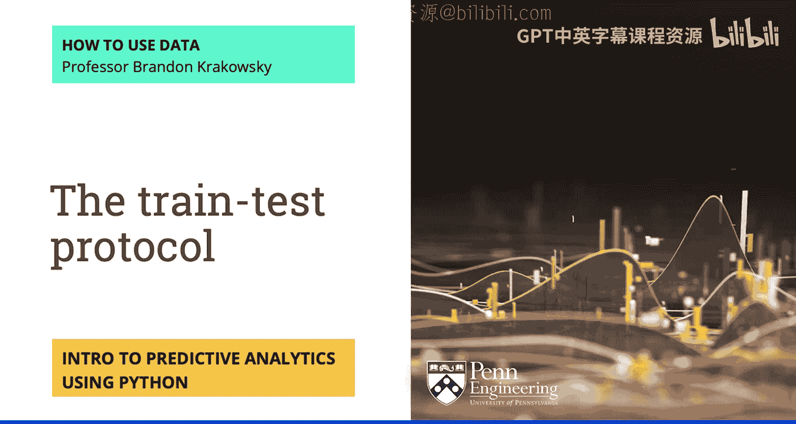
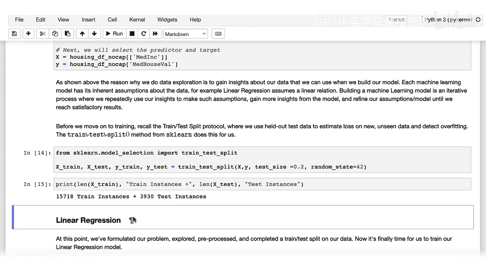

# uPenn《如何运用数据2、3（Python预测分析、数据可视化和叙事）｜How to Use Data》中英字幕 p09 8_编程演示：训练测试集划分.zh_en [BV1LqxEzcEBy_p9]

Before we move on to training， recall the train test split protocol where we use held out data to estimate loss on new unseen data and detect overfitting。

😡，The train test split method from S K learn does this for us from S K learn dot model selection。

 We'll import train test split， and we'll use this method to split our X and Y data with a test size of 。

2。 meaning that we set the size of our test set to be 20% of the original data set and will also give a random state seed of 42。

 This forces the function to generate the same train test split each time you run the code。

 And so our results can be reproduced with the same seed。

If we print the length of our training and test sets。

 we'll see over 15000 training samples and around 4000 testing samples。

