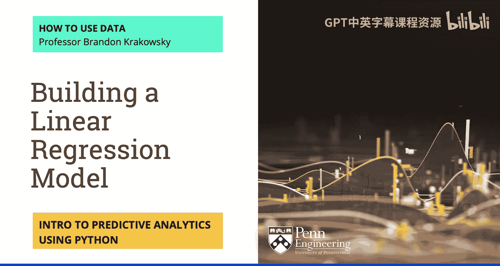
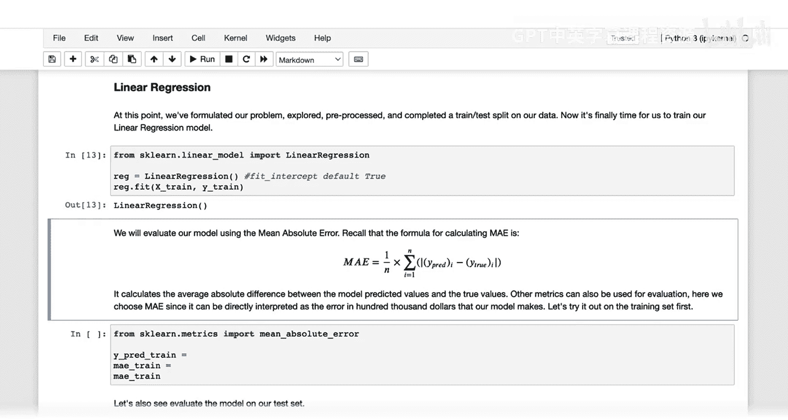

# uPenn《如何运用数据2、3（Python预测分析、数据可视化和叙事）｜How to Use Data》中英字幕 p10 9_编程演示：构建线性回归模型.zh_en [BV1LqxEzcEBy_p10]

At this point， we've formulated our problem， explored pre processing and completed a trained test split on the data。

 So we'll import linear regression from S K learn dot linear model。

 Then we'll initialize a linear regression using our import。

 here we can provide different arguments to change the settings of the model。

 One particular useful setting is fit intercept。 This specifies whether or not to calculate the intercept for the model。

 If you recall， the intercept is the point at which the line for the linear regression intersects the Y axis。

The default value for fit intercept is true， which means that the model will have an intercept and will try to lu that intercept during training。

For this problem， we'll keep the default setting the way it is。 Once we have our model initialized。

 we can fit the model to our training data using the fit method on X train。And why train。

After running this， we'll have a trained linear regression model on our training set。

 and we can move on to evaluate our model on both our training set and our test set。

