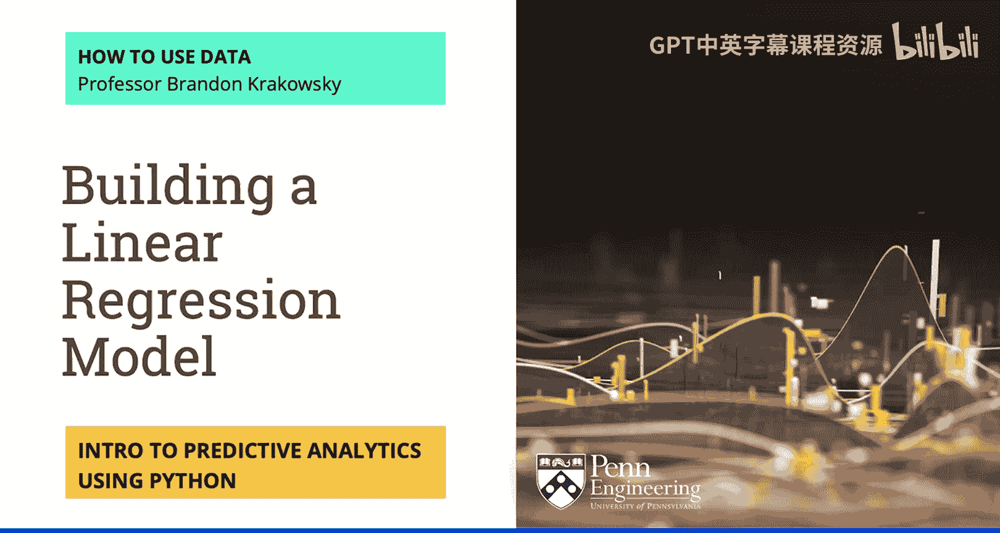
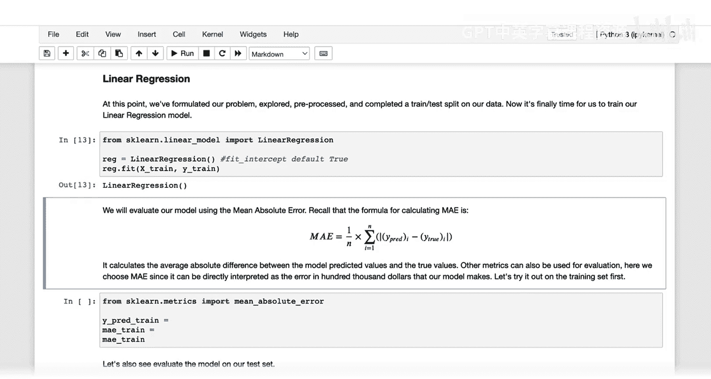

# 预测分析：P10：编程演示：构建线性回归模型 📊



在本节课中，我们将学习如何使用Python的Scikit-learn库来构建一个线性回归模型。我们将从导入必要的模块开始，初始化模型，然后使用训练数据来拟合模型。

---

上一节我们完成了数据的探索、预处理以及训练集与测试集的划分。本节中，我们来看看如何具体构建线性回归模型。

首先，我们需要从Scikit-learn库中导入线性回归模块。

```python
from sklearn.linear_model import LinearRegression
```

导入完成后，我们可以初始化一个线性回归模型。

```python
model = LinearRegression()
```

在初始化时，我们可以提供不同的参数来调整模型的设置。一个特别有用的参数是 `fit_intercept`。这个参数指定模型是否计算截距。

如果你还记得，**截距**是线性回归直线与Y轴相交的点。其公式为：
**y = β₀ + β₁x₁ + ... + βₙxₙ**
其中 **β₀** 就是截距。

`fit_intercept` 参数的默认值是 `True`，这意味着模型将包含一个截距项，并会在训练过程中尝试计算它。对于当前问题，我们将保持这个默认设置不变。

模型初始化后，我们就可以使用训练数据来拟合它。这通过调用模型的 `fit` 方法并传入训练特征 `X_train` 和训练目标 `y_train` 来完成。

```python
model.fit(X_train, y_train)
```

运行这行代码后，我们就得到了一个在训练集上训练完成的线性回归模型。

---

现在，我们已经成功地在训练数据上拟合了模型。接下来，我们就可以使用这个训练好的模型，分别在训练集和测试集上进行评估，以了解其性能。

---



本节课中我们一起学习了构建线性回归模型的关键步骤：导入模块、初始化模型、理解截距参数，以及使用训练数据拟合模型。这为后续评估模型性能奠定了基础。