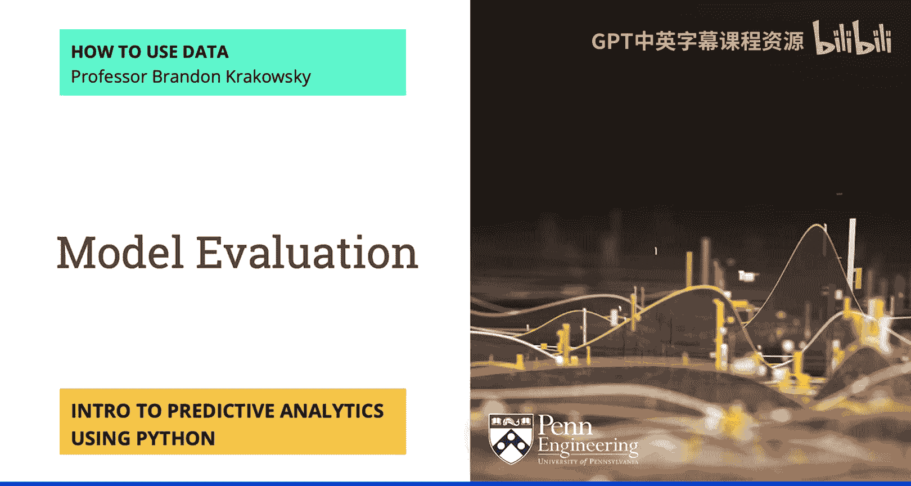
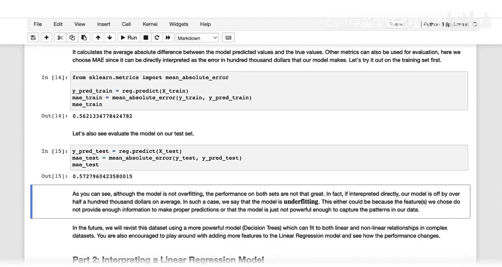

# uPenn《如何运用数据2、3（Python预测分析、数据可视化和叙事）｜How to Use Data》中英字幕 p11 10_编程演示：模型评估.zh_en [BV1LqxEzcEBy_p11]

Now， it's time to evaluate the model。 recall that there are multiple functions we can use to evaluate a linear regression model。

 One way is to calculate the mean squared error。 This calculates the average square difference between the predicted output and the desired output。

 and another ways to calculate the mean absolute error。

 This calculates the average of the sum of absolute differences between the predicted values and the actual values。

 Here， we're choosing mean absolute error since it can be directly interpreted as the error in hundred000 that our model makes for this particular problem。

 As noted， other metrics could be used。Let's try it on the training set。 So first。

 we're importing mean absolute error from S K learn dot metrics。

 Then we'll retrieve the predictions from our training set using the predict function。

Take the linear regression model that we fitted， call predict pass X train。

This gives us the why predictions for the training set。

 Then we'll use the mean absolute error function and provide the true values， which is why train。

And the predicted values， which we just retrieved for evaluation。If we run this。

 we'll see that we have an MAe of approximately 0。56 on the training set。

So let's repeat this process of the test set。So here we're going to predict on X test instead of xtrain。

This gives us the why predictions on the test data。

And then we use mean absolute error and pass in the true value Y test and our predicted value。

If we run this， we can see that we have an MAE of approximately 。57 on the test set。

So as you can see， although the model is not overfitting。

 the performance on both dataset sets is not that great。 In fact， if interpreted directly。

 our model is off by over half of 100000 on average， In such a case。

 we could say that the model is underfitting。 This could either be because the features we chose don't provide enough information to make proper predictions or that the model is just not powerful enough to capture the patterns in the data In the future。

 will revisit this data set using a more powerful model， decision trees。

 which can fit to both linear and nonlinear relationships in complex data sets。

You're also encouraged to play around with adding more features in this linear regression model and see how the performance changes。

