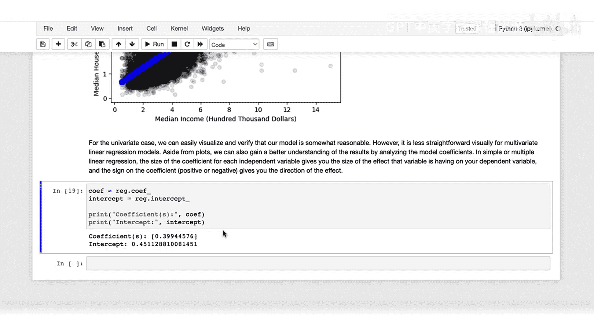

# uPenn《如何运用数据2、3（Python预测分析、数据可视化和叙事）｜How to Use Data》中英字幕 p12 11_编程演示：线性回归模型解读.zh_en [BV1LqxEzcEBy_p12]

Previously， we trained our linear regression model with median income as predictor and median house value as the target and evaluated the model using Me。

 Now， let's take a closer look at the results and what they imply。 First。

 let's plot the trained model on top of our entire data set。

 We'll use the Matteplotlib library for plotting。 So here we're importing the Matplot Lib library。😊。

Then we're scattering our original data set with X and Y。

 We're also scattering in blue the trained model where we have x trained as the x values and the predicted y values as the y values。

Once we run this in this plot， we'll see that we have a blue line corresponding to the predicted model that's being plotted over the original data set。

 which is represented as black dots。For the Uniivevaria case。

 we can easily visualize and verify that our model is somewhat reasonable。

 So here we do have a positive correlation， which is consistent with the trend in the original dataset set。

 However， it is less straightforward visually for multivariate linear regression models。

 Aside from plots， we can also gain a better understanding of the result by analyzing the model coefficients。

 in a simple or multivariate linear regression。 The size of the coefficient for each independent variable。

 gives you the size of the effect of that variable on your target variable。

 and the size of the coefficient， which is either positive or negative。

 gives you the direction of that effect。😊，So here， let's observe the coefficient and intercepts from the learn model。

We can fetch that by retrieving the corresponding attributes for coefficient。An intercept。

Priinnting these out， you'll notice that we have a positive coefficient of almost 04。 In this case。

 this represents the degree of increase in median house value for every unit increase of median income。

 So if median income increases by $100000， median house value increases by almost 04 times $100000。

 And for the intercept at about 。45 is a constant value with units and 100000。

 this corresponds to the estimated median house value for a0 median income。

 So this could also be interpreted as the base value for median house value， about 45000。

