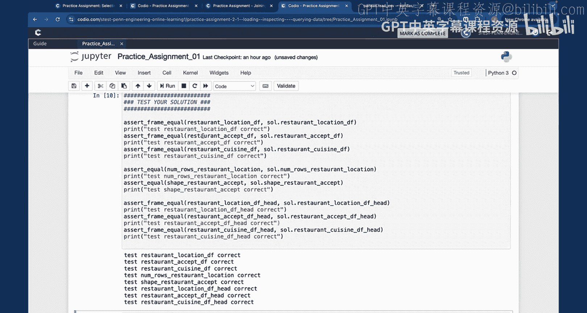
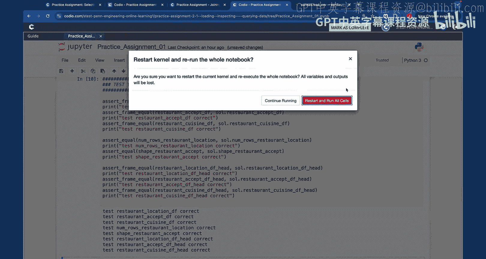
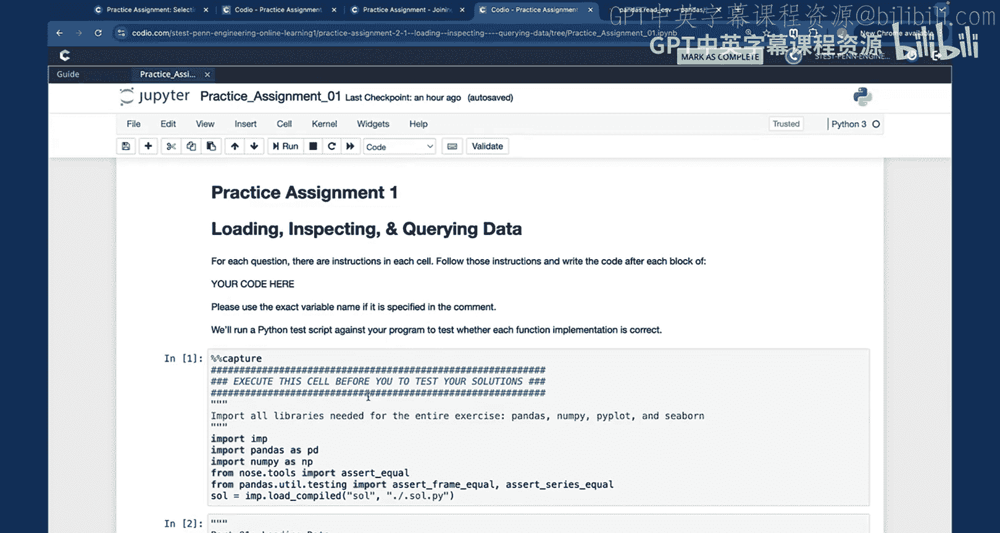

# uPenn《如何运用数据2、3（Python预测分析、数据可视化和叙事）｜How to Use Data》中英字幕 p13 12_Codio演示：Jupyter Notebook.zh_en [BV1LqxEzcEBy_p13]

Welcome to this walk through on how to work with assignments in Kodio for this course。

 Kodio is an excellent online platform that provides you with pre installed environments to run your code seamlessly。

 No matter if you're on Mac， Windows or Linux。😊，What you see here is a homework assignment that requires Jupiter notebook。

If you wish， you can follow along with the Jupiter notebook instructions on this page。

 Sc down and follow the detailed assignment instructions in the P D F provided。

 Sc down and check the check box at the bottom。 If this is your first time。

 enter your legal name and click， La app。 the setup typically takes 20 seconds to a minute。

 If nothing happens， refresh the page。on launching。

 you'll see a guide page with additional instructions。 Open the notebook from the page。

The coial environment is preconfigured for you。Run the first cell by pressing shift and enter or shift in return on a Mac。

 This imports all the libraries needed for the entire exercise。 in addition to the solution。

Questions are listed step by step。 Follow them carefully。

 write code to answer the questions and insert where it says your code here。

Execute each cell sequentially。Test cells compare your variables with the solution variables stored in the environment。

 You shift enter to validate your variables。 You'll see the results of each test below the cell。

Here's some information about troubleshooting common errors for loading data files。

 Check the file path in your code。 If it's incorrect， you'll get a file not found error。

Here's the error here。 The file does not exist。 Here you can see a reference to the line of code that caused the error。

To fix the error， fix the file path in your code。Here's the line of code here。

Use resources like the official pandas documentation to understand function parameters。 For example。

 for the read CSV function， you can see more information here。

And you can see more specific information about the file path parameter here。

Let's fix the file path here。And if we rerun the code in the cell。

 we no longer get the file not found ever。If your code runs， but returns incorrect results。

 compare your logic with the project requirements。 Review variables and calculations to ensure accuracy。

 What if we stored incorrect information in this variable by getting the length of the wrong data frame。

 So instead of getting the length of the restaurant location D F。

 we get the location of the restaurant except D F。So now， if I rerun my code in this cell。

 I don't get any errors per se。But then if I rerun the test for the code in that cell。

 you can see that I get an assertion error。 Here's a reference to the specific test that's failing right here。

The assert is comparing my Nm rose restaurant location with the solution。

 Nm rose restaurant location。 These are not equal。 And here's the actual code for that test。

 comparing my Nm rose restaurant location with the solution。 Nm rose restaurant location。

 Let's go ahead and scroll up and fix our code。 and get the length of the correct data frame。

 which is the restaurant location D F。 and then rerun our tests。

 And you can see that we pass everything。Before submission。

 reset the kernel and run all cells sequentially using kernel， restart and run all。

Validate your notebook。If all tests pass， mark your assignment as complete。By following these steps。

 you'll smoothly complete your assignments in codeio and Jupiter Note book。

 If you encounter challenges， refer back to this guide or consult the course materials。

 happy coding and good luck。

