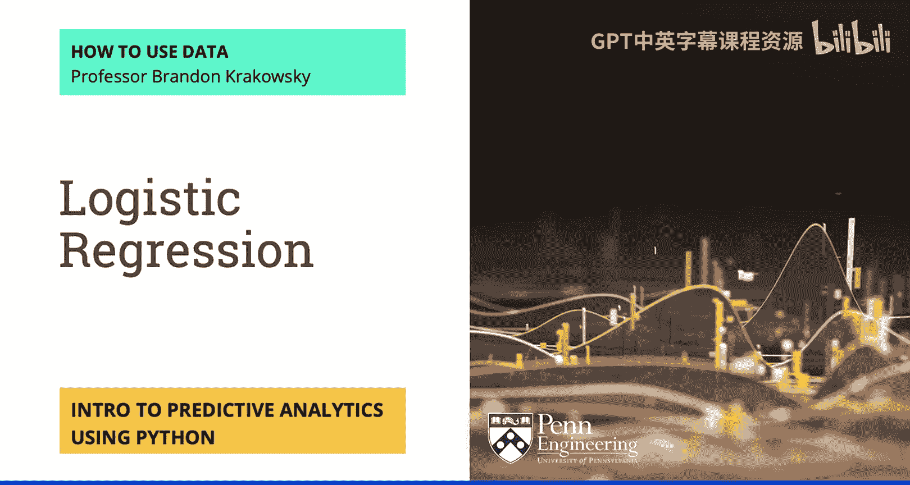
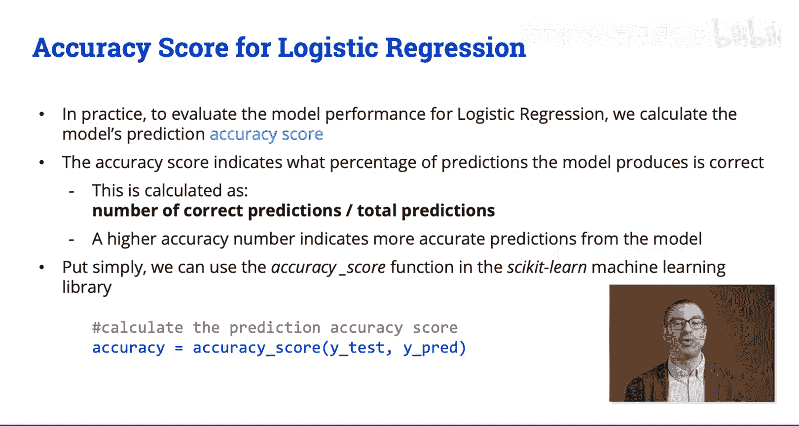

# uPenn《如何运用数据2、3（Python预测分析、数据可视化和叙事）｜How to Use Data》中英字幕 p14 13_逻辑回归.zh_en [BV1LqxEzcEBy_p14]

Regression refers to the task of predicting a continuous numerical value as the output variable。

 The goal is to model the relationship between the input variables and the output variable。

 The predicted value is real and can take any value within range。 For example。

 predicting the age of a customer or the price of a house are regression problems。Classification。

 on the other hand， involves assigning input variables to predefined categories or classes。

 The output variable is discrete and represents a class label。

 The goal is to learn a decision boundary that separates different classes based on the input features。

 For example， classificationifying emails as spam or not spam or predicting whether a tumor is benign or malignant are classification problems。

Linear regression and logistic regression both learn a line in linear regression。

 This line is used to predict real target values within a range。 In logistic regression。

 it defines a boundary that separates different categories or classes。

How is the decision boundary determined in logistic regression In simple terms。

 logistic regression uses a logistic function， also called a sigmoid function to map the output to a value between 0 and 1。

 representing the probability of belonging to a certain class。How does it work？

The sigmoid function takes an input value and transforms it into a smooth S shaped curve。

 The curve starts at 0 when the input is negative and approaches one as the input becomes positive。

 At the midpoint， input value of 0， the sigmoid function evaluates to 0。

5 built upon the logistic function， the logistic regression model calculates the probability of a given output belonging to a particular class。

 So if the probability of class 1 is greater than 05。

 we can be confident enough to predict the output class to be class 1。 Otherwise， class 0。

The decision boundary between classes is， in fact， the line at the midpoint of the S shaped curve where the endpoint value is 0 and the sigoid function evaluates to 0。

5。 In practice to evaluate the model performance for logistic regression。

 we calculate the model's prediction accuracy score。

 The accuracy score indicates what percentage of predictions the model produces is correct。

This is calculated as the number of correct predictions divided by the total predictions。

 A higher accuracy number indicates more accurate predictions from the model put simply。

 we can use the accuracy score function in the S kit learning machine learning library。😡。

