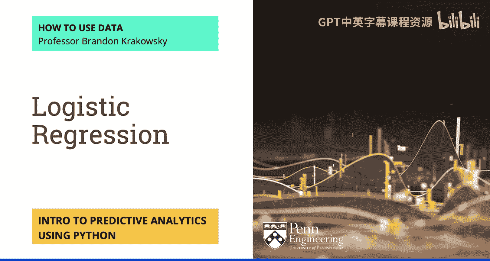
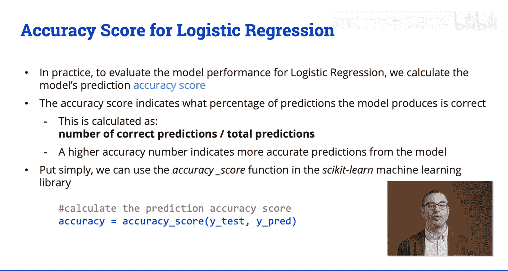

**机器学习基础：第14章：逻辑回归**

在本节课中，我们将学习逻辑回归，这是一种用于解决分类问题的强大算法。我们将了解它与线性回归的区别，并深入探讨其核心工作原理。

---

在上一节中，我们介绍了回归任务。本节中，我们来看看分类任务，并聚焦于逻辑回归这一核心分类算法。

**回归** 的任务是预测一个连续的数值作为输出变量。目标是建模输入变量和输出变量之间的关系。预测值是实数，可以在一定范围内取任意值。例如，预测客户的年龄或房屋的价格都属于回归问题。

**分类** 则涉及将输入变量分配到预定义的类别或类中。输出变量是离散的，代表一个类别标签。目标是学习一个基于输入特征来区分不同类别的决策边界。例如，将电子邮件分类为垃圾邮件或非垃圾邮件，或预测肿瘤是良性还是恶性，都属于分类问题。

线性回归和逻辑回归都学习一条直线。在线性回归中，这条直线用于预测一定范围内的真实目标值。在逻辑回归中，它定义了一个用于分隔不同类别或类的边界。

---

那么，逻辑回归中的决策边界是如何确定的呢？简单来说，逻辑回归使用一个逻辑函数，也称为Sigmoid函数，将输出映射到0到1之间的值，代表属于某个特定类别的概率。

以下是其工作原理：

Sigmoid函数接收一个输入值，并将其转换为平滑的S形曲线。当输入为负值时，曲线从0开始；随着输入变为正值，曲线趋近于1。在中点，即输入值为0时，Sigmoid函数的取值为0.5。

基于逻辑函数，逻辑回归模型计算给定输出属于特定类别的概率。因此，如果类别1的概率大于0.5，我们就可以足够自信地预测输出类别为类别1。否则，预测为类别0。

类别之间的决策边界，实际上就是S形曲线中点的连线，该点处的函数值为0.5。

---

在实践中，为了评估逻辑回归的模型性能，我们计算模型的预测准确率分数。准确率分数表示模型产生的预测中有百分之多少是正确的。

其计算公式为：**准确率 = 正确预测的数量 / 总预测数量**。更高的准确率数值表明模型的预测更准确。

简而言之，我们可以使用Scikit-learn机器学习库中的准确率评分函数。

---

本节课中，我们一起学习了逻辑回归。我们明确了回归与分类的区别，理解了逻辑回归如何利用Sigmoid函数将线性输出转换为概率，并基于此概率设定决策边界来进行分类预测。最后，我们介绍了使用准确率作为评估分类模型性能的基本指标。