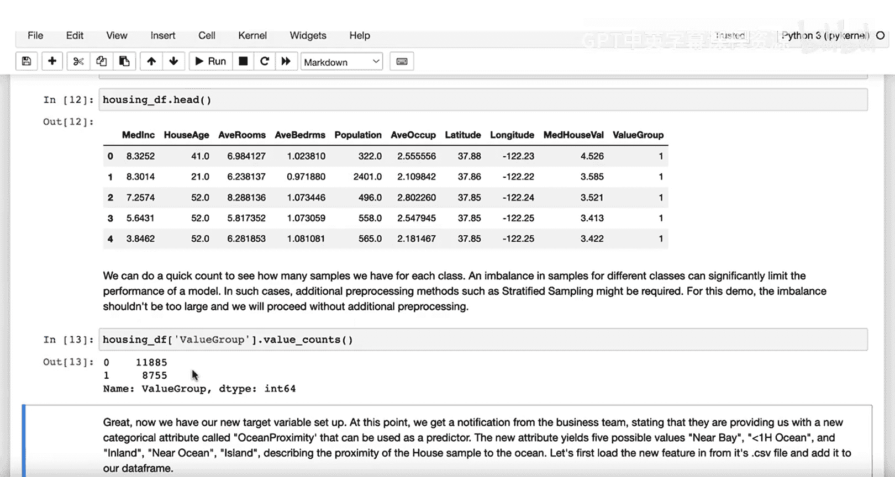

# uPenn《如何运用数据2、3（Python预测分析、数据可视化和叙事）｜How to Use Data》中英字幕 p15 14_编程演示：创建分类属性.zh_en [BV1LqxEzcEBy_p15]

Yeah。Recall the California housing data set we used in the linear regression demo in this coding example。

 we'll continue to use this dataset set to analyze the application of the logistic regression model。

 First off， we'll load the data set and get everything set up where we left off。

 Re that this data set contained aggregated data regarding housing values in districts in California。

 There were 8 numeric features and one numeric target called median house value。

Let's assume that after some discussion， the business team decides that they're no longer interested in predicting a numerical median house value。

 but instead would like to predict which of two value groups does the House sample fall into。

 after such an adjustment。 The problem can be formulated as a supervised binary classification problem。

 Let's create a new column called value group in our data set。

 This will represent the new class label。Value group is going to be a categorical attribute。

 Here will encode the groups low and high as 0 and 1， respectively。So when we create the new column。

 we'll first initialize all the values to 0， indicating the low class。Now。

 we'll use boolean conditions to find the sample， satisfying the conditions for the second class。

 which is samples with median house values higher than two。 and we'll set their class labels to one。

 Here， we're going to use the locate method。 This allows you to access specific rows in columns by specifying a boolean array or column labels。

 In this case， we're going to use both。 So first， we'll pass our condition to select the row samples。

So this condition looks for samples where the median house value is greater than or equal to 2。

 And we're also going to specify a column that we want to access in this case， value group。

 So for that column from those specific rows， we're going to set the value to one。

 If we run that and then view the first five rows， we can see that there's now a value group column and the value set to one for any row where the median house value is greater than  two。

 which means greater than $200000。 We could do a quick count to see how many samples we have for each class。

 In imbalance and samples for different classes could greatly limit the performance of a model。

 In such cases， additional pre processings methods such as stratified sampling。

 might be required for this example， the imbalance shouldn't be too large and we' proceed without additional pre processing。

😊，So now let's check to see how many unique values we have for each group。

We'll use the value counts method。So we have two class labels，0 and1。

 Each class label has close to 10，000 samples， so there's not a huge imbalance between the class labels。

