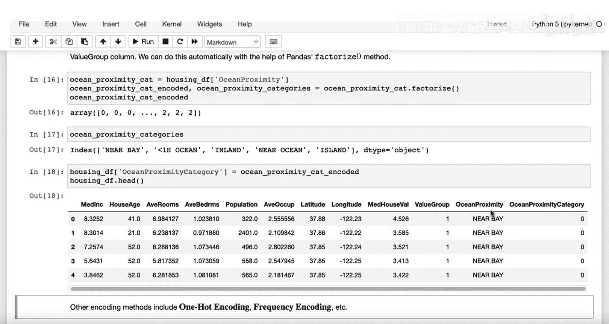

# uPenn《如何运用数据2、3（Python预测分析、数据可视化和叙事）｜How to Use Data》中英字幕 p16 15_编程演示：整合新数据.zh_en [BV1LqxEzcEBy_p16]

Now that we have a new variable set up， we get notification from the business team stating that they're providing us with a new categorical attribute called ocean proximity that can be used as a predictor。

 The new attribute yields five possible values， describing the proximity of the house sample to the ocean。

 Let's first load the new feature in from its CV file and add it to our data frame。

 So we'll read the CV file directly using pandas。 And here we'll see that for each sample。

 itll have a label determining its proximity to the ocean。😊。

And we want to add this to our original data frame so we can create a new column called ocean proximity。

And we'll set this new column to be a copy of the data frame that we just read from the CSV file。

 We can do a quick check of the info on this data frame after we've added the new feature。

You'll notice that although there aren't any missing values。

 we currently have string values for our new categorical attribute， ocean proximity。 As humans。

 we can interpret these strings quite easily。 However。

 machine learning models work with numerical data。 Hence。

 we need an additional step to convert the categorical feature into numerical values。

One option is to use integer encoding， also known as label encoding or ordinal encoding。

 This is similar to what was manually done to construct the value group column。

 We can also do this automatically with the help of panda's factorized method。

So here we'll first select the ocean proximity column from our data set。

 put that in a variable ocean proximity cat。Then we'll apply the factorized method on this column。

Ocean。😔，Proximity， cat， dot factorized。This will return the encoded values for this feature。

 as well as the categories available used to encode the features。

 so we can first check what the encoded values look like。 so they should be integers。 Here。

 we're only seeing 0 and 2。 but to get a better understanding， we can next check the categories。

 So there should be a total of five categories， meaning that we'll have numerical labels or integer labels from 0 to 4。

 So 0，1，2，3，4。 So let's add this encoded attribute back into our data frame。

We'll create a new column called Ocean proximity category。

Instead set it using the encoded values that we obtain from factorize。That's ocean。Proximity。

Cat encoded。And we could check the first few samples in our data frame again。

So now we have a categorical value group。 We also have a categorical attribute ocean proximity category corresponding to the string values in the new feature that we got for reference。

Other encoded methods include one hot encoding， frequency encoding， et cetera。

 You can choose the encoding method based on your specific business problem。

