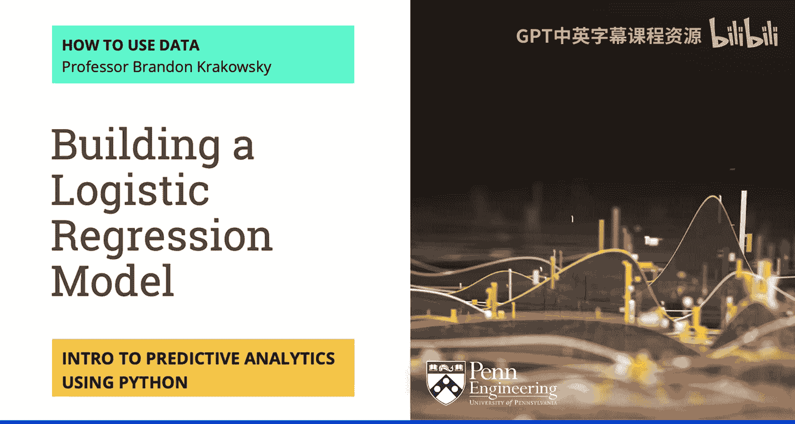
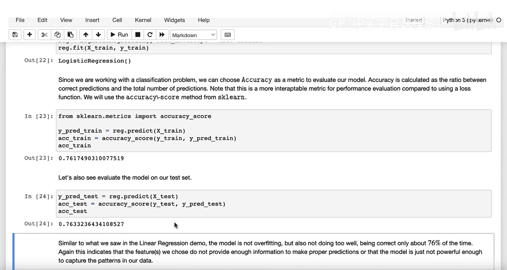

# uPenn《如何运用数据2、3（Python预测分析、数据可视化和叙事）｜How to Use Data》中英字幕 p17 16_编程演示：构建逻辑回归模型.zh_en [BV1LqxEzcEBy_p17]

For this demo， let's train a logistic regression model to predict the value group using two features。

 median income without any capping and ocean proximity。 Let's first extract the data that we need。

So for our predictors， we have two features。 The first is the median income。

Second is the newly constructed categorical feature， ocean proximity category。 And for our target。

 we'll be using our newly constructed categorical target variable value group。As we saw before。

 we need to apply the train test split protocol on our data set before we train。

So let's use the train test split method from SK learnn。Again， we'll pass in our X and Y's。

And will set the same test size。 So still 20 per of the original data set and will give a random state in order to reproduce the results。

And if we check， we'll have around 16000 training instances and 4000 testing instances after we've completed the split。

 Now we can train our model。 We've imported the logistic regression model from S K learnn。

 Now we'll initialize the model Again， during initialization。

 you can pass in various parameters to change any settings in this model here。

 similar to the linear regression model。There's an argument called fit intercept。

That you can change that determines whether or not the decision boundary you're trying to learn has an intercept term。

By default， this is set to true。 and again， will'll keep the default settings。

 Once the model is initialized， we'll fit the model on our training data by passing in the X train and Y train。

Now， we have a trained logistic regression model。 since we're working on a classification problem。

 we can choose accuracy as a metric to evaluate our model。

 Acacy is calculated as the ratio between correct predictions and the total number of predictions。

Note that this is a more interpretable metric for performance evaluation compared to using a loss function。

 We'll use the accuracy score method from SK learn to do the calculation。

Now we'll fetch the predictions on our training sets and we'll pass the predictions and our true values into the accuracy score method。

 So we'll pass the Y training set and the Y predicted training set。

This will get an accuracy of about 76% on the training set。We'll do the same for the test set。

 So we predict for the testing samples， and then we'll evaluate the accuracy between the true test labels and the predicted test labels。

 So we pass the Y testing set。And then the Y predicted testing set。

And then we can check the accuracy， which is also about 76%。

 similar to what we saw in the linear regression demo， the model is not overfitting。

 but also not doing too well being correct， only about 76% of the time。 Again。

 this indicates that the features that we chose do not provide enough information to make proper predictions or that the model is not powerful enough to capture the patterns in our data。

