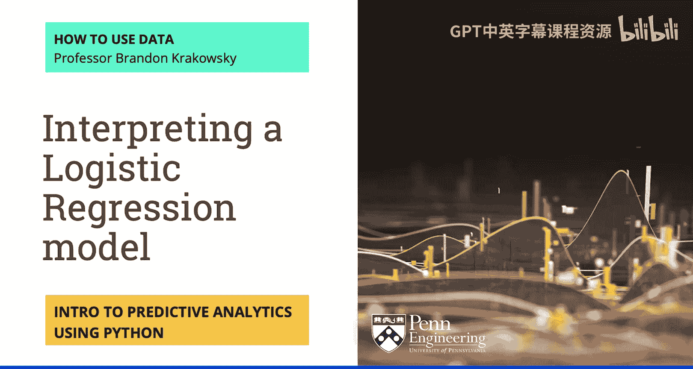
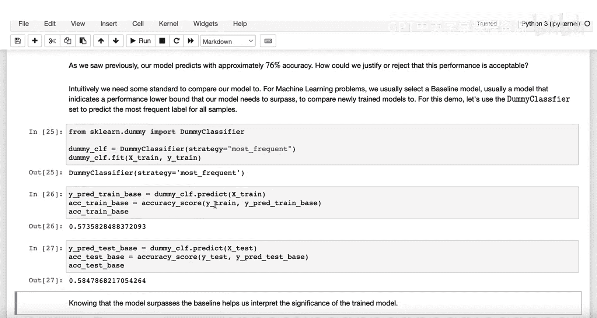

# uPenn《如何运用数据2、3（Python预测分析、数据可视化和叙事）｜How to Use Data》中英字幕 p18 17_编程演示：逻辑回归模型解读.zh_en [BV1LqxEzcEBy_p18]

As we saw， our model predicts with approximately 76% accuracy。

 How can we justify or reject that this performance is acceptable？ Intuitively。

 we need some standard to compare our model to for machine learning problems。

 we usually select a baseline model， usually a model that indicates a performance lower bound that our model needs to surpass to compare newly trained models。

 to。For this demo， let's use the dummy classifiers set to predict the most frequent label for all samples。

 We'll import the dummy classifier from S K learnn， and then we'll initialize the dummy classifier。

 And this type of classifier basically classifies the given data using some kind of simple rules Here well pass in a setting called strategy。

 determining how this classifier functions and will set the strategy to be most frequent。

Meaning that the classifier will just predict the most frequent label that it's trained on for all samples。

And then we'll train this dummy classifier on our training data。

Now let's check the performance of this baseline on both the training set and the test set。

Similar to before， we first make predictions on the training samples。

 we'll take the dummy classifier and make predictions based on the given training set。

Then we compare our predicted labels with that of the true labels for our training set。

And we can check the accuracy， which is about 57% on the training set。

So then let's make predictions based on the test set。Then we'll check the accuracy。

 give it the actual labels and the predicted labels。We'll get an accuracy score of about 58%。

 so this shows that our model does indeed surpass this baseline。

 which helps us interpret the significance of the learn model。

