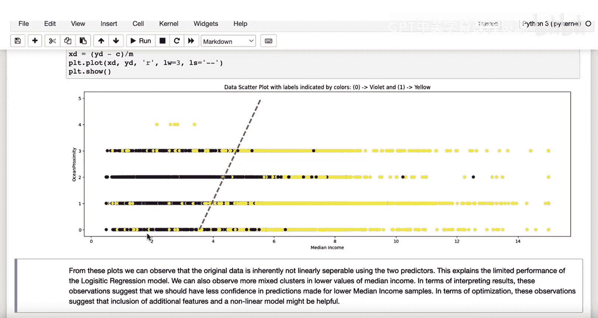

# uPenn《如何运用数据2、3（Python预测分析、数据可视化和叙事）｜How to Use Data》中英字幕 p19 18_编程演示：可视化决策边界.zh_en [BV1LqxEzcEBy_p19]

Since we have a binary classification problem using only two features for this demo。

 we can visualize a learned decision boundary using matte plotlib。

 Note that since one of the features is categorical。

 the scatter plot will look like a set of horizontal lines。

 So here we're scattering the median income and ocean proximity category features for each of the samples。

 And then we're labeling the classes with different colors with 0 being violet and class 1 being yellow。

 So for each set of median income and ocean proximity values。

 we see the median house value class label 0 or one or violet or yellow。 Now。

 let's plot the learned decision boundary on top of the scatter plot。

 So we have our scatter plot here。 Ex as we've done before。

 And we want to find and plot the decision boundary。 to do so。

 We'll first fetch the intercept term from our trained classifier。

 And we'll fetch the weights for each of the features from our classifier as well。😊。

Here we're calculating the intercept and gradient of the decision boundary。

 and then here we're going to plot the data and the classification with the decision boundary。

Shown in this plot， we have the red line as our decision boundary。Above the decision boundary。

 we have one class and below we have another class。

That the original data is inherently not linearly separable using the two predictors。

 This explains a limited performance of the logistic regression model。

 We can also observe more mixed clusters in lower values of media income。

 In terms of interpreting results， These observations suggest that we would have less confidence in predictions made for lower and median income samples in terms of observations。

 These observations suggest that inclusion of additional features and a nonlinear model might be helpful。

