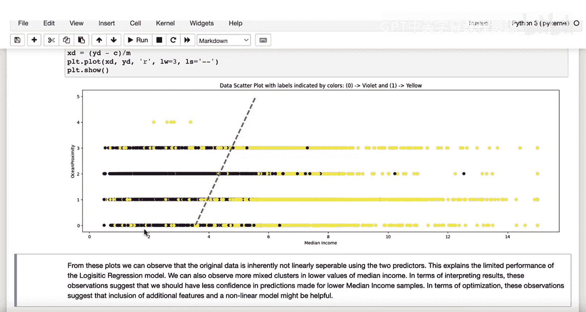

# 数据科学实战：第19讲：可视化决策边界 📊


在本节课中，我们将学习如何为一个二元分类问题可视化决策边界。我们将使用两个特征（一个数值型，一个分类型）来绘制数据点，并展示逻辑回归模型学习到的线性决策边界。通过这个过程，我们可以直观地评估模型的性能与局限性。

---

上一节我们介绍了逻辑回归模型的基础。本节中，我们来看看如何将模型学习到的决策边界进行可视化。

由于本演示中使用的是一个二元分类问题，并且仅使用了两个特征，因此我们可以使用Matplotlib库来可视化学习到的决策边界。需要注意的是，由于其中一个特征是分类型，散点图看起来会像一组水平线。

以下是绘制数据点的步骤：

*   我们为每个样本绘制了“收入中位数”和“离海距离类别”这两个特征的散点图。
*   然后，我们使用不同颜色为类别标签上色，其中类别0（紫色）和类别1（黄色）。
*   对于每一组“收入中位数”和“离海距离”的值，我们可以看到对应的“房价中位数”类别标签（0或1，即紫色或黄色）。

现在，让我们在散点图之上绘制学习到的决策边界。

我们首先需要从训练好的分类器中获取必要的参数。以下是计算并绘制决策边界的关键步骤：

*   **获取截距和权重**：我们从分类器中获取截距项以及每个特征的权重。
    ```python
    intercept = classifier.intercept_
    weights = classifier.coef_
    ```
*   **计算决策边界**：利用截距和权重，我们可以计算出决策边界的直线方程。
*   **绘制图形**：我们将数据点和分类结果与决策边界一起绘制出来。

在此图中，红线代表我们的决策边界。在决策边界之上，我们有一个类别；在决策边界之下，我们有另一个类别。

原始数据本身无法仅使用这两个预测变量进行线性分离。这解释了逻辑回归模型性能有限的原因。

我们还可以观察到，在收入中位数较低的区域，数据点的类别混合更为明显。

从结果解释的角度来看，这些观察表明，对于中低收入样本的预测，我们的置信度会较低。

这些观察结果暗示，引入更多特征或使用非线性模型可能会有所帮助。

---



本节课中，我们一起学习了如何可视化逻辑回归的决策边界。我们通过绘制特征散点图并叠加决策边界直线，直观地理解了模型如何进行二元分类，并分析了模型在特定数据分布下的局限性，例如线性不可分问题以及低特征值区域的预测不确定性。这为后续考虑使用更复杂的模型或特征工程提供了直观依据。