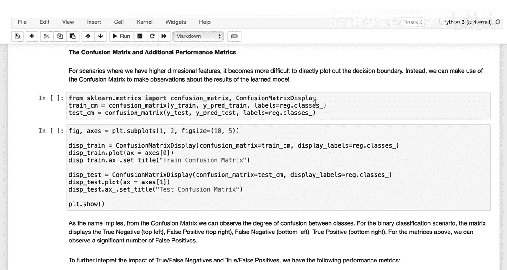
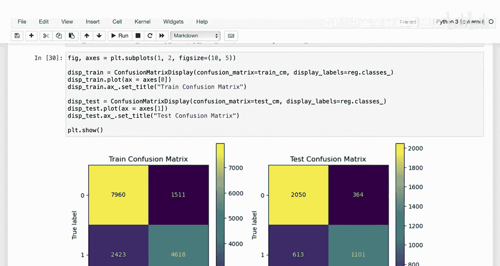
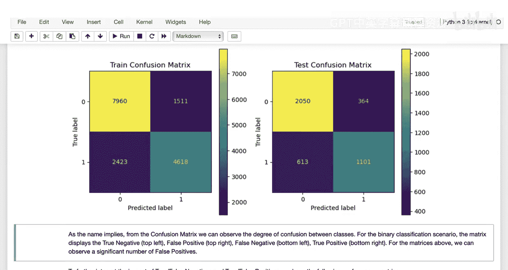
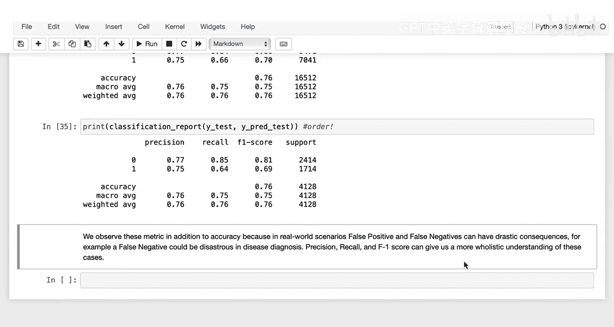

# uPenn《如何运用数据2、3（Python预测分析、数据可视化和叙事）｜How to Use Data》中英字幕 p20 19_编程演示：创建混淆矩阵.zh_en [BV1LqxEzcEBy_p20]

For scenarios where we have higher dimensional features。

 it becomes more difficult to directly plot the decision boundary。 Instead。

 we can make use of the confusion matrix to make observations about the results of the learn model。

 A confusion matrix basically summarizes predictions in matrix form。 So first。

 we'll import confusion matrix from S K learn and will construct the confusion matrix for both the training set and test set。

So for the training set， we'll pass in the predicted training values。The true training values。

As well as the names of the labels will retrieve from the class's attribute in our classifier。

We'll do the same thing for the test confusion matrix。

Except we're passing in the predicted test labels。The true test labels and also the same classes。

 Once we have this constructor， we can plot the confusion matrix using the method confusion matrix display。

This will show a more visualized version of the confusion matrix。

 where we have the number of samples for each case between true values。

And predicted values as the name implies， the confusion matrix observes the degree of confusion between the classes so we can see which cases we make more incorrect predictions and in which cases we're doing better and making accurate predictions for the binary classification scenario。

 the matrix displays the true negative。False positive。

 false negative and true positive in this order for the matrices above。

 we can observe that for both the test case and the training case。

 there is a significant number of false positives。 So that would be in the top right corner。

 This indicates that we're mistakenly predicting a lot of samples that should be labeled as 0 as one instead。

 to further interpret the impact of true false negatives and true false positives。

 We have the following performance metrics， precisionciion。

 which is the percentage of correct positive predictions relative to total positive predictions。

 recall， which is the percentage of correct positive predictions relative to total actual positives and F1。

 which is a mean of the two。😊。

These metrics can be accessed using the classification report method from S K Learnn。

 So here we've imported this， and we're printing out the classification report for the training case and the testing case。

 We could see we have a precision of about 76%。 recall of about 75，76%。 And on average。

 all these values are about 75 or 76% for both the training and the testing sets。

We observe these metrics in addition to accuracy because in real world scenarios。

 false positives and false negatives can have drastic consequences。 For example。

 a false negative could be disastrous in a diseased diagnosis。 Precision， recall。

 and F1 score can give us a more holistic understanding of these cases。

