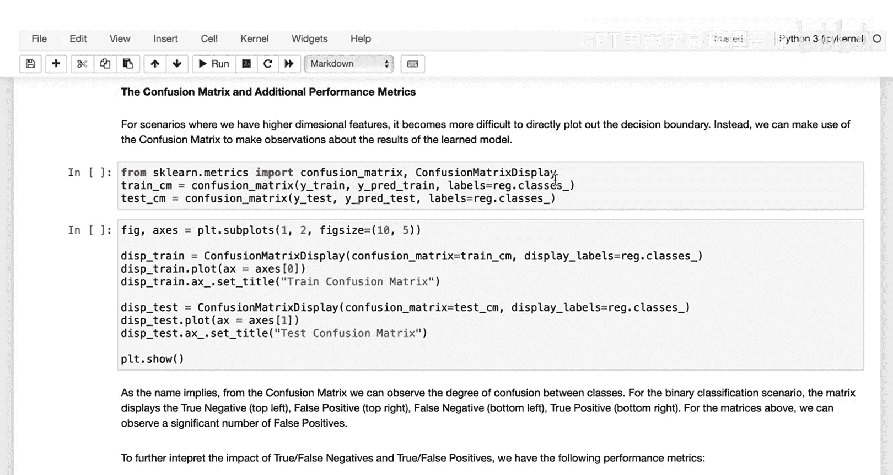
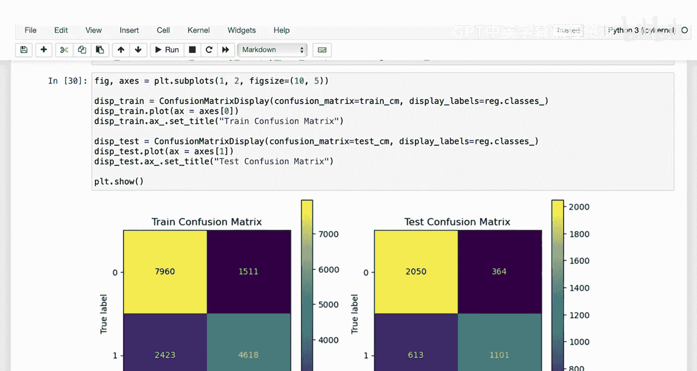
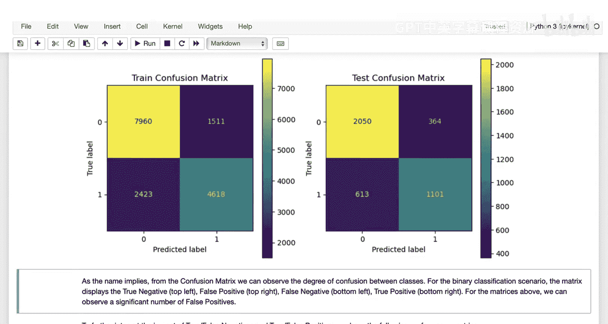
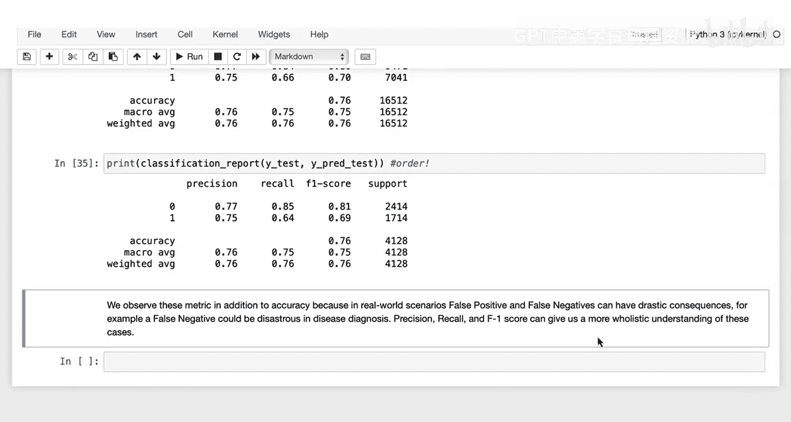

# 机器学习实战：第20章：创建混淆矩阵 📊


在本节课中，我们将学习如何创建和解读混淆矩阵。当我们的模型特征维度较高，难以直接可视化决策边界时，混淆矩阵是一个强大的工具，可以帮助我们直观地评估分类模型的预测结果。

## 混淆矩阵简介

上一节我们介绍了高维数据的可视化难题。本节中我们来看看如何利用混淆矩阵来观察学习模型的结果。

混淆矩阵以矩阵形式总结预测结果。首先，我们需要从Scikit-learn库中导入相关模块，并为训练集和测试集分别构建混淆矩阵。

以下是构建训练集混淆矩阵的步骤：
```python
from sklearn.metrics import confusion_matrix, ConfusionMatrixDisplay

# 构建训练集混淆矩阵
train_conf_matrix = confusion_matrix(y_train_true, y_train_pred, labels=classifier.classes_)
```

对于测试集，我们执行类似的操作，但传入测试集的真实标签和预测标签：
```python
# 构建测试集混淆矩阵
test_conf_matrix = confusion_matrix(y_test_true, y_test_pred, labels=classifier.classes_)
```



## 可视化混淆矩阵



构造好混淆矩阵后，我们可以使用`ConfusionMatrixDisplay`方法将其可视化。

这将显示一个更直观的混淆矩阵版本，其中包含了真实值与预测值之间每种情况的样本数量。

顾名思义，混淆矩阵用于观察类别之间的混淆程度。我们可以看出在哪些情况下我们的预测错误更多，在哪些情况下我们的预测更准确。

对于二分类场景，矩阵按以下顺序显示：**真阴性**、**假阳性**、**假阴性**、**真阳性**。

观察上面的矩阵，我们可以发现，无论是测试集还是训练集，都存在相当数量的假阳性（位于矩阵右上角）。这表明我们将许多本应标记为0的样本错误地预测为1。

## 性能指标解读

为了进一步理解假阴性、假阳性等的影响，我们引入以下性能指标：

*   **精确率**：正确阳性预测数占总阳性预测数的百分比。公式为：`精确率 = TP / (TP + FP)`
*   **召回率**：正确阳性预测数占总实际阳性数的百分比。公式为：`召回率 = TP / (TP + FN)`
*   **F1分数**：精确率和召回率的调和平均数。公式为：`F1 = 2 * (精确率 * 召回率) / (精确率 + 召回率)`

这些指标可以通过Scikit-learn的`classification_report`方法轻松获取。



以下是生成分类报告的代码示例：
```python
from sklearn.metrics import classification_report

print("训练集分类报告：")
print(classification_report(y_train_true, y_train_pred))

print("测试集分类报告：")
print(classification_report(y_test_true, y_test_pred))
```

从报告中我们可以看到，精确率约为76%，召回率约为75%-76%。平均而言，训练集和测试集的这些值都在75%或76%左右。

## 为何需要这些指标

我们除了准确率外还要观察这些指标，因为在现实场景中，假阳性和假阴性可能会带来严重后果。例如，在疾病诊断中，假阴性可能是灾难性的。精确率、召回率和F1分数能让我们更全面地理解这些情况。



本节课中我们一起学习了混淆矩阵的创建、可视化与解读。我们了解到，在面对高维数据时，混淆矩阵及其衍生的性能指标（精确率、召回率、F1分数）是评估分类模型性能、洞察模型错误类型不可或缺的工具。