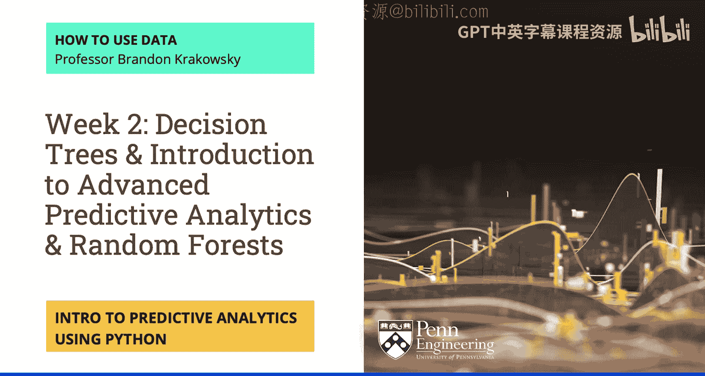
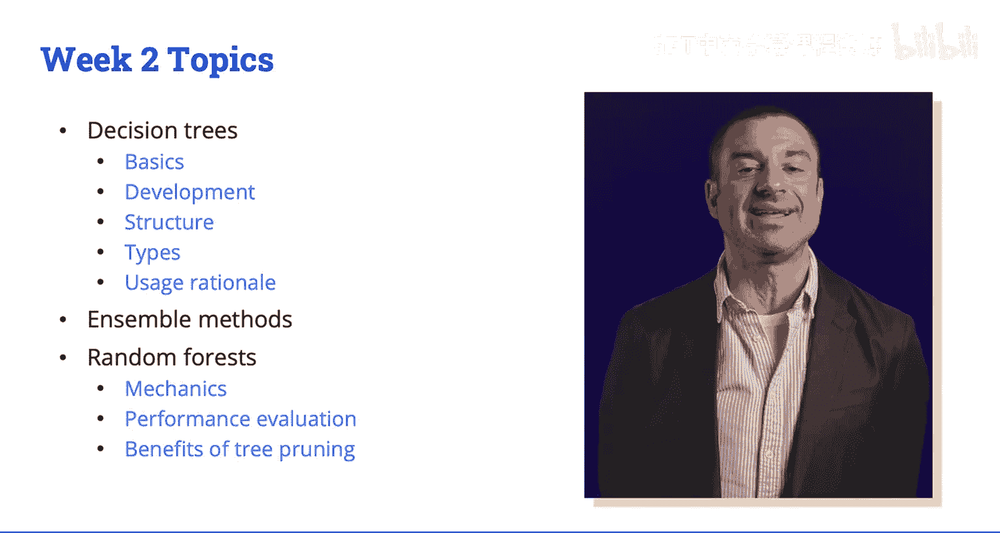

# uPenn《如何运用数据2、3（Python预测分析、数据可视化和叙事）｜How to Use Data》中英字幕 p21 20_第二周导论：决策树与高级预测分析.zh_en [BV1LqxEzcEBy_p21]

Module 2 expands our predictive analytics exploration into decision trees and the broader category of advanced predictive models。

 We start with the basics of what decision trees are and how they're developed。

 exploring their structure types and the rationale behind using them。

 The journey continues with a deeper look into ensemble methods。

 particularly focusing on random forests an advanced technique that combines multiple decision trees to improve prediction accuracy and prevent overfitting。

You'll learn a bit about the mechanics behind random forests。

 how to evaluate the performance and the benefits of using tree pruning。

By building and interpreting decision tree and random forest models using Python。

 you'll develop an understanding of these powerful predictive tools。

 equipping you with the skills to tackle more complex data analysis challenges。

 to solidify your learning and enhance hands-on experience。

 This module is equipped with short exercises focused on decision trees and random forests。

 providing ample opportunity to practice and apply your newfound skills to various data sets。😡。

