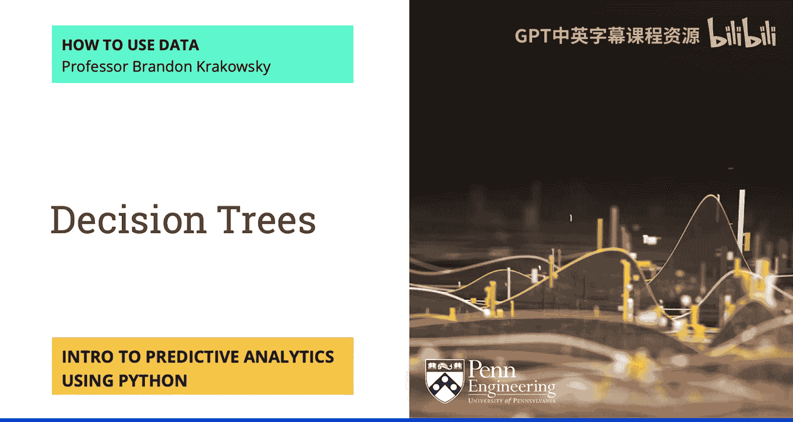
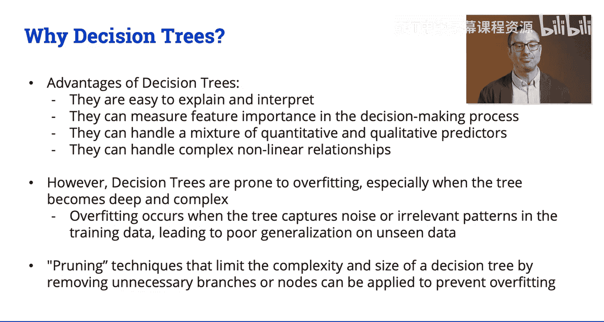

# uPenn《如何运用数据2、3（Python预测分析、数据可视化和叙事）｜How to Use Data》中英字幕 p22 21_决策树.zh_en [BV1LqxEzcEBy_p22]

The decision tree model is like 20 questions。 By asking question after question。

 we move down the tree， narrowing down the possibilities until we reach the conclusion。 Also。

 like the game， we want to predict the correct answer， both accurately and efficiently。

 This requires us to ask the right questions。 We need to consider which questions can give us the most information and lead us towards the correct answer。

 for a given training data set， a decision tree is learned by first。

 picking the best feature to partition the data set。 Second。

 by partitioning the data set into child trees。 And third。

 if all samples in the partition have the same label， stop growing that branch。 Otherwise。

 recursively repeat step 1 and 2 for each child tree。😡，As the decision tree grows。

 we're segmenting the input space into rectangular regions。

 where each region contains data with similar labels。

Just like for logistic regression to evaluate the model performance for decision trees。

 we calculate the model's prediction accuracy score。 Again。

 this is calculated as the number of correct predictions divided by the total predictions In practice。

 we can use the accuracy score function in thes kit learning machine learning library。😡。

Decision trees can be applied to both regression and classification problems。

 A regression tree is for numerical outputs。 Each region contains points of similar output value。

And the predicted value of an input is the average output in its region。

A classification tree is for categorical outputs， each region contains points of the same category。

 and the predicted category of its input is the majority class in its region。

Here are some advantages of decision trees。They're easy to explain and interpret。

They can measure feature importance in the decision making process。

They can handle a mixture of quantitative and qualitative predictors。

 and they can handle complex nonlinear relationships。 In terms of the disadvantages。

 decision trees are prone to overfitting， especially when the tree becomes deep and complex。

 Overfitting occurs when the tree captures noise or irrelevant patterns in the training data。

 leading to poor generalization on unseen data。Pruning techniques that limit the complexity and size of a decision tree by removing unnecessary branches or nodes can be applied to prevent overfitting。

