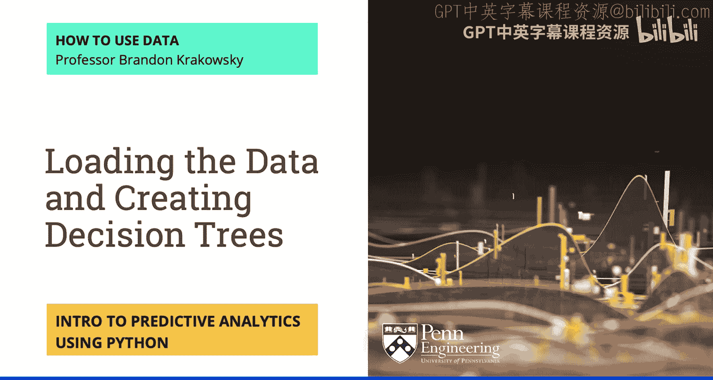
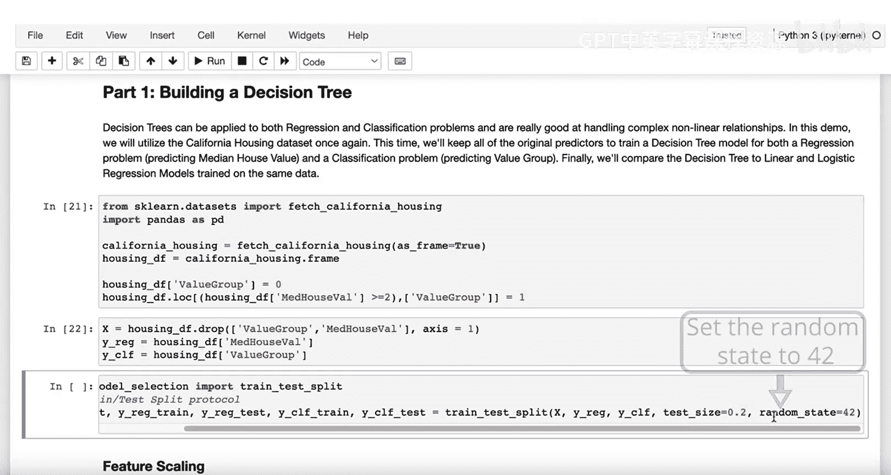

# uPenn《如何运用数据2、3（Python预测分析、数据可视化和叙事）｜How to Use Data》中英字幕 p23 22_编程演示：数据加载与决策树创建.zh_en [BV1LqxEzcEBy_p23]

Decision trees can be applied to both regression and classification problems and are really good at handling complex nonlinear relationships。

 In this demo we'll utilize the California Hous data set once again。 This time。

 we'll keep all the original predictors to train a decision tree model for both the regression problem where we predict median house value and a classification problem where we predict the value group。

 Finally， we'll compare the decision tree to linear and logistic regression models trained on the same data。

 First off， as usual， we'll load the data set and get everything set up to mimic what we had in the previous demos。

😊，So here we're loading the data frame first， and we're creating the value group column based on the group division principle where median house values above two are considered class 1 and below two are considered class 0。

 Once we have that set up， will'll divide our predictors and target variables for the two problems。

 So we have our predictors to be everything except the value group and median house value columns。

 which indicate the target variables。We have the median house value to be our regression target and the value group column to be our classification target。

 So we have these set up， and finally， we'll split everything based on the train test split protocol before we move on。

So we have training and tests for both the regression and classification case。Again。

 we have a test size of 20% for the original data set。

