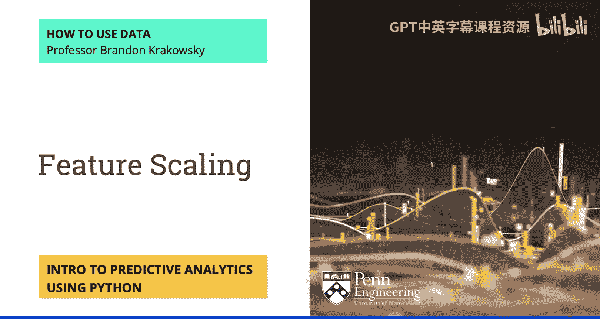
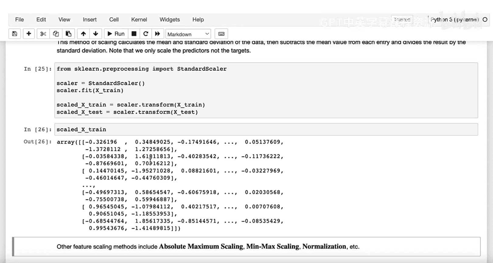

# uPenn《如何运用数据2、3（Python预测分析、数据可视化和叙事）｜How to Use Data》中英字幕 p24 23_编程演示：特征缩放.zh_en [BV1LqxEzcEBy_p24]

Now let's take a look at the numerical statistics of our data。

So we use the original data frame and use the describe method。

 As mentioned in a previous demo when we observe the statistics。

 we'll notice that there is a vast difference between the scales of different features。 For example。

 here for population， the maximum value goes up to 35000。 wherefo median income。

 this value goes up to 15。 even though they're on different units。

 if the features that you're using are on vastly different scales。

 the trained model might become biased towards some features over others to prevent this will need to apply feature scaling in order to standardize all the features into a fixed range。

 in this demo we'll be using the standard scalar method from S K learnarn。

 this method scales the features by calculating the mean and standard deviation of the data and then subtracting the mean from each entry before dividing the result by the standard deviation。

 note that we only scale the predictors and not the targets。

 because the model is trained to learn from the predictors of your data。

So here we're importing standard Scalar from S K learn。And were initializing the scaling model。

Once we have this initialized， we'll fit this scalar to our training data。So we fit on X train。

We can scale the training data and the test data using the Scalar by applying the transform method on X train。

And then X test。Note that by convention， we only fit the scalar to X train and we transform our X test without fitting a new scalealar on X test。

 This is because the test set is a set of data that should be completely unknown by the model。

 And if we train the scalealr and the test set， Then we're calculating the mean and standard deviation of the test set indicating that we know something about the test set。

 So in general， we avoid fitting any models on the test set。

 So once we transform both the training and test values， we can check the scale training values。

 and you'll notice that the values are now on a much smaller scale than usual。

 and they seem to have a consistent scale between one another。

 Other scaling methods include absolute maximum scaling， min max scaling normalization and others。

 you can learn more about these other scaling methods from documentation in S K learn for different problems。

 a different scaling method might be better。

