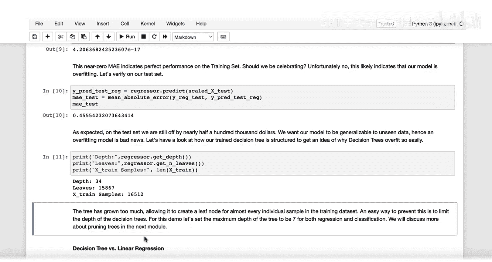

# uPenn《如何运用数据2、3（Python预测分析、数据可视化和叙事）｜How to Use Data》中英字幕 p25 24_编程演示：构建决策树模型.zh_en [BV1LqxEzcEBy_p25]

So now that we have our features scaled and ready to go。 let's train a decision tree on the data。

 For now， let's train a decision tree regressiongressor for the regression problem and evaluate using the mean absolute error。

 We'll start off by importing the decision tree regressor from S K learn will also import our metric mean absolute error from S K learnn and we'll initialize our decision tree regressor。

 Here will give a random state of 0 just to fix any randomness that might go on when splitting the data inside the decision tree。

 This will allow us to reproduce the results across different sessions。

 Once the model has been initialized， we can fit the regressor to our training dataset set。

 using the scaled X train。😊，And also， the why train for the regression problem。 Once we run this。

 we'll have a trained decision tree regressor。Now we'll evaluate the model in the training set and the test set。

So first on the training set， we'll calculate the predictions。Predict on the scale training data。

And as we've seen before， we'll use the mean absolute error to calculate the MAe by providing the true values and the predicted values that our model outputs。

So here you'll notice that we have a near zero MAE on the training set。

 which indicates an almost perfect performance on the training set。 Unfortunately。

 this is not something that we should celebrate because a case like this would likely indicate that our decisionary model is overfitting to our training dataset set。

 We can verify this on our test set。😊，We'll predict on the scaled X test data。

And then we'll calculate the MAE。Provide the actual values。And the predicted values。If we run this。

We'll see a much higher Me。 So on the test set， we're off by nearly half of 100000。

 even though we're doing really well on our training set。

A situation like this indicates that we're overfitting to our training set and not generalizing enough to unseen data in order to have a good model。

 We want the model to be both accurate on the training data and generalizable on the test data。

 Let's have a look at the structure of our training decision tree to understand why the decision tree is overfitting。

 So here we're getting the depth， which is how many layers or how deep your tree is growing。

 And how many splits it's creating。 We're also counting the leaves， which is at the final layer。

 the final number of nodes in that last layer， which usually indicates the final types of predictions that your decision tree might need to make。

 We'll also compare that to the number of samples that we have in our training set。

 So here you'll notice that once we execute this。 We have a very large tree with a huge number of leaf nodes at the final layer。

 Almost the same number as the number of samples in our training dataset set。

This means that our tree has grown too deep， which is creating so many leaf nodes that it's almost covering each individual case for each training sample。

This will cause the model to overfit and learn noise in the training dataset set。

 An easy way to prevent this is to limit the depth of the decision tree。

 to prevent it from growing too much For this demo。

 Let's set the maximum depth of the tree to be 7 for both regression and classification。

 We'll discuss more about pruning trees in the next module。

